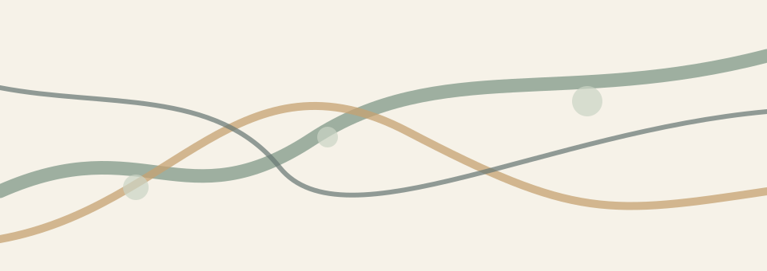
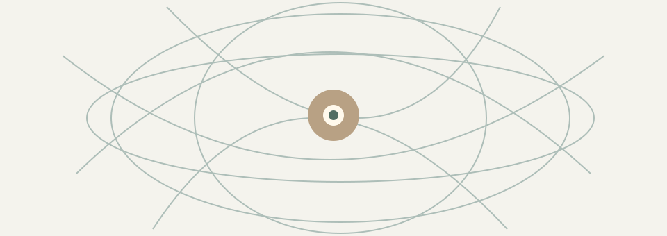
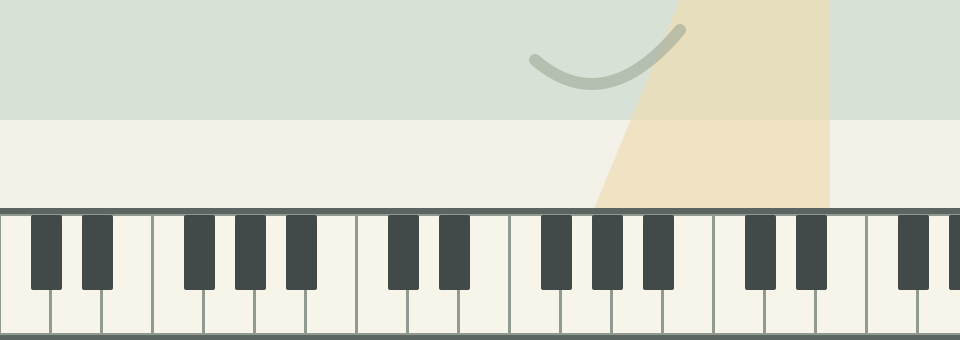

# 일과 삶 사이에서

*AI와 나눈 질문들 · 단행본 통합 퇴고본 v1*

어떤 기술이 발전하면 사람들은 그 기술로 무엇을 더 잘할 수 있게 되었는지부터 묻는다. 그런데 그 기술 덕분에 어떤 일을 더 이상 하지 않아도 된다면, 그때부터는 다른 질문이 시작된다. 우리는 왜 그 일을 하고 있었을까. 그것이 사라지면 무엇을 얻게 되고 무엇을 잃게 될까.

이 책은 그런 질문을 한 사람이 AI와 나눈 대화에서 출발했다. 질문은 노동에서 교육으로, 놀이에서 기술의 신뢰와 통제로, 다시 사람과 가족의 시간으로 옮겨 갔다. 어느 시점에도 하나의 정답이 주어지지는 않았다. 오히려 앞선 생각이 다음 대화에서 수정되거나 복잡해지는 경우가 더 많았다.

이 원고는 개별적으로 발표했던 열 편의 글을 책으로 읽을 수 있도록 순서를 다시 배열하고 중복되는 논의를 덜어 낸 별도 편집본이다. 웹에 공개한 원문은 각각의 대화와 시간을 기록하는 자료로 남겨 두었다. 여기서는 같은 논점을 두 번 설명하기보다 각각의 장이 다음 장에 새로운 질문을 건네도록 구성했다.

## 차례

- **제1부 · 일을 넘어**
  1. 우리는 무엇을 위해 일해왔는가
  2. 아이들은 무엇을 위해 공부하는가
  3. 물고기를 사지 않고 낚으러 가는 이유
  4. 인간은 더 이상 일하지 않아도 되는가
- **제2부 · 우리가 만든 것의 바깥**
  1. 우리는 이해하지 못하는 것을 만들기 시작했다
  2. 똑똑한 기계 앞에서 망설이는 사람
  3. 우리가 만든 세상에 순응하는 날
- **제3부 · 살아갈 시간**
  1. 인간은 왜 다른 인간을 필요로 하는가
  2. 내 인생은 내가 살아볼게
  3. 그래도 우리는 내일을 살아간다

---

# 제1부 · 일을 넘어

AI가 사람의 일을 돕고 대신하기 시작할 때, 우리는 노동을 통해 얻던 가치와 배움의 의미를 다시 묻게 된다. 이 부에서는 기술의 역사에서 출발해 학교와 놀이, 분배의 문제까지 이어 간다.

---

# 우리는 무엇을 위해 일해왔는가

## 코드를 작성하지 않은 날

몇 년 전까지만 해도 소프트웨어를 만들겠다는 말에는 꽤 구체적인 뜻이 있었다. 개발자를 구하고, 요구사항을 정리하고, 일정을 잡고, 기능을 하나씩 구현한다는 뜻이었다. 무엇을 만들고 싶은지 아는 사람과 그것을 실제로 만드는 사람 사이에는 늘 거리가 있었다. 그 거리는 때로 예산으로 측정되었고, 때로 채용 공고와 회의 시간으로 측정되었다.

관리자의 머릿속에는 이미 완성된 제품이 있었다. 실험 데이터를 모으고, 계산을 실행하고, 결과를 분석하고, 연구자가 다음 실험을 결정하도록 돕는 시스템. 그러나 머릿속에서 하나로 이어진 기능들은 개발팀의 일정표에서는 여러 달에 걸친 작업이 되었다. 우선순위를 정해야 했고, 어떤 아이디어는 다음 분기로 밀렸고, 어떤 아이디어는 아예 실현되지 않았다. 사람의 생산성이 조직의 상상력에 상한선을 그었다.

생성형 AI가 코드를 작성하기 시작하면서 그 상한선이 움직였다. 오래 미뤄둔 아이디어를 설명하면 몇 시간 뒤 작동하는 시제품을 볼 수 있었다. 구현할 수 있는 것의 범위가 넓어졌다. 관리자에게는 분명한 해방이었다. 그러나 같은 기술을 바라보는 개발자의 마음은 조금 다를 수 있다. 여러 날 씨름하던 로직을 AI가 몇 분 만에 작성하는 모습을 보면, 편리함과 함께 묘한 상실감이 찾아온다.

무엇이 사라진 것일까. 고생이 사라졌다고만 하기에는 설명이 부족하다. 문제를 발견하고, 막히고, 다시 시도하고, 마침내 작동하는 코드를 확인하던 과정에는 노동의 보상과 별개인 기쁨이 있었다. AI는 결과를 더 쉽게 가져다주지만, 결과에 이르는 길의 일부를 생략한다. 그 길을 걷는 일이 즐거웠던 사람에게는 편리함이 곧 행복은 아니다.

이 사소해 보이는 감정에서 시작해 보자. 인간은 왜 일하는가. 기술은 왜 발전해 왔는가. 우리가 더 이상 예전처럼 일하지 않아도 되는 날이 온다면, 그때 무엇을 성공이라고 부를 것인가.

## 기억을 맡긴 최초의 기계

문자가 없던 시대에도 인간에게는 지식이 있었다. 사냥감을 추적하는 법, 계절을 읽는 법, 독이 있는 식물을 피하는 법, 공동체의 규칙과 조상의 이야기가 있었다. 그런 지식은 사람의 몸과 기억에 붙어 다녔다. 숙련자가 죽으면 그가 미처 전하지 못한 지식도 함께 사라졌다. 구전 사회를 무지한 사회로 볼 이유는 없다. 오히려 정확한 기억과 반복적인 전달에 특별한 능력이 필요했을 것이다.

문자가 등장한 과정은 우리가 학교에서 배운 것처럼 어느 날 한 사람이 기호를 발명한 사건이 아니었다. 메소포타미아 남부의 우루크에서는 기원전 4천년기 후반, 대략 기원전 3400~3200년 무렵부터 점토판에 물품과 수량을 기록한 흔적이 나타난다. 초기 기록은 서사시나 철학보다 곡물, 가축, 배급 같은 행정적 필요에 가까웠다. 점토판에 눌러 남긴 표식은 점차 설형문자 체계로 발전했다. 인간은 처음부터 사상을 영원히 남기려고 글을 쓴 것이 아니라, 누가 무엇을 얼마나 가지고 있는지 잊지 않으려 글을 썼을 가능성이 크다.

비슷한 시기 이집트에서도 상형문자 기록이 나타난다. 이집트인들은 나일강 유역에 자라는 파피루스 식물의 줄기를 얇게 잘라 겹쳐 붙이고 눌러 말려 필기 재료를 만들었다. 파피루스의 사용은 적어도 기원전 3천년기 초까지 거슬러 올라간다. 현재 남아 있는 가장 이른 사례와 실제 사용이 시작된 시점은 구분해야 하지만, 중요한 것은 점토판보다 가볍고 운반하기 쉬운 기록 매체가 고대 국가의 행정과 문서 문화를 지탱했다는 사실이다.

점토는 무거웠지만 내구성이 있었고, 파피루스는 가벼웠지만 보존 조건에 민감했다. 매체가 달라지면 기록할 수 있는 내용뿐 아니라 기록을 이동시키는 비용도 달라졌다. 문서는 사람보다 오래 살 수 있었고, 먼 곳으로 갈 수 있었으며, 서로 다른 시점의 판단을 비교할 수 있게 했다. 기억은 개인의 능력에서 공동체가 관리하는 자산으로 조금씩 바뀌었다.

그렇다고 문자가 기억을 불필요하게 만든 것은 아니다. 읽고 쓸 수 있는 사람은 오랫동안 소수였다. 문서가 늘어나자 그것을 분류하고 해석하고 보관하는 새로운 노동이 생겼다. 왕과 사원, 상인에게 서기관은 중요한 인력이었다. 기억을 외부에 저장하자 인간에게 필요한 능력이 사라진 것이 아니라, 필요한 능력의 구성이 바뀐 셈이다.

문자의 확산이 곧바로 지식의 평등한 확산을 뜻하지도 않았다. 기록을 소유한 사람과 읽을 수 있는 사람이 권력을 가졌다. 기술은 기억의 한계를 줄였지만 새로운 접근 격차를 만들었다. 이후 등장하는 거의 모든 지식 기술은 이 두 가지 효과를 함께 갖게 된다.

## 책이 많아질수록 해야 할 일이 달라졌다

종이의 역사는 중국에서 오래전부터 전개되었다. 후한의 채륜이 서기 105년에 제지법을 개선해 보고했다는 전승이 유명하지만, 그보다 앞선 시기의 종이 유물도 발견되었다. 한 사람의 발명으로 설명하기보다 여러 재료와 제작 기술이 오랜 시간 발전했다고 보는 편이 정확하다. 종이는 이후 아시아 여러 지역과 이슬람권을 거쳐 유럽으로 퍼졌다. 이 과정에는 수세기의 시간과 복잡한 교역망이 필요했다.

15세기 중엽 유럽에서 구텐베르크가 금속활자와 인쇄기, 잉크를 결합한 인쇄 체계를 발전시키면서 책을 복제하는 비용은 크게 달라졌다. 활자 인쇄가 세계 최초였다는 뜻은 아니다. 동아시아에는 훨씬 앞선 목판 인쇄와 금속활자 전통이 있었다. 다만 유럽에서 대량 인쇄의 경제성과 유통망이 맞물리며 책과 논쟁, 종교개혁, 학술 교류에 큰 영향을 주었다.

책이 귀한 시대에는 한 권을 구하는 일이 어려웠다. 책이 흔해진 시대에는 어떤 책을 읽을지 고르는 일이 어려워졌다. 기록의 양이 늘어날수록 기억력보다 검색, 분류, 비교, 비판적 독해가 중요해졌다. 도서관과 서지 목록, 색인, 백과사전은 지식의 증가가 낳은 새로운 도구들이었다.

20세기 후반 컴퓨터 네트워크가 보급되면서 이 변화는 다시 가속했다. 1969년 시작된 아파넷은 오늘날 인터넷의 유일한 출발점이라고 할 수는 없지만, 패킷 교환 네트워크 발전의 중요한 이정표였다. 1989년 팀 버너스리가 제안하고 1990년대 초 공개된 월드와이드웹은 서로 다른 컴퓨터의 문서를 링크로 연결하는 방법을 널리 확산시켰다. 인터넷과 웹은 같은 것이 아니다. 인터넷은 네트워크 기반이고 웹은 그 위에서 작동하는 정보 서비스다.

검색 엔진이 일상화되자 사람은 많은 사실을 머릿속에 보관하지 않아도 됐다. 어떤 정보를 알고 있는가보다 어디에서 찾고, 무엇을 믿고, 어떻게 조합하는가가 중요해졌다. 그러나 인터넷은 지식을 모두에게 균등하게 제공하지 않았다. 접속 환경, 언어, 교육 수준, 검색 결과의 배열이 접근성을 좌우했다. 기록이 늘어날수록 진실이 저절로 드러나는 것도 아니었다. 거짓 정보 역시 빠르게 퍼질 수 있었다.

이런 변화는 모두 인간이 지식을 다루는 방식을 바꾸었지만, 한 가지 경계는 비교적 뚜렷했다. 책과 검색 엔진은 기본적으로 인간이 읽고 판단할 재료를 제공했다. 생성형 AI는 그 경계에 들어와 있다. 이제 도구는 자료를 보여주는 데 그치지 않고 답을 구성하고, 논리를 제안하고, 코드를 만들고, 때로는 연구의 다음 질문까지 제안한다.

## 지식의 독점이 끝난다는 말

AI가 인간처럼 지식을 가진다고 말할 때는 조심해야 한다. 오늘날의 언어모델은 사람처럼 삶을 경험하거나 세계를 이해한다는 점이 입증된 존재가 아니다. 그럼에도 실제 업무에서는 지식의 상당 부분을 사용할 수 있다. 법률 문서를 비교하고, 논문을 요약하고, 프로그램의 오류를 추정하고, 수학적 설명을 구성한다. 그 답이 항상 옳지는 않지만, 과거에는 숙련된 사람이 하던 일을 상당 부분 수행한다는 사실은 부정하기 어렵다.

여기서 지식이라는 말을 두 가지로 나눌 필요가 있다. 하나는 명제와 기록으로서의 지식이다. 다른 하나는 그 지식을 상황에 맞게 사용할 수 있는 능력이다. 전자는 이미 오래전부터 인간의 두뇌 밖에 있었다. 도서관에는 누구도 모두 읽지 못할 만큼 많은 책이 쌓여 있다. AI가 새롭게 바꾸는 것은 후자다. 기록을 꺼내어 연결하고 적용하는 능력까지 외부에 놓이기 시작한 것이다.

이 변화는 과학 연구에서 특히 선명하게 드러난다. 연구자는 문헌을 검토하고, 가설을 세우고, 실험 조건을 정하고, 계산 결과를 해석한다. AI는 이 가운데 일부를 돕거나 자동화할 수 있다. 소재 연구를 예로 들면 계산 프로그램의 입력을 만들고, 결과를 정리하고, 후보 조성을 추천하는 작업을 하나의 흐름으로 연결할 수 있다. 그러나 모델이 추천한 물질이 실제로 합성되는지, 측정값이 믿을 만한지, 어떤 연구에 비용을 투입할지는 여전히 검증과 판단의 문제로 남는다.

AI가 어떤 결과를 제시했는데 인간 연구자가 그 계산의 모든 단계를 이해하지 못한다면, 그것을 인류의 지식이라고 부를 수 있을까. 과학은 원래부터 개인 한 명이 전체를 이해할 수 없는 방향으로 발전해 왔다. 현대의 반도체, 의약품, 기후 모델은 수많은 전문가와 장비의 협력으로 만들어진다. 중요한 것은 누구 한 사람이 전부 아느냐보다 검증 가능성, 재현성, 책임 소재가 확보되어 있느냐일 수 있다.

그렇다고 이해를 포기해도 된다는 결론이 나오는 것은 아니다. 검증 도구 자체가 잘못되었을 때 무엇으로 확인할 것인가. AI가 설명하는 근거가 실제 작동 원리와 일치하는가. 사람이 개입해야 할 순간을 어떻게 판단할 것인가. 외부화된 지적 능력이 커질수록 이런 질문은 더 중요해진다.

## 먼저 흔들리는 것은 사무실이다

산업혁명을 이야기할 때 우리는 흔히 공장과 증기기관을 떠올린다. 기계는 사람의 근육을 대신했고, 생산은 빠르게 늘었다. 그 뒤 오랫동안 교육은 육체노동에서 벗어나는 가장 확실한 경로 가운데 하나로 여겨졌다. 더 오래 공부하면 더 안전하고 높은 보수를 받는 일을 할 수 있다는 기대가 있었다.

생성형 AI는 이 기대에 균열을 낸다. 보고서 초안, 계약서 검토, 고객 응대, 코드 작성처럼 컴퓨터 화면에서 시작해 컴퓨터 화면에서 끝나는 일은 자동화에 필요한 물리적 장벽이 낮다. 반대로 오래된 주택의 누수 위치를 찾아 수리하거나, 복잡한 현장에서 배관을 교체하는 일은 사람에게 익숙해 보여도 로봇에게는 어렵다. 좁은 공간, 예측하지 못한 장애물, 다양한 물체의 촉감, 안전 문제를 동시에 해결해야 하기 때문이다.

물론 육체노동이 언제나 안전하다는 뜻은 아니다. 자동차 공장이나 대형 물류센터처럼 환경을 표준화할 수 있는 곳에서는 기계화가 오래전부터 진행되었다. 반대로 고도의 판단과 신뢰 관계가 필요한 지식노동은 AI의 보조를 받더라도 사람의 역할이 오래 남을 수 있다. 직업 전체가 사라지기보다 직업 안의 업무가 다시 나뉠 가능성도 크다.

경제성의 차이도 중요하다. 소프트웨어는 한 번 만들어 여러 곳에 배포할 수 있다. 로봇은 현장마다 몸체와 전력, 유지보수, 안전 설비가 필요하다. 임금이 낮고 작업 환경이 복잡한 곳에서는 사람을 쓰는 편이 오랫동안 더 저렴할 수 있다. 기술적으로 가능하다는 말과 기업이 실제로 도입한다는 말 사이에는 비용이라는 간격이 있다.

여기서 역설이 발생한다. 인간은 기계를 만들어 고된 육체노동에서 벗어나려 했지만, 어떤 지식노동은 물리적 노동보다 먼저 자동화될 수 있다. 교육을 많이 받은 사람이 언제나 기계보다 대체되기 어렵다는 오래된 믿음은 수정이 필요해졌다.

## 종의 번영은 개인의 행복과 같은가

농경의 시작은 대략 1만 년 전 전후 여러 지역에서 서로 다른 경로로 이루어졌다. 곡물 재배와 가축 사육은 더 많은 인구를 부양하고 정착지를 확대하는 기반이 되었다. 그러나 초기 농경민의 삶이 모든 면에서 수렵채집민보다 나았다고 말하기는 어렵다. 지역과 시대에 따라 식단의 다양성, 질병, 노동 시간, 신체 상태가 달랐고, 고고학 자료의 해석에도 논쟁이 있다.

유발 하라리의 『사피엔스』가 널리 알린 문제의식 가운데 하나는 농업혁명이 종 전체의 번영과 개개인의 행복을 반드시 동시에 높이지는 않았다는 것이다. 이 주장을 그대로 역사적 정답으로 받아들일 필요는 없다. 다만 문명의 성공을 평가할 때 어떤 단위를 선택하는지 묻는 질문으로서는 유용하다. 인구가 늘고 저장 곡물이 많아졌다는 사실이 그 시대 한 사람의 삶이 더 만족스러웠다는 증거는 아니다.

국가와 시장도 마찬가지다. 국가는 치안과 기반시설, 분쟁 해결을 제공할 수 있지만 동시에 세금과 징병을 요구해 왔다. 시장은 분업과 교환을 가능하게 했지만, 모든 사람에게 같은 협상력을 주지는 않았다. 경제 성장률은 생산 활동의 변화를 보여주지만, 가족과 보내는 시간이나 자신의 삶을 통제한다는 감각을 직접 측정하지는 못한다.

여기서 생물학적 진화와 문명의 목적을 혼동하지 않는 것이 중요하다. 자연선택은 행복을 향한 계획이 아니다. 인간의 문화와 제도 역시 오직 종의 번식만을 위해 설계된 것은 아니다. 사람들은 오래전부터 사랑과 우정, 신앙, 예술, 명예, 쾌락을 추구했다. 그럼에도 사회의 성과를 측정할 때 생산과 규모가 유독 강한 지표였다는 사실은 생각해 볼 만하다.

오늘날에도 국내총생산이 늘었다는 뉴스는 쉽게 접하지만, 그 성장으로 사람들이 얼마나 많은 시간을 자유롭게 쓰게 되었는지, 자신의 삶을 얼마나 만족스럽게 평가하는지는 별도의 질문으로 남는다. 생산의 확대가 삶을 위한 수단이라면, 수단이 성공했다고 목적도 달성된 것은 아니다.

## 로마의 여가와 보이지 않는 노동

고대 로마의 부유한 시민이 교외 별장에서 시간을 보내는 모습을 떠올려 보자. 정원이 있고, 식사가 준비되고, 목욕과 독서, 손님을 맞는 일이 이어진다. 그가 일상적인 생계 노동에서 비교적 자유로울 수 있었던 배경에는 토지 소유와 지대, 속주에서 거둔 부, 노예노동과 하인들의 노동이 있었다. 로마 제국의 주민 모두가 그런 삶을 산 것은 아니다. 오히려 그런 여가는 소수의 특권이었다.

그리스의 경우도 비슷하다. 고전기 아테네의 일부 남성 시민은 정치 토론과 철학, 체육에 참여할 여유를 가졌다. 그러나 그 사회의 생산과 가사노동에는 여성, 노예, 외국인 거주자 등 다양한 사람들이 참여했다. 우리가 고대의 철학과 민주정에 감탄할 때, 그 시간을 가능하게 한 노동의 분배를 함께 보아야 한다.

흥미로운 것은 여가의 내용이다. 그리스어 스콜레(scholē)는 단순히 아무 일도 하지 않는 시간이 아니라 학습과 사색을 위한 여유를 가리키기도 했고, 훗날 영어 school의 어원이 되었다. 로마에서는 오티움(otium)이라는 말로 공적인 업무에서 벗어난 시간을 표현했다. 오티움은 휴식과 오락일 수도, 독서와 글쓰기일 수도 있었다. 고대인도 이미 노동에서 벗어난 시간을 어떻게 사용해야 하는지 고민했던 것이다.

근세 유럽의 궁정 귀족도 생산 노동에서 상대적으로 자유로웠지만, 그렇다고 걱정 없이 놀기만 한 것은 아니었다. 궁정의 의례와 사교는 지위 경쟁의 장이었다. 권력자에게 가까이 가는 일, 체면을 유지하는 일, 혼인 관계를 맺는 일이 삶을 지배했다. 생존을 위한 노동이 줄어도 경쟁과 불안이 사라지는 것은 아니었다.

이 역사는 AI 시대를 이해하는 데 하나의 실험 사례가 된다. 노동에서 벗어난 사람은 시간을 무엇으로 채우는가. 어떤 사람은 쾌락을 추구하고, 어떤 사람은 예술과 사유에 몰두하며, 또 어떤 사람은 새로운 지위 경쟁을 만든다. 자유시간의 증가가 행복을 자동으로 보장하지는 않는다는 뜻이다.

과거와 미래 사이에는 결정적인 차이도 있다. 고대 엘리트의 여가는 다른 인간의 강제되거나 불평등한 노동에 크게 의존했다. AI와 로봇이 생산을 담당하는 미래에는 그 관계를 일부 바꿀 가능성이 있다. 그러나 자동화 설비를 누가 소유하고, 그 생산물에 누가 접근할 수 있는지에 따라 새로운 불평등이 생길 수도 있다. 기계가 노동한다고 해서 그 혜택이 저절로 모두에게 돌아가지는 않는다.

## 문제를 풀지 않고 문제를 해결하는 시대

프로그래밍을 해본 사람은 어떤 오류가 오래 마음에 남는지 안다. 코드는 거의 맞는 것 같은데 예상한 값이 나오지 않는다. 로그를 찍고, 조건문을 살펴보고, 문서를 읽고, 작은 테스트를 만든다. 한참 뒤 문제의 원인이 사소한 인덱스 하나였다는 사실을 발견한다. 그 순간의 기쁨은 버그가 사라졌다는 사실만으로 설명되지 않는다. 자신이 이해했고, 해결했다는 감각이 있다.

AI에게 같은 오류를 보여주면 몇 초 만에 수정안을 받을 때가 있다. 생산성만 보면 반길 일이다. 실제로 반길 만한 일이다. 하지만 문제를 푸는 과정이 즐거웠던 사람은 무엇인가를 잃었다고 느낄 수 있다. 고생이 줄어든 것과 성취감이 줄어든 것은 동시에 참일 수 있다.

심리학에서는 자율성, 유능감, 관계성이 동기에 중요하다고 설명하는 자기결정성이론이 있다. 이 이론 하나로 개발자의 감정을 모두 설명할 수는 없지만, 직접 해결했다는 경험이 왜 중요한지 이해하는 데 도움이 된다. 자신이 상황을 통제하고 능력을 발휘했다고 느끼는 것은 결과물의 양과 별개다.

그런데 관리자에게 AI는 다른 의미로 다가온다. 예전에는 팀의 인력과 일정 때문에 만들지 못했던 시스템을 이제 구현할 수 있다. 직접 함수 하나를 완성했을 때의 기쁨 대신, 오래 구상한 서비스가 실제로 작동하는 모습을 보는 더 큰 성취감이 생긴다. AI가 빼앗은 즐거움과 AI가 새롭게 준 즐거움이 같은 사람 안에 공존한다.

이 변화는 자전거와 자동차의 관계를 떠올리게 한다. 자동차가 더 빨리 이동할 수 있게 되었다고 사람들이 자전거 타기를 그만두지는 않았다. 자전거는 이동 수단이면서 그 자체로 즐거운 활동이 되었다. 코딩도 언젠가 비슷한 위치에 놓일 수 있다. 다만 차이가 있다. 자동차는 자전거를 타는 사람보다 페달을 잘 밟는 존재가 아니다. AI는 내가 해결하고 싶었던 지적 문제를 나보다 더 빨리 해결할 수 있다. 그래서 비교에서 오는 상실감이 더 클 수 있다.

이때 필요한 질문은 코딩을 계속할 것인가, 포기할 것인가의 양자택일이 아니다. 어떤 문제는 AI에게 맡기고, 어떤 문제는 스스로 풀 것인가. 무엇을 빠르게 완성하고, 무엇을 천천히 이해할 것인가. 효율과 즐거움이 충돌할 때 어느 쪽을 선택할 것인가. 생산의 문제였던 개발이 삶의 방식에 관한 질문으로 바뀌는 순간이다.

## 사람이 읽지 못하는 소프트웨어

소프트웨어 공학은 오랫동안 복잡성을 다루는 기술을 발전시켜 왔다. 함수를 나누고, 모듈의 경계를 만들고, 인터페이스를 정의하고, 테스트를 작성하는 이유는 컴퓨터만을 위해서가 아니다. 사람이 전체를 이해할 수 없으므로 작은 단위로 나누어 다루기 위해서다. 좋은 코드는 기계가 실행할 수 있을 뿐 아니라 다른 개발자가 읽고 수정할 수 있어야 한다는 규범이 강했다.

그런데 코드의 주된 생산자가 AI로 바뀌면 이 규범은 어떻게 될까. AI가 설계, 구현, 테스트, 성능 최적화를 모두 맡고 인간은 요구사항과 결과만 확인한다면, 사람이 읽기 쉬운 코드의 가치가 낮아질 수도 있다. 반대로 AI가 설명과 문서화도 잘한다면 이해 가능성을 유지하는 비용은 오히려 낮아질 수 있다. 어느 쪽이 될지는 기술과 제도, 기업의 선택에 달려 있다.

문제는 최악의 경우다. 시스템은 작동하고, 코드는 저장되어 있고, 문서도 존재한다. 그런데 그 시스템을 AI 없이 독립적으로 고칠 수 있는 사람이 거의 없다. 이것은 흔히 떠올리는 로스트 테크놀로지와 조금 다르다. 지식이 기록에서 사라진 것이 아니라, 기록을 실제 기술로 재현할 인간의 능력이 약해진 것이다.

오늘날에도 모든 사람이 반도체 공장을 만들거나 항공기 엔진을 설계할 수는 없다. 고도의 기술은 원래 분업에 의존한다. 중요한 차이는 전문성이 사회 어딘가에 계속 존재하는가, 새로운 전문가를 훈련할 수 있는가, 핵심 인프라가 실패했을 때 대체 경로가 있는가에 있다. 인간 개발자의 수가 줄어드는 것 자체보다 기술을 독립적으로 검증하고 복구할 수 있는 능력이 끊어지는 것이 더 위험하다.

이 문제에는 시장의 유인이 충분하지 않을 수 있다. 개별 기업은 AI로 더 싸게 개발하는 편을 택할 것이다. 인간 전문가를 오랫동안 훈련하고 유지하는 비용은 당장 손익계산서에 부담으로 나타난다. 그러나 사회 전체는 비상시에 시스템을 이해하고 복구할 인력이 필요하다. 이 차이는 교육과 연구기관, 공공 인프라가 맡아야 할 역할을 새롭게 생각하게 한다.

여기서 자유는 두 가지로 갈라진다. 직접 코딩하지 않아도 원하는 것을 만들 수 있는 자유와, 필요하다면 스스로 코딩할 수 있는 자유다. 전자는 커지고 후자는 줄어들 수 있다. 기술은 인간을 노동에서 해방하면서 동시에 기술에 의존하지 않을 능력을 약화시킬 수 있다. 둘 중 하나만을 자유라고 부르면 중요한 부분을 놓친다.

## 생산이 줄어도 삶이 나아질 수 있다

현대 사회는 생산을 세는 데 능숙하다. 기업은 매출과 이익을 계산하고, 국가는 국내총생산을 발표한다. 이런 숫자는 중요하다. 병원을 운영하고 도로를 만들고 식량을 공급하려면 실제로 자원이 필요하다. 생산을 무시한 행복론은 쉽게 공허해진다.

그러나 생산량은 목적이 아니라 수단이다. 어떤 사람이 기술의 도움으로 하루 여덟 시간 하던 일을 두 시간 만에 끝내고, 남은 시간을 가족과 보내거나 운동하거나 책을 읽는다고 해보자. 그 활동이 시장에서 거래되지 않는다면 국내총생산에는 거의 잡히지 않을 수 있다. 그래도 그 사람의 삶은 분명히 더 나아졌을 가능성이 있다.

반대로 AI가 생산성을 높였는데 노동자의 근무시간은 줄지 않고, 기업의 목표만 계속 높아지는 상황도 가능하다. 더 빨리 할 수 있으니 더 많이 하라는 요구가 생긴다. 기술이 만든 여유가 개인에게 돌아가지 않는다면 생산성 혁명은 행복 혁명으로 이어지지 않는다. 역사적으로 생산성 향상과 노동시간 단축의 관계도 제도와 협상, 산업구조에 따라 달라졌다.

행복을 숫자로 측정하는 일도 쉽지 않다. 삶의 만족도 설문은 사람의 주관적 평가를 보여주지만, 문화와 기대 수준에 영향을 받는다. 건강, 안전, 자유, 관계, 의미를 하나의 점수로 합치면 무엇이 좋아졌고 무엇이 나빠졌는지 가려질 수 있다. 그렇다고 측정을 포기할 이유는 없다. 단일 지표가 아니라 여러 지표를 함께 보는 편이 현실적이다.

더 근본적으로는 행복을 최종 목표로 삼아도 되는지 물어야 한다. 어려운 연구를 하는 사람은 몇 년 동안 좌절을 경험할 수 있다. 아이를 돌보는 사람은 피곤하고 불안한 날이 많을 수 있다. 누군가는 불편을 감수하면서 사회적으로 중요한 일을 한다. 그들의 삶을 순간적인 즐거움의 합계로만 평가할 수는 없다. 인간은 기분이 좋은 삶뿐 아니라 가치 있다고 믿는 삶을 원한다.

## 일하지 않아도 되는 사람은 무엇을 할까

사람이 생존을 위해 일하지 않아도 된다면 어떤 하루를 보낼까. 처음에는 잠을 더 자고, 여행을 가고, 밀린 영화를 볼지도 모른다. 그러나 몇 달 뒤에도 똑같이 만족할지는 알 수 없다. 인간은 휴식만으로 살아가는 존재가 아니다. 목표를 세우고, 배우고, 관계를 맺고, 무언가를 성취하고 싶어 한다.

과거의 귀족들이 보여준 것은 여가가 곧 무위가 아니라는 사실이었다. 어떤 사람은 예술과 학문에 몰두했고, 어떤 사람은 권력과 명예를 놓고 경쟁했다. 오늘날에도 생계와 무관하게 마라톤을 뛰고, 악기를 연습하고, 어려운 게임에 도전하는 사람이 많다. 사람들은 고통을 줄이기만 하는 것이 아니라 스스로 선택한 어려움을 찾아 나선다.

여기에는 중요한 차이가 있다. 생계를 위해 해야만 하는 일과 자신이 원해서 하는 일은 겉으로 똑같아 보여도 경험이 다르다. 누군가에게는 코드를 작성하는 일이 생계 노동이고, 다른 누군가에게는 가장 즐거운 취미다. AI 시대에는 이런 구분이 더 중요해질 수 있다. 노동의 양이 줄어드는 것보다 노동을 선택할 수 있는 범위가 넓어지는 것이 핵심일지 모른다.

물론 모든 사람이 같은 출발선에 서지는 않는다. 소득과 주거, 돌봄, 교육, 건강이 불안정하면 자유시간이 늘어도 원하는 삶을 설계하기 어렵다. 기술의 혜택을 누구에게 어떻게 나눌 것인지는 개인의 마음가짐으로 해결할 수 없는 사회적 문제다. AI가 풍요를 만드는 능력과 그 풍요를 공정하게 누리는 능력은 서로 다르다.

그래서 미래의 질문은 인간이 더 이상 일하지 않을 것인가가 아니다. 인간이 어떤 일을 스스로 선택할 수 있는가, 그리고 그 선택을 실제로 실행할 조건이 있는가에 가깝다. 어떤 사람은 계속 연구할 것이고, 어떤 사람은 가족을 돌볼 것이고, 어떤 사람은 아무런 경제적 성과가 없는 활동에서 만족을 찾을 것이다. 그 삶들을 하나의 생산성 척도로 줄 세우는 일은 점점 설득력을 잃을 수 있다.

## 성공이라는 계산법을 바꿀 때

우리는 성공을 외부에서 확인할 수 있는 결과로 설명하는 데 익숙하다. 얼마나 벌었는지, 얼마나 높은 자리에 올랐는지, 얼마나 많은 것을 만들었는지 묻는다. 그런 질문은 비교하기 쉽다. 비교하기 쉽다는 이유로 중요한 질문이 된 측면도 있다.

하지만 AI가 생산의 상당 부분을 맡는 시대에는 생산량과 인간의 성취가 더 멀어질 수 있다. 한 사람이 AI를 활용해 일주일 만에 만든 소프트웨어가 다른 사람이 수년에 걸쳐 작성한 코드보다 많을 수 있다. 그렇다면 앞의 사람이 더 성공한 삶을 살았다고 말할 수 있을까. 제품의 시장 성과는 비교할 수 있어도, 그 사람이 어떤 삶을 살았는지까지 알 수는 없다.

성공을 자신이 중요하게 여기는 것을 실현하는 능력이라고 정의하면 어떨까. 이 정의에도 문제가 있다. 사람의 욕망은 사회적 비교와 광고, 권력에 영향을 받는다. 무엇을 원하는지조차 스스로 결정하기 어려울 때가 있다. 그래서 단순히 원하는 것을 얻는 것보다, 자신의 목표를 성찰하고 바꿀 수 있는 자유가 중요하다.

지혜라는 말은 여기에서 의미를 얻는다. 지식은 무엇이 사실인지 알려주고, 지능은 문제를 어떻게 풀지 돕는다. 지혜는 그 문제를 왜 풀어야 하는지, 어떤 결과를 감수할 수 있는지, 다른 사람의 삶에 어떤 영향을 미치는지 묻는다. 물론 인간이 언제나 지혜로운 존재인 것은 아니다. AI가 더 나은 판단을 돕는 경우도 있을 것이다. 지혜를 인간만의 신성한 영역으로 선언하기보다, 목적과 책임을 숙고하는 실천으로 이해하는 편이 낫다.

결국 새로운 성공의 기준은 하나의 숫자가 되기 어렵다. 충분한 안전, 건강, 관계, 자율성, 의미 있는 활동, 그리고 자신의 삶을 바꿀 기회가 함께 필요하다. 문명의 성공은 사람들이 같은 삶을 살도록 만드는 것이 아니라, 서로 다른 삶을 선택할 수 있게 하는 데 있을지도 모른다.

## 무엇을 직접 할 것인가

AI에게 코드를 맡긴 뒤 남는 시간이 있다. 그 시간에 더 많은 코드를 만들 수도 있고, 오래 미뤄둔 문제를 생각할 수도 있다. 어떤 날은 직접 작은 프로그램을 작성할 수도 있다. 효율만 따지면 설명하기 어려운 선택이겠지만, 그것이 즐겁다면 이유는 충분하다.

우리는 기술을 발전시키면서 기억을 기록에 맡겼고, 정보 탐색의 일부를 네트워크에 맡겼으며, 이제 지적 노동의 일부를 AI에 맡기고 있다. 그 과정에서 인간의 능력이 단순히 줄어든 것은 아니다. 어떤 능력은 약해졌고, 어떤 능력은 새롭게 중요해졌다. 앞으로도 그럴 것이다.

기술이 인간의 생존을 더 안정적으로 보장한다면, 인류는 생산을 늘리는 일 말고도 많은 것을 목표로 삼을 수 있다. 그러나 생산이 자동화된다는 이유만으로 행복이 자동화되는 것은 아니다. 기술이 제공하는 자유를 실제로 누릴 수 있는 제도가 필요하고, 자유로워진 시간을 살아갈 각자의 이유도 필요하다.

그래서 마지막 질문은 거창한 문명론보다 작고 구체적인 형태로 남는다. 오늘 무엇을 AI에게 맡길 것인가. 무엇은 직접 해볼 것인가. 무엇을 더 많이 만들지 말고, 무엇을 위해 만들 것인가.

어쩌면 다음 시대의 성공은 모든 문제를 가장 빨리 해결하는 데 있지 않을 것이다. 어떤 문제를 해결할 가치가 있는지 판단하고, 때로는 해결하지 않은 채 남겨두며, 스스로 선택한 어려움을 기꺼이 감당하는 능력에 있을지 모른다.

인류는 오랫동안 살아남기 위해 무엇을 해야 하는지 물었다. 이제 그 질문에 하나를 더할 수 있다. 살아남을 수 있게 된 우리는, 어떻게 살아가고 싶은가.

---

# 아이들은 무엇을 위해 공부하는가

밤이 깊었는데도 아이들의 숙제는 끝나지 않았다. 세 딸은 학원에서 받아 온 문제를 풀고 있다. 부모가 된 뒤에는 아이들이 열심히 공부하는 모습을 보는 일에도 두 가지 감정이 동시에 생긴다. 성실하게 자기 일을 해내는 모습이 기특하다가도, 오늘 이 시간을 꼭 이렇게 보내야 할까 싶은 마음이 든다. 어른인 내가 하루의 일을 마친 뒤 쉬고 싶은 것처럼 아이들에게도 쉬고 싶은 밤이 있을 것이다. 그런데 아이들의 하루는 학교가 끝난 뒤에도 쉽게 끝나지 않는다.

몇 년 뒤의 세상에 이 아이들이 어떤 일을 하며 살지 알 수 없다. 지금부터 여섯 해에서 열 해가 지나면 인공지능은 얼마나 많은 일을 하게 될까. 우리가 미래에 유용할 것이라고 믿는 지식 가운데 얼마나 많은 부분이 그때도 인간에게 필요할까. 이런 질문을 떠올리는 일은 어렵지 않다. 그러나 그 질문에 따라 오늘 밤의 숙제를 줄이자고 결정하는 일은 전혀 다르다. 자녀의 미래에 책임을 느끼는 부모는 먼 미래의 가능성보다 내일의 시험과 다음 학기의 성적에 더 쉽게 붙들린다.

우리 가족에게도 오래 생각해 온 설명이 있다. 지금 밤늦게 하는 공부가 훗날 행복하게 먹고사는 데 직접 활용될 가능성은 높지 않다. 사실 이것은 AI가 등장하기 전부터 그랬다. 그렇지만 성장기에 중요한 것은 어떤 일을 최선을 다해, 꾸준히 해보는 경험이다. 밤늦은 숙제도 그 경험을 익히는 과정이라고 볼 수 있다. 나는 이 생각에 꽤 동의했다. 동시에 어딘가 불편했다. 성실함을 익히는 데 지금만큼 많은 시간이 필요할까. 그리고 성실함을 배울 수 있는 방법이 꼭 숙제여야 할까.

그날의 대화는 공부를 할 것인지 말 것인지에 관한 논쟁으로 시작하지 않았다. 우리가 공부에서 무엇을 얻으려 하는지를 조금 더 정확하게 물어보자는 이야기였다. 그런데 질문을 따라가다 보니 공부의 목적보다 더 곤란한 문제에 도착했다. 아이가 노력하지 않는 시간은 어떤 의미를 가져야 하는가. 부모가 그 시간까지 설명하고 정당화해야 하는가.

아이들의 공부를 이야기하면서 우리는 놀이와 성취에까지 점수를 붙이려는 습관을 떠올렸다. 그러나 그 문제를 다루기 전에, 아이가 오늘의 시간을 어떻게 사용하고 있는지 먼저 살펴보아야 한다.

## 학교는 무엇을 가르치기 위해 만들어졌나

오늘날 아이가 일정한 나이에 학교에 가고, 정해진 교과목을 배우고, 학년마다 시험을 치르는 풍경은 너무 익숙해서 자연의 질서처럼 보이기도 한다. 그러나 아이들을 비슷한 나이끼리 모아 같은 내용을 가르치는 제도는 긴 인류 역사에서 비교적 최근에 널리 자리 잡았다. 그 이전에도 교육은 있었다. 누군가는 가정에서 일과 기술을 배웠고, 누군가는 종교기관에서 문자를 익혔으며, 소수의 특권층은 학문과 통치에 필요한 교육을 받았다. 배움은 오래되었지만, 국민 모두를 대상으로 국가가 학교를 조직하고 출석을 관리하는 방식은 따로 설명해야 하는 역사다.

1763년 프로이센의 프리드리히 2세는 농촌 학교와 교사에 관한 규정을 공포했다. 당시 문서에는 제대로 교육받지 못한 교사의 문제, 학교를 관리하고 감독해야 할 필요, 남녀 아동의 취학, 교사에 대한 점검이 함께 등장한다. 국가가 교육을 중요한 공적 문제로 본 것이다. 이 제도를 오늘날 학교의 유일한 기원이라고 설명하는 것은 정확하지 않다. 국가의 계획이 곧바로 모든 마을의 교실에서 실현된 것도 아니었다. 다만 이 문서를 읽으면 한 가지 흥미로운 사실을 알 수 있다. 국가는 아이들을 교육하면서 아이 한 명의 행복만이 아니라 더 잘 운영되는 공동체, 종교적·도덕적 질서, 유능한 신민을 함께 생각했다.

산업화와 국민국가의 형성은 이런 방향을 다른 곳에서도 밀어붙였다. 읽고 쓰고 계산하는 능력은 개인의 삶에 도움이 되었지만 동시에 행정, 상업, 군대, 정치에 필요한 역량이었다. 학교는 개인에게 새로운 기회를 열어 주는 제도이면서 사회가 다음 세대에게 요구하는 능력을 조직적으로 전달하는 제도가 되었다. 두 목적은 자주 겹쳤고 때로 충돌했다. 사회가 필요로 하는 성실한 노동자와 스스로 행복한 삶을 선택할 수 있는 사람이 반드시 같은 교육을 필요로 하는 것은 아니다.

그렇다고 근대 학교의 역사를 순종적인 노동자를 만드는 음모로 환원할 수는 없다. 공교육의 확대는 문자와 학문을 일부 계층의 소유물에서 꺼내 더 많은 사람에게 나누어 주었다. 교육받은 시민은 국가의 지시를 이해하는 데 그치지 않고 국가를 비판할 수도 있다. 아이들이 학교에 가야 하는 이유는 복수이고, 그중 어느 하나로 모든 학교의 역사를 설명할 수 없다.

이 이야기가 밤늦은 숙제와 무슨 관계가 있을까. 우리가 아이에게 공부를 시키는 이유를 하나의 단어로 대답하기 어렵다는 것과 관계가 있다. 지식을 얻기 위해서인가. 좋은 직업을 갖기 위해서인가. 남들과 더불어 살아갈 시민이 되기 위해서인가. 아니면 성실하고 인내심 있는 사람이 되기 위해서인가. 이 목적들은 모두 타당해 보이지만, 하나를 위한 시간을 늘리다 보면 다른 하나를 위한 시간이 줄어든다. 어느 목적으로 교육을 정당화하느냐에 따라 같은 숙제도 다르게 보인다.

## 삼각함수를 쓰지 않아도 삼각함수를 배우는 이유

내가 어릴 때부터 어른들은 농담처럼 수학은 사칙연산만 할 줄 알면 살아가는 데 지장이 없다고 했다. 삼각함수를 일상에서 직접 사용할 일이 거의 없는 사람에게는 충분히 그럴듯한 말이다. 수학을 어렵게 공부했던 사람일수록 어느 순간 억울해진다. 그 많은 시간을 들여 익힌 공식을 살면서 한 번도 써보지 않는다면 무엇을 위해 배웠을까.

하지만 삼각함수는 특정한 값을 계산하는 기술만이 아니다. 직접 올라갈 수 없는 곳의 높이를 거리와 각도에서 추론하거나, 주기적으로 반복되는 움직임을 식으로 표현하는 방법이다. 우리가 눈으로 본 현상을 다른 관계로 옮겨 놓으면, 직접 경험하지 못한 상황에 대해서도 생각할 수 있다. 수학이 가르치는 능력 가운데 중요한 것은 바로 이 변환이다. 숫자가 아니라 관계를 다루는 법, 겉모습이 다른 문제에서 같은 구조를 찾아내는 법이다.

그런데 여기서도 함정이 있다. 수학을 많이 풀면 어느 분야에서나 논리적인 사람이 된다고 쉽게 말할 수는 없다. 한 영역에서 익힌 능력이 다른 영역으로 얼마나 옮겨가는지는 과제와 학습 방식에 따라 다르다. 수학 문제를 빠르게 푸는 기술과 근거 없는 주장을 의심하는 태도는 연결될 수 있지만 같은 능력은 아니다. 답안지의 빈칸을 채우는 데 익숙하다고 낯선 문제를 스스로 정의할 수 있는 것도 아니다. 무엇보다 정답을 찾는 속도와 개념을 이해하는 깊이는 구분해야 한다.

AI는 이 오래된 문제를 특별히 불편하게 만든다. 계산기를 사용할 때에도 사람은 계산 절차의 일부를 기계에 맡겼다. 검색엔진이 등장한 뒤에는 정보를 기억하는 대신 찾아보는 일이 쉬워졌다. 생성형 AI는 여기에 한 가지를 더한다. 답뿐 아니라 그 답에 이르렀다는 설명까지 만들어 낸다. 학습자가 숙제에 적은 풀이를 스스로 이해하지 못하더라도, 겉으로는 이해한 것처럼 보이기 쉬워진 것이다. 반면 도움을 잘 주는 AI는 막막한 학생에게 비유를 바꾸어 설명하고 적절한 질문을 던져 줄 수 있다. 같은 기술이 배움을 건너뛰는 도구이자 배움을 돕는 도구가 될 수 있다.

과연 우리가 원하는 것은 어떤 결과인가. 아이가 삼각함수 문제를 직접 풀 수 있는 능력인지, 삼각함수가 필요한 상황을 알아보는 능력인지, 필요할 때 도구를 써서 믿을 만한 결과를 얻는 능력인지 구분해야 한다. 어느 하나만 남고 나머지는 없어져도 된다고 말하기는 어렵다. 기본적인 개념을 모르면 AI의 그럴듯한 오류를 가려내기 어렵다. 그러나 모든 계산을 직접 반복하는 능력만이 수학 교육의 목표일 수도 없다. 도구가 바뀌면 교육의 목적을 다시 묻는 것이 합리적이지, 그 목적이 자동으로 사라지는 것은 아니다.

## 실패가 배움이 되는 조건

밤늦게 숙제를 하는 아이를 볼 때 우리 가족이 떠올린 것은 지식의 양만이 아니었다. 하기 싫더라도 한 번 더 해보고, 잘 안 되는 문제를 며칠에 걸쳐 붙잡고, 처음에 못하던 일을 마침내 해내는 경험이었다. 성적표에 적히지 않지만 어른이 된 뒤에도 남을 법한 무엇. 사람들은 그것을 성실함이나 끈기라고 부른다.

그러나 노력했다는 사실만으로 좋은 경험이 만들어지는 것은 아니다. 두 학생이 똑같이 삼십 분 동안 문제를 풀지 못했다고 생각해 보자. 한 학생은 풀이를 여러 방식으로 바꿔보며 이전에는 모르던 관계를 발견했을 수 있다. 다른 학생은 어디서부터 잘못되었는지도 모른 채 시간을 버텼을 수 있다. 두 학생의 공부 시간을 숫자로 기록하면 같지만, 그 시간에 일어난 학습은 전혀 다르다.

소련의 심리학자 레프 비고츠키가 제시한 근접발달영역이라는 개념은 이 차이를 생각하는 데 도움을 준다. 아이 혼자서는 해낼 수 없지만 적절한 도움을 받으면 가능한 활동의 영역이 있다는 것이다. 중요한 것은 문제를 반드시 혼자 해결해야 한다는 규율이 아니라, 지금 할 수 있는 일과 다음에 할 수 있게 될 일 사이의 간격을 어떻게 건너갈 것인가에 가깝다. 도움을 너무 일찍 주면 아이는 시도할 기회를 잃고, 너무 늦게 주면 문제를 이해할 발판 자체를 잃을 수 있다.

싱가포르에서 수학교육을 연구한 마누 카푸르는 이 문제를 다른 각도에서 연구했다. 그의 '생산적 실패' 연구에서는 학생들이 아직 정식으로 배우지 않은 문제에 대해 여러 해결 방식을 먼저 만들어 보고, 그 뒤 교사가 핵심 개념을 정리하는 학습 설계를 다룬다. 주목할 점은 여기서 실패가 수업의 끝이 아니라 한 단계라는 사실이다. 학생은 익숙하지 않은 문제 앞에서 자신이 무엇을 모르는지 드러내고, 이후 설명을 들을 때 그 설명이 왜 필요한지 이해할 준비를 한다. 연구에서는 이런 설계가 특정 조건에서 개념적 이해와 전이에 유리할 수 있음을 보여주지만, 모든 아이를 오래 방치하면 공부가 잘된다는 뜻은 아니다.

이것을 숙제에 적용하면 단순한 질문이 생긴다. 이 숙제는 아이에게 새로운 어려움을 주는가, 아니면 이미 할 수 있는 일을 오래 반복하게 하는가. 교사나 부모가 적절한 시점에 도움을 줄 수 있는가. 틀린 답에서 무엇이 부족했는지 배울 수 있는가. 무엇보다 오늘의 어려움이 내일 다시 해보고 싶은 마음을 남기는가. 교육은 때로 고통을 수반하지만 고통의 양이 교육의 질을 대신할 수는 없다.

AI 개인교사에 관한 기대도 여기에서 이해할 수 있다. 한 학생에게는 개념을 설명하고 다른 학생에게는 힌트만 주며, 또 다른 학생에게는 기다려 주는 일이 기술적으로 더 쉬워질 수 있다. 그렇지만 학생이 고민하는 시간을 최대한 짧게 만드는 시스템이 반드시 좋은 교사는 아니다. 도움을 언제 주어야 하는지 판단하는 데는 정답률뿐 아니라 아이가 무엇을 경험하고 있는지에 대한 이해가 필요하다. 그리고 기계가 더 잘 가르칠 수 있게 되더라도, 무엇을 배워야 하는지를 정하는 문제는 그대로 남는다.

## 모든 아이에게 같은 사다리가 필요한가

학교가 지식을 가르치는 곳인 동시에 사람을 구분하는 곳이라는 사실은 입시철이면 쉽게 드러난다. 시험에서 높은 점수를 받는 것은 대체로 유리하다. 그러나 점수는 지식을 얼마나 이해했는지에 관한 정보일 뿐 아니라 제한된 기회에 누가 먼저 접근할지 정하는 기준이기도 하다. 아이들은 수학을 배우기 위해 공부하지만, 일정한 순간부터 다른 아이보다 앞서기 위해 공부하게 된다. 같은 문제집을 펴 놓고도 목적이 두 겹으로 나뉜다.

2025년 OECD의 한국 교육 자료에는 이 긴장이 숫자로 나타난다. 당시 한국의 25~34세 고등교육 이수율은 71%로 OECD 평균 48%보다 높았다. 더 많은 사람이 대학 교육을 받는 것은 분명 공교육과 사회의 큰 변화다. 동시에 고등교육을 받은 젊은 성인의 고용률은 OECD 평균보다 낮았다. 이 수치만으로 학위의 가치가 사라졌다고 말할 수는 없다. 산업 구조와 노동시장 참여, 경제 상황을 함께 봐야 하기 때문이다. 다만 대학 교육이 보편화되는 일과 대학 졸업장이 곧바로 안정적인 삶을 보장하는 일은 다른 과정이라는 점은 확인할 수 있다.

같은 자료에는 부모의 교육 수준에 따른 차이도 나온다. 부모 중 적어도 한 명이 고등교육을 마친 청년들의 고등교육 이수율은 85%였고, 부모가 중등교육 상급 과정을 마치지 못한 집단에서는 45%였다. 양육 환경과 소득, 지역, 정보와 기대의 차이를 이 단일 수치로 분리할 수는 없다. 그렇지만 교육이 기회를 넓히는 제도이면서 이미 존재하는 격차를 다음 세대로 전달하는 경로가 될 수 있다는 사실을 생각하게 한다.

이 문제를 설명할 때 경제학자들이 사용하는 개념 가운데 '위치재'가 있다. 어떤 재화는 다른 사람이 얼마나 갖고 있는지와 무관하게 가치가 있다. 책을 읽고 문자를 이해하는 능력은 더 많은 사람이 가질수록 사회 전체에 도움이 될 수 있다. 그러나 명문대 입학 기회처럼 정원이 제한되고 상대적 위치가 중요한 것은 다르다. 모든 학생이 공부 시간을 두 배로 늘려도 모두가 상위 10퍼센트가 될 수는 없다. 개별 가정에 합리적인 선택이 사회 전체에서는 끝없는 시간 경쟁이 되기도 한다.

이전에 대학원 시절 선배인 친구와 지식의 의미에 대해 메시지를 주고받은 일이 있다. 그 친구는 아들과 인간이 무엇을 알아야 하는지 이야기했다고 했다. 원리를 완전히 이해하지 못하더라도 쓸 수 있는 지식이 점점 늘어나는 세상이라면, 인간에게 중요해지는 능력은 무엇일까. 여기서 한 가지 역설적인 가설로 대화가 이어졌다. AI가 누구에게나 상당한 지적 도움을 제공한다면, 오히려 소수의 학교에 속했다는 이력이 더 중요한 구별의 표시가 되는 것은 아닐까.

가능성은 있지만 필연적인 결론은 아니다. AI가 기존 자격의 권위를 약화시키고 실제 문제 해결 능력을 더 쉽게 평가하게 할 수도 있다. 누군가를 선발할 때 학벌보다 협업 능력과 신뢰, 결과에 대한 책임을 중요하게 볼 수도 있다. 반대로 새로운 기술을 이용할 수 있는 사람과 없는 사람 사이에 또 다른 격차가 생길지도 모른다. 미래는 아직 열려 있다. 다만 AI가 지식의 생산비용을 낮춘다고 해서 사회적 경쟁까지 자동으로 없애 주지는 않는다는 점은 분명하다.

이것이 부모를 곤란하게 만든다. 우리 가족만 시험 경쟁에서 빠져나오겠다고 결심하면 사회 전체의 경쟁 구조가 바뀌는 것이 아니다. 아이의 시간을 지키고 싶으면서도 경쟁에서 불이익을 받게 하고 싶지는 않다. 좋은 학교에 진학할 가능성을 완전히 무시할 수 없는 이유가 여기에 있다. 그렇다고 그 가능성 하나만을 위해 아이의 오늘을 모두 바치는 것이 합리적일까. 부모의 고민은 교육철학의 문제가 아니라 실제로 무엇을 포기하고 무엇을 지킬 것인지 결정해야 하는 문제다.

## 노력이라는 이름으로 무엇을 가르치는가

나는 공부를 줄이자는 생각을 하면서도 노력의 가치를 포기하고 싶지는 않았다. 무엇이든 한 번 진지하게 해본 경험은 중요하다고 믿는다. 오랫동안 코드를 작성하고 연구 도구를 만들며 일했던 경험에서 배운 것도, 일이 언제나 재미있어서 계속할 수 있었다는 사실만은 아니다. 처음에는 막연했던 문제가 시간을 들여 이해 가능한 형태로 바뀌고, 마침내 작동하는 것을 볼 때의 성취감이 있었다. 그 과정에는 돌아가는 길과 반복과 실패도 포함되어 있었다.

그래서 아이들의 숙제를 보면서 생각한 대안도 처음에는 다른 종류의 노력들이었다. 춤을 배우거나 웅변을 배우면 어떨까. 영상편집을 하거나 피아노를 연습하면 어떨까. 무언가를 만들면서 실패를 겪고 다시 시도하면 어떨까. 우리 아이들이 좋아하는 것 가운데도 영상편집과 유튜브에 올리기, 피아노, 만들기가 있다. 이 활동들은 단순히 숙제보다 재미있는 대체품이 아니라 자기 목표를 세우고 결과를 확인할 수 있는 다른 종류의 일이다.

피아노에서 어려운 마디를 몇 주 동안 연습하는 일과 수학의 어려운 문제를 여러 번 다시 풀어보는 일은 겉으로 닮았다. 둘 다 처음에는 잘되지 않는 것을 조금씩 할 수 있게 만든다. 그러나 아이가 원해서 선택한 목표와 어른이 정한 과제를 끝내는 경험은 완전히 같지 않다. 자기결정성이론은 사람이 자율성, 유능감, 관계성을 경험하는 일이 동기에 중요하다고 설명한다. 여기서 자율성은 무엇이든 자기 마음대로 한다는 뜻이 아니다. 자신이 하는 일의 이유를 이해하고 어느 정도 자기 것으로 받아들일 수 있다는 뜻에 가깝다.

그렇다면 아이가 싫어하는 공부를 모두 없애야 할까. 그 역시 성급한 결론이다. 아이는 아직 자신이 무엇을 모르고 무엇을 좋아하게 될지도 모른다. 처음에는 지루했던 활동이 이해가 생기면서 흥미로워질 수 있고, 성인이 된 뒤 선택의 폭을 넓히는 기초지식은 당장 즐겁지 않아도 배울 필요가 있다. 부모와 학교에는 아직 보이지 않는 가능성을 소개할 책임이 있다. 자율성을 존중한다는 이유로 아이가 처음부터 좋아하는 일만 하게 하면 오히려 선택지가 좁아질 수도 있다.

그러나 그 반대편에도 같은 위험이 있다. 훗날 도움이 될 수 있다는 이유로 지금의 모든 시간을 성과를 위한 훈련으로 채우면, 아이는 자기가 무엇을 좋아하는지 알아볼 기회 자체를 잃는다. 우리는 성실함을 배우라고 숙제를 시키지만, 때로는 성실함의 대상이 무엇인지 스스로 선택할 기회를 가르치지 않는다. 노력하는 법을 배우는 것과 노력해야 할 이유를 찾는 것은 다른 경험이다.

## 늦게까지 깨어 있는 시간의 비용

숙제를 줄이고 싶다는 마음을 단지 감상적인 부모의 고민으로 치부할 수도 있다. 조금 피곤해도 견디는 법을 배워야 하지 않느냐는 반론은 설득력이 있다. 성인의 삶에서도 모든 어려움을 피할 수는 없다. 그러나 '힘든 일을 해본다'와 '회복할 시간을 잃는다'는 다르다. 우리가 교육의 효과를 따질 때 공부 시간만 세고 그 대가로 줄어든 시간을 세지 않는다면 계산이 한쪽으로 기운다.

미국수면의학회의 소아 수면 권고에 따르면 6~12세는 하루 9~12시간, 청소년은 8~10시간의 수면이 권장된다. 이는 모든 아이에게 정확히 같은 수면시간을 적용하라는 규칙이 아니라 건강을 위한 범위다. 충분한 수면은 주의력, 기억, 정서 조절과 관련되어 있다. 학습을 위해 잠을 줄이는 결정은 그 학습을 수행하는 데 필요한 조건을 약화시킬 수도 있다.

여기서 중요한 것은 우리 아이들이 실제로 권장 수면시간보다 적게 잔다고 단정하는 일이 아니다. 그럴 자료는 없다. 다만 밤늦게까지 숙제를 끝내는 장면을 볼 때, 우리는 얼마나 오래 공부했는지만 물어서는 안 된다는 것이다. 내일 학교에 가서 집중할 여력이 남아 있는지, 오늘은 가족과 이야기하거나 자기 생각을 따라갈 시간이 있었는지도 물을 수 있어야 한다.

공부의 효율이라는 기준만으로 수면을 설명하는 것도 어딘가 부족하다. 잠을 충분히 자는 것은 다음 날 더 높은 성적을 얻기 위한 수단만이 아니라 건강하게 사는 일의 일부다. 저녁에 아무 계획 없이 쉬는 시간 역시 다음 공부를 위한 연료로만 이해할 필요는 없다. 나는 여기에서 다시 처음의 설명을 의심하게 되었다. 아이에게 필요한 모든 시간을 미래의 성취로 환산하려는 습관이 너무 깊이 배어 있는 것은 아닐까.

## 아이는 미래의 어른이기 전에 지금의 사람이다

교육의 목표를 이야기할 때 우리는 아이를 미래의 모습으로 상상한다. 장차 직업을 갖고, 스스로 생계를 꾸리고, 다른 사람과 관계를 맺을 존재. 그런 미래를 준비시키는 것은 부모의 책임이다. 아이가 성인이 되어서 선택지가 너무 적어 고통받지 않게 하려면 기본적인 지식과 사고력, 일정한 자기조절 능력을 갖출 수 있도록 도와야 한다.

그러나 미래를 위해 현재를 얼마까지 희생할 수 있는지는 별개의 질문이다. 미래는 언제나 불확실하다. AI가 지금의 직업 일부를 바꿀 수도 있고, 새로운 전문성을 만들 수도 있다. 학벌의 가치가 약해질 수도 있고, 역설적으로 더 강해질 수도 있다. 어느 예측도 오늘 숙제 한 장의 가치를 정확히 계산해 주지 않는다. 불확실한 미래를 위해 매일 밤 확실한 시간을 지불하고 있다는 사실만은 분명하다.

나는 여전히 아이들이 쉽게 포기하지 않았으면 좋겠다. 어려운 문제를 만나면 조금 더 생각해 보고, 때로는 마음에 들지 않는 일을 책임지고 마무리할 수 있었으면 좋겠다. 다른 사람과 함께 살아가려면 자기 마음대로만 할 수 없다는 사실도 배워야 한다. 그러니 이 글의 결론은 공부가 불필요하다는 것이 아니다. 그보다 공부가 중요하다는 말 하나로는 교육의 모든 선택을 설명할 수 없다는 데 가깝다.

우리가 아이에게 주고 싶은 것은 단지 높은 점수나 유리한 자격이 아니라, 자기 삶을 살아갈 여지일 것이다. 어떤 날에는 진지하게 노력하고, 어떤 날에는 스스로 고른 어려움에 몰두하고, 어떤 날에는 다른 사람의 요구를 받아들이며, 또 어떤 날에는 아무것도 하지 않을 수 있는 여지. 그것들은 서로를 지우지 않는다. 숙제를 줄이는 것과 성실함을 버리는 것 사이에는 생각보다 넓은 공간이 있을지 모른다.

지금까지 나는 숙제를 줄이려면 그 빈시간에 무엇을 넣을지부터 생각했다. 그날 나눈 대화 끝에서야 질문이 조금 달라졌다. 남는 시간을 반드시 다른 것으로 채워야 한다는 생각부터 내려놓을 수는 없을까.

## 다시, 아이들의 책상 앞에서

밤의 숙제는 어느 날 갑자기 사라지지 않을 것이다. 아이들도 내일 아침 학교에 가야 하고, 우리 가족도 그 안에서 현실적인 결정을 내려야 한다. 다른 부모들과 마찬가지로 나는 아이들이 미래의 기회를 잃을까 걱정할 것이다. 그래서 단순한 선언 하나로 모든 학원과 숙제를 없애는 결론에는 이르지 못한다. 좋은 의도만으로 교육의 선택이 쉬워지지는 않는다.

다만 이제는 숙제가 얼마나 남았는지와 함께 다른 것도 생각해 보고 싶다. 오늘 충분히 애써 보았는지. 무엇을 새로 이해했는지. 그 과정이 내일 다시 시작할 힘을 남겼는지. 그리고 오늘은 여기까지 해도 되는지.

아이에게 '다 하고 놀아'라고 말하는 건 쉽다. 그 말에는 숙제가 끝나야 비로소 자기 시간이 시작된다는 전제가 있다. 어느 날에는 숙제를 끝내지 못했어도 쉴 수 있어야 한다는 생각을 받아들이는 일이 더 어렵다. 나는 아직 그 경계를 어디에 그어야 할지 모르겠다. 아마 아이의 나이와 상황, 숙제의 종류에 따라 여러 번 생각이 바뀔 것이다.

그럼에도 한 가지는 전보다 분명해졌다. 교육은 아이가 미래에 어떤 사람이 되어야 하는지 묻는 일인 동시에, 그 아이가 오늘 어떤 하루를 살고 있는지 살피는 일이다. 우리는 여태 아이가 시간을 허비하지 않도록 애써 왔다. 이제는 그 시간 중 일부가 아무 성과도 남기지 않아도 괜찮다고 말할 준비를 해야 할지 모른다.

어쩌면 오늘 밤 가장 어려운 숙제는 아이가 아니라 부모에게 남아 있는 셈이다.

---

# 물고기를 사지 않고 낚으러 가는 이유

낚싯대를 들고 바다에 가는 사람은 물고기를 구하러 가는 것일까. 그렇게 물으면 대답이 조금 이상해진다. 시장에 가면 물고기가 있다. 시간과 장비에 들어가는 비용까지 계산하면 그편이 대체로 편하고 확실하다. 더 많은 물고기를 얻으려는 것이 목적이라면 개인의 낚싯대는 전문 어선과 경쟁할 수 없다. 그런데도 요즘 나는 낚시가 재미있다. 물고기가 필요한 것도 아닌데 물고기를 잡으러 간다.

낚시의 어떤 부분이 좋은지 설명하기는 생각보다 쉽다. 어디에 물고기가 있을지 짐작하고, 채비를 정하고, 미끼를 던진 뒤 기다린다. 아무 일도 일어나지 않으면 미끼를 바꿔 볼 수도 있고, 내 판단을 의심할 수도 있다. 운이 좋으면 입질이 오고, 운이 없으면 빈손으로 돌아온다. 사 먹으면 없앨 수 있는 불확실성을 굳이 찾아 나서는 셈이다. 그 불확실성이 때로는 낚시를 낚시답게 만든다.

며칠 전 인공지능과 연구개발의 미래에 관해 이야기하다가 이 낚시가 떠올랐다. 나는 AI와 함께 코드를 만들고 연구하는 일이 여전히 즐겁다. AI가 계산을 더 빠르게 수행하고, 내가 생각하지 못한 방법까지 제안할 때는 오히려 새로운 문제를 시도할 수 있어 좋다. 언젠가 연구의 거의 모든 단계에서 AI가 나보다 나은 판단을 하더라도, 내 의견 때문에 연구가 불필요하게 늦어지지만 않는다면 계속 참여하고 싶다는 생각도 했다.

그 말을 하고 나서 이상한 모순을 발견했다. 낚시에서는 결과를 얻는 가장 효율적인 방법을 일부러 거절한다. 그런데 연구에서는 내가 비효율적인 존재가 되는 것을 경계한다. 물고기를 낚을 때에는 과정을 즐긴다고 하면서, 연구할 때에는 가능한 한 성과를 방해하지 않아야 한다고 생각한다. 둘 다 내가 좋아서 하는 일이라면, 왜 한쪽에서만 나의 시간을 생산성으로 증명해야 할까.

이 글은 낚시 예찬이 아니다. AI가 일을 대신하게 될 미래를 낙관하거나, 모든 사람이 취미를 갖기만 하면 행복해질 것이라고 말하려는 것도 아니다. 다만 한 가지 낯선 질문에서 출발해 보려 한다. 일이 더 이상 인간의 손을 필요로 하지 않게 될 때, 우리는 무엇을 하기 위해 계속 무언가를 할 것인가.

앞 장에서 공부의 의미를 물었다면 이번에는 성인이 스스로 선택한 활동으로 눈을 돌려 본다. 낚시는 같은 문제를 학교나 직장의 평가 없이 살펴보게 해 준다.

## 그림이 완성되면 흥미를 잃는 화가들

사람이 결과물보다 과정 자체에 끌릴 수 있다는 이야기는 오래전부터 연구되어 왔다. 심리학자 미하이 칙센트미하이는 1960년대와 1970년대 예술가들의 작업을 관찰하고 면담하면서 한 가지 현상에 주목했다. 화가들이 그림을 그리는 동안에는 오랫동안 몰두하지만, 작품이 완성되면 방금까지 모든 관심을 쏟았던 그림에서 비교적 빨리 마음을 거두고 다음 작업으로 향하기도 한다는 것이었다. 그들이 그림을 완성하는 일에 아무 관심이 없었던 것은 아니다. 다만 완성된 물건을 소유하는 즐거움만으로 그 긴 작업 시간을 설명하기 어려웠다.

칙센트미하이는 이후 사람들이 자신이 하는 활동에 깊이 몰입해 시간 감각이나 자기 의식을 다르게 경험하는 상태를 '몰입(flow)'이라고 불렀다. 이 개념의 중요한 특징 가운데 하나는 활동이 그 자체로 보상이 된다는 것이다. 외부의 상이나 결과가 없더라도, 참여하는 과정 때문에 다시 그 일을 하고 싶어진다. 물론 몰입의 경험은 누구에게나 언제나 찾아오는 것이 아니다. 지나치게 쉬운 과제는 지루하고, 감당하기 어려운 과제는 불안을 일으킬 수 있다. 과제의 어려움과 자신의 기술이 어떤 관계에 놓이는지가 중요하다는 설명도 이 연구에서 나왔다.

이 장면을 낚시로 옮겨 보면 흥미롭다. 낚시꾼이 물고기를 전혀 원하지 않는 것은 아니다. 오히려 물고기가 잡힐 가능성이 있기 때문에 채비를 고르고 물을 관찰하는 일이 의미를 얻는다. 그러나 누구나 한 마리를 잡는다는 사실이 보장되어 있다면 기술을 바꾸고 기다리는 과정의 일부는 사라질 것이다. 반대로 절대로 물고기가 잡히지 않는다고 미리 알고 있다면 기다림은 다른 일이 된다. 그 사이에서 나는 내가 하는 선택이 결과에 영향을 준다는 감각을 즐기는 것 같다.

연구에서도 비슷한 일이 일어난다. 계산이 끝난 뒤 얻은 그래프는 중요하다. 새로운 물성이 발견되거나 알고리즘이 빨라지면 실제 성과가 생긴다. 하지만 연구자가 좋아하는 시간은 결과를 확인하는 순간에만 있지 않다. 예상과 다른 수치를 보고 가설을 바꾸는 동안, 처음에는 이해할 수 없던 계산 오류를 추적하는 동안에도 이상한 몰입이 생긴다. 어떤 날은 결과가 좋지 않아도 문제가 조금 더 분명해졌다는 이유로 만족한다.

그래서 연구와 낚시는 단순히 지적 활동과 취미라는 차이만으로 나뉘지 않는다. 둘 다 결과가 중요하면서 동시에 결과만으로 설명되지 않는 활동이다. 다만 연구에는 동료와 고객, 예산과 일정, 후속 연구라는 책임이 있다. 나의 시행착오가 다른 사람의 시간을 빼앗을 수도 있다. 낚시는 대개 나 자신의 시간을 사용하지만 연구의 비효율은 공동의 비용이 되기도 한다. 어쩌면 내가 연구에서 병목이 되지 않으려는 이유는 성과주의에 길들었기 때문만이 아니라 다른 사람에 대한 책임을 의식하기 때문일지도 모른다.

이렇게 생각하면 처음의 모순은 조금 달라진다. 내가 연구에 참여하고 싶은 이유와, 내 참여를 남에게 강요하지 않으려는 이유는 동시에 성립할 수 있다. 다만 모두가 AI보다 느려지는 세상이 온다면, 우리가 스스로 즐기는 활동과 사회가 그 활동을 지원할 이유를 어떻게 조정할지는 여전히 어려운 문제로 남는다.

## 기계가 더 잘해도 인간이 계속하는 일

인간은 이미 오래전부터 자신보다 성능이 좋은 기계가 존재해도 직접 하는 일을 계속해 왔다. 자전거는 자동차보다 느리고, 걸어서 산에 오르는 일은 케이블카보다 힘들다. 계산기가 사람보다 계산을 빠르게 한다고 해서 수학을 배우는 일이 사라지지는 않았다. 컴퓨터가 체스에서 인간의 최고 기량을 넘어선 뒤에도 사람들은 체스를 두고 새로운 수를 연구한다. 기계의 성능과 사람이 그 활동을 하고 싶어 하는 이유는 같은 종류의 척도가 아니다.

그렇다고 기술이 취미를 전혀 바꾸지 않는다고 말할 수도 없다. 등산 장비가 좋아지면 이전에는 위험했던 경로를 시도할 수 있고, 자전거의 기어와 소재가 바뀌면 가능한 여정이 달라진다. 체스 엔진은 선수들이 공부하는 방법을 바꾸었다. 기술은 인간의 역할을 단순히 빼앗거나 보존하는 것이 아니라, 무엇을 도전이라고 느끼고 어디에 자신의 시간을 쓰는지까지 다시 구성한다. AI와 함께하는 연구도 그럴 수 있다.

과거에는 과학자가 직접 수식을 풀고 코드를 작성해야만 질문 하나를 시험할 수 있었지만, 이제는 에이전트에게 초기 코드를 작성하게 하거나 여러 실험 조건을 비교하게 할 수 있다. 그러면 연구자는 더 많은 질문을 생각할 수 있다. 이전에는 너무 비싸거나 오래 걸려 포기했던 가설을 검증할 수도 있다. 이런 변화는 연구의 즐거움을 줄이기만 하지는 않는다. 다른 일을 덜 하게 되는 대신, 전에는 할 수 없던 일을 하게 되는 즐거움이 생긴다.

문제는 AI가 잘하게 되는 일의 범위가 계속 넓어질 때다. 코드를 대신 작성하는 수준을 넘어 연구 질문을 고르고, 실험을 설계하고, 결과를 해석하며, 다음 가설까지 선택하게 된다면 나는 어디에 참여할까. 그때도 내 판단이 새로운 관점을 보탤 수 있을까. 혹은 내가 연구에 참여하는 일은 낚시에서처럼 개인적인 즐거움이 될까. 이 질문은 AI가 반드시 그렇게 발전한다는 예언이 아니다. 인간의 능력과 성취를 지금의 직업에 너무 단단히 묶어 놓았을 때 어떤 문제가 생기는지 살펴보는 사고실험에 가깝다.

여기서 능력의 문제와 권리의 문제를 나누어 볼 필요가 있다. AI가 어떤 연구를 사람보다 잘한다고 해서 사람은 그 문제에 손댈 자격이 없어진다고 결론 내릴 수는 없다. 그렇지만 중요한 사회적 결정을 위해 수행하는 연구에서 개인의 즐거움만을 이유로 잘못된 결과를 고집할 권리가 생기는 것도 아니다. 누가 연구를 결정하는지, 그 결과에 누가 책임지는지, 사람이 어디까지 이해하고 검증할 수 있어야 하는지는 별도로 논의해야 한다. 개인의 취미와 공동의 연구를 같은 규칙으로 다룰 수 없기 때문이다.

그렇다면 연구자의 즐거움은 어디에 남을까. 어쩌면 미래의 연구자는 AI가 제시한 최선의 경로를 알고도, 어떤 작은 문제를 스스로 풀어 보는 일을 선택할 수 있을 것이다. 이미 답을 알고 있는 수학 문제를 학생이 다시 풀어 보는 것처럼. 그 선택이 시간 낭비인지 아니면 인간이 세계와 관계를 맺는 방식의 하나인지는 생산성만으로는 결정할 수 없다.

## 우주선 안의 편리한 삶

2008년 공개된 픽사의 애니메이션 영화 《월-E》에는 인간이 거대한 우주선에서 살아가는 미래가 등장한다. 오염된 지구를 떠난 사람들이 머무는 '액시엄'이라는 우주선이다. 사람들은 의자에 앉아 이동하고, 화면을 통해 소통하며, 일상적인 활동의 많은 부분을 자동화된 시스템에 맡긴다. 기계는 편리함을 제공하고, 인간은 그 편리함에 익숙해져 있다. 이들의 생활은 어딘가 우스꽝스럽게 그려지지만, 곰곰이 생각해 보면 인류가 오랫동안 바라던 목표의 일부가 실현된 모습이기도 하다.

우리는 힘든 노동을 줄이기 위해 기계를 만들었다. 더 적은 노동으로 더 많은 음식을 생산하고, 먼 곳까지 편하게 이동하고, 질병과 사고의 위험을 줄이려 했다. 그런 목적에서라면 《월-E》의 우주선은 실패라기보다 성공의 극단적인 모습에 가깝다. 그런데 영화를 보는 많은 관객은 그 안의 인간들을 행복한 사람으로 받아들이지 않는다. 걷는 일도 적고, 주변에서 실제로 무슨 일이 일어나는지 관심을 갖지 않는 모습이 안타깝게 느껴진다.

영화에서 흥미로운 것은 기계가 모든 것을 대신한다는 사실만이 아니다. 우주선의 자동항법장치 '오토'가 인간의 귀환을 가로막는 장면에는 편리한 시스템이 인간의 선택을 제한할 수 있다는 우려가 담겨 있다. 반대로 인간의 선장은 식물을 발견한 뒤 지구에 관해 알아보고 직접 결정을 내리려 한다. 그 변화가 감동적인 것은 그가 더 높은 생산성을 달성했기 때문이 아니다. 자신이 살아가는 세계에 다시 개입하기 시작했기 때문일 것이다.

그러나 여기에도 불편한 반론이 있다. 우주선에 남아 화면을 보고 지내는 사람이 그 생활에 진심으로 만족하고 있다면, 밖에서 그를 깨워야 한다고 말할 권리가 우리에게 있을까. 인간은 반드시 걷고, 일하고, 무언가를 만들어야 한다는 주장을 행복의 보편적인 정의로 삼는 순간, 우리는 다른 사람의 삶을 다시 평가하기 시작한다. 누군가가 선택하지 않은 능동성을 강요하는 것은 자유를 돌려주는 일이 아닐 수 있다.

그렇다면 영화가 제기하는 문제는 사람들이 충분히 생산적이지 않다는 데 있지 않다. 다른 삶을 알고도 선택할 수 있는지, 원할 때에는 몸을 움직이고 세상에 개입할 기회가 있는지, 시스템이 편리함을 제공하는 대신 선택권을 가져가고 있지는 않은지에 가깝다. 우주선에서 무엇을 할 것인가는 사람마다 다를 것이다. 중요한 것은 모두가 같은 활동을 해야 한다는 명령보다 그 활동을 선택할 수 있는 조건이다.

미래에 AI가 우리 대신 연구하고 생산하는 시대가 오더라도 사정은 비슷할 수 있다. 우리는 자동화의 혜택을 누릴 수 있어야 한다. 동시에 자동화를 거부하거나 그 과정에 직접 참여하는 삶도 현실적인 선택지로 남을 수 있어야 한다. 기술이 제공하는 자유와 기술에 종속되지 않을 자유를 모두 생각해야 하는 이유가 여기에 있다.

## 즐거운 경험만으로 충분한가

《월-E》의 우주선에서 살고 싶지 않다고 생각하는 이유는 무엇일까. 그곳에서는 즐거운 영상과 음식, 편리한 생활을 쉽게 얻을 수 있다. 그런데도 직접 무언가를 해 보고 싶다는 마음이 남는다면, 우리는 즐거운 기분 이상의 것을 원하는 것일까. 혹은 그저 어릴 때부터 움직이고 성취해야 한다고 배워 왔기 때문에 가만히 있는 생활을 못 견디는 것일까.

이 질문과 닮은 철학적 사고실험을 로버트 노직이 1974년 저서 《무정부, 국가, 유토피아》에서 제시했다. 흔히 '경험 기계'라고 부르는 실험이다. 어떤 기계에 몸을 연결하면 원하는 경험을 모두 할 수 있다고 상상해 보자. 위대한 발견을 한 기쁨, 누군가를 사랑하고 사랑받는 느낌, 오래 바라던 일을 해낸 성취감까지 생생하게 경험할 수 있다. 실제 세계에서 그 일이 일어난 것은 아니지만 당사자의 느낌은 똑같다. 그런 기계 안에서 평생 살겠느냐는 질문이다.

노직은 많은 사람이 기계에 들어가기를 꺼릴 것이라는 직관에 기대어 인간이 좋은 느낌만 원하는 것은 아니라고 논의했다. 우리는 어떤 일을 했다는 느낌뿐 아니라 실제로 그 일을 하고 싶고, 특정한 모습의 사람이 되고 싶고, 기계가 만들어 낸 세계만이 아니라 현실과 접촉하고 싶어 한다는 것이다. 하지만 이 사고실험을 인간 본성에 대한 확정된 증거로 볼 수는 없다. 현실 세계에는 고통과 불확실성이 있고, 어떤 사람에게는 안전하게 느끼는 경험 자체가 충분히 가치 있을 수도 있다. 질문에 대한 대답은 경험 기계가 어떤 것인지 상상하는 방식에 따라서도 달라질 수 있다.

낚시는 아주 작은 경험 기계와 닮은 점이 있다. 물고기를 잡았다는 짜릿한 기분만 필요하다면 그 느낌을 만들어 주는 장치로 충분할 수도 있다. 하지만 내가 실제로 바닷가에 서서 바람을 맞고, 채비를 바꾸고, 결과를 기다렸다는 사실도 중요하다. 그렇다고 실패한 경험이 언제나 좋은 것도 아니다. 힘든 날에는 쉬고 싶고, 한 번도 입질이 오지 않으면 실망한다. 실제 세계에 참여한다는 것과 반드시 고생해야 한다는 주장은 서로 다르다.

우리는 일상에서 행복이라는 말을 지나치게 많은 뜻으로 사용한다. 순간의 쾌락, 오래 지속되는 만족, 잘한 일에 대한 자부심, 다른 사람에게 도움이 되었다는 기쁨, 불안 없이 쉬는 평온함을 같은 단어로 묶는다. 그러다 누군가 '진짜 행복은 무엇인가'라고 물으면 그중 하나를 골라 다른 것들을 부차적인 것으로 만들고 싶어진다. 하지만 좋은 하루가 언제나 즐거운 순간으로만 채워지는 것은 아니다. 어떤 하루는 힘들고 답답했는데도 다시 살고 싶은 날로 기억되기도 한다.

## 행복을 설명하는 이론의 한계

인간이 성취를 좋아하는 이유를 진화로 설명할 수 있을까. 어려운 문제를 해결하고 타인과 협력하는 능력은 오랜 세월 생존과 번식에 도움이 되었을 수 있다. 인정받고 소속되고 싶은 마음에도 사회적 동물로서의 역사와 문화가 함께 작용했을 것이다. 그러나 자연선택은 사람들이 행복하게 살도록 목표를 설정한 설계자가 아니다. 특정 환경에서 번식과 생존에 차이를 낳은 특성이 세대를 걸쳐 달라지는 과정이다. 오늘의 행복을 단순히 하나의 유전자나 생존 전략으로 환원할 수는 없다.

심리학은 행복을 연구할 때도 여러 서로 다른 것을 측정한다. 현재 느끼는 정서, 삶 전체에 대한 평가, 자신이 가치 있다고 여기는 활동에 참여하는 경험은 겹치지만 일치하지 않는다. 예컨대 자녀를 돌보는 일은 순간순간 피곤하고 짜증스러울 수 있지만 어떤 사람에게는 삶에서 가장 중요한 활동일 수 있다. 오래 연구한 끝에 실패했다는 소식을 듣는 날은 즐겁지 않지만, 그 연구를 했던 세월 자체가 후회스러운 것은 아닐 수 있다. 여기에서 한 가지 수치로 행복을 평가하려는 시도의 어려움이 드러난다.

그러나 이 차이를 이야기하다 보면 우리는 또 다른 함정에 빠진다. 순간의 즐거움보다 '의미 있는 삶'이 더 고귀하다고 쉽게 결론 내리는 것이다. 그렇게 하면 즐거움을 좇는 사람보다 성취하고 기여하는 사람을 위에 놓게 된다. 낚시를 하며 멍하니 앉아 있는 날보다 어려운 문제를 풀어낸 날을 더 가치 있게 평가하게 될지도 모른다. 결국 행복을 설명하겠다고 시작했다가 남의 시간을 평가하는 새로운 기준을 만든다.

내가 아는 행복도 하나의 모양으로 정리되지 않는다. 문제를 해결했을 때의 짜릿함이 있고, 누군가 도움이 되었다고 말해 줄 때의 기쁨이 있다. 반면 특별히 성취한 일이 없어도 편안한 시간이 있다. 어느 쪽이 진짜이고 다른 쪽이 가짜라고 말할 수는 없다. 때로는 둘을 모두 원하고, 그 요구가 서로 충돌하기도 한다. 사람은 한 가지 욕망만 가진 존재가 아니기 때문이다.

그렇다면 행복의 정확한 정의를 찾는 일이 꼭 필요할까. 좋은 삶이 무엇인지 생각하는 일은 중요하다. 다만 그것을 하나의 답으로 확정하지 못한다고 해서 오늘 하고 싶은 일을 멈춰야 하는 것은 아니다. 우리는 지도를 완성한 뒤에야 걷기 시작하는 사람이 아니다. 걸으면서 길의 모양을 조금씩 알아 가기도 한다.

## 행복해져야 한다는 숙제

새로운 기술이 등장할 때 우리는 해방을 이야기한다. 기계가 힘든 일을 대신하고, 소프트웨어가 반복 작업을 줄이며, AI가 생각의 일부까지 돕는다. 해방된 시간으로 사람들은 더 자유로워질 것이라고 기대한다. 그런데 시간을 조금 더 얻으면 우리는 곧 그 시간을 어떻게 유익하게 사용할지 묻는다. 시간을 잘 쓰는 법을 배우고, 새로운 취미를 익히고, 운동 기록을 개선하고, 더 행복한 사람이 되기 위한 계획을 세운다.

노동에서 벗어난 시간을 다시 생산성의 논리로 평가하는 일이 이렇게 시작된다. 아무것도 하지 않은 주말은 아깝고, 여행은 무언가를 느끼고 배워야 하며, 취미는 실력이 늘어야 한다. 우리가 스스로 선택한 목표가 즐거움을 주는 동안에는 문제가 없다. 하지만 그 목표를 달성하지 못한 날 자신을 실패자로 평가한다면, 처음에 바라던 자유가 조금씩 다른 것으로 변한다. 더 이상 일을 하지 않아도 되는 날에도 우리는 무엇인가 해야만 하는 사람으로 남는다.

《아이들은 무엇을 위해 공부하는가》라는 다른 글을 쓰면서 비슷한 생각에 도착한 적이 있다. 아이들의 숙제를 줄이고 싶어 하면서도, 처음에는 그 빈자리에 피아노나 영상편집처럼 유익한 활동을 넣으려 했다. 그러다 왜 남는 시간을 반드시 무언가를 배우는 데 사용해야 하는지 다시 묻게 되었다. 어른의 삶도 크게 다르지 않다. 쉬는 시간을 정당화하기 위해 그 시간이 다음 업무에 도움이 된다고 설명한다. 마치 아무 성과도 남지 않는 시간은 언제나 낭비인 것처럼.

그러나 휴식과 방임, 자유와 무책임을 같은 말로 생각해서는 안 된다. 가족과 동료에 대한 책임은 남아 있다. 누구나 원하는 만큼 노동을 그만둘 수 있는 경제적 조건도 아직 주어지지 않았다. AI가 더 많은 일을 한다고 해서 그 성과가 모든 사람에게 돌아갈 것이라는 보장도 없다. 어떤 개인이 생산성에 덜 매달려 살 수 있다는 것과 사회가 생산을 유지하고 돌봄을 분담해야 하는 문제는 별개다. 행복을 위해 일하지 말자는 말로 이 문제를 덮을 수는 없다.

나는 앞으로도 연구를 하고 싶을 것이다. AI가 더 잘하는 문제가 늘어나도 새로운 가설이 궁금할 것이고, 그 과정에 조금이라도 참여할 방법을 찾을 것이다. 그 일이 누군가에게 도움이 되면 더 좋다. 동시에 모든 하루가 누군가에게 도움을 주어야만 가치 있는 날은 아니라는 생각도 갖고 싶다. 연구가 재미있는 날에는 연구하고, 낚시가 재미있는 날에는 낚시하면 된다. 이 단순한 문장을 받아들이기까지 사람은 얼마나 많은 설명을 필요로 하는 것일까.

## 오늘을 붙잡는 일

대화의 끝에 떠오른 말은 라틴어 두 단어였다. *카르페 디엠(Carpe diem).* 로마의 시인 호라티우스가 기원전 1세기에 쓴 《송가》 1권 11편에 등장하는 구절이다. 그는 레우코노에라는 상대에게 앞날에 얼마나 많은 겨울이 남아 있을지 알려 하지 말라고 권한다. 티레니아해의 파도가 바위를 부수는 풍경을 언급한 뒤, 아직 오지 않은 긴 미래에 너무 많은 기대를 걸지 말고 오늘을 붙잡으라고 말한다. 미래를 모두 포기하라는 권유라기보다 알 수 없는 미래에 현재를 지나치게 담보 잡히지 말라는 뜻에 가깝다.

이 말은 현대의 자기계발 구호로 쓰일 때와는 조금 다른 울림이 있다. 오늘을 최대한 효율적으로 사용하라는 명령이 아니다. 매 순간 즐거운 일을 찾아내라는 강박도 아니다. 우리는 내일을 준비해야 하지만 내일의 계획이 오늘을 완전히 대신할 수는 없다는 사실을 인정하는 태도다. 생각해 보면 이 말은 낚시와도 어울린다. 물고기를 얼마나 잡을지는 알 수 없어도 바다에 가는 날을 정할 수는 있다.

인간의 일이 어느 정도까지 AI로 대체될지, 그 변화가 언제 일어날지는 아무도 정확히 알 수 없다. 연구를 하는 방식도 바뀔 것이고, 내가 할 수 있는 일의 범위와 다른 사람이 내게 기대하는 역할도 달라질 것이다. 중요한 결정을 미루어야 할 이유는 얼마든지 찾아낼 수 있다. 몇 년 뒤에 무엇이 가치 있을지 확실해질 때까지 기다리자는 말도 그럴듯하다. 하지만 확실한 미래가 도착할 때까지 기다린다면 현재의 삶은 언제나 준비 단계에 머물게 된다.

나는 연구하는 일을 그만둘 생각이 없다. 좋아하는 문제를 발견하면 아직도 직접 손을 대고 싶다. 언젠가 AI가 그 일을 나보다 빨리, 정확하게 하게 되더라도 내가 그 일을 즐긴다는 이유까지 없애지는 못할 것이다. 그렇다고 나의 즐거움을 위해 다른 사람의 시간과 기회를 빼앗을 이유도 없다. 그 사이에서 적절한 거리를 찾는 것이 앞으로의 숙제일 수 있다.

그리고 어떤 날에는 낚싯대를 챙길 것이다. 시장에서 물고기를 사는 것과 낚시터에서 기다리는 것 중 어느 쪽이 더 현명한 소비인지 계산하지 않을 것이다. 어쩌면 한 마리도 잡지 못할 것이다. 그날 바다가 특별한 깨달음을 주지 않을 수도 있고, 아무 생각 없이 돌아올 수도 있다. 반드시 삶의 의미를 발견하고 와야 하는 것도 아니다.

물고기를 사지 않고 낚으러 가는 이유를 설명하려고 시작한 글이 여기까지 왔다. 설명을 더 정교하게 만들수록 놓치기 쉬운 것이 하나 있다. 내가 바다에 가고 싶은 날에는, 그 이유를 끝까지 설명하지 않아도 된다는 사실이다.

---

# 인간은 더 이상 일하지 않아도 되는가

대학원에 다닐 때 연구실 동료들이 계산 프로그램을 쓰는 모습을 보며 답답했던 적이 있다. 당시 연구실에서 사용하던 소재 계산 프로그램은 입력 파일을 준비하고 실행 결과를 해석하는 데 제법 많은 손이 갔다. 계산 자체를 연구하는 사람이 아니라면 이런 작업은 연구의 본론에 들어가기 전에 치러야 하는 통행료에 가까웠다. 컴퓨터에 익숙하지 않은 동료들이 입력 파일을 쉽게 준비하고 결과를 분석할 수 있도록 간단한 웹 인터페이스를 만들었다.

처음부터 회사를 만들거나 연구의 미래를 바꾸려던 일은 아니었다. 주변 사람이 불편해하니 그것을 줄여 주고 싶었다. 그런데 도구를 만드는 일이 연구 자체보다 더 재미있었다. 나중에 웹 기반 시뮬레이션 플랫폼을 필요로 하던 연구기관의 사업과 연결되면서, 그때 만든 도구는 예상하지 못한 진로의 출발점이 되었다. 돌이켜 보면 나는 다른 사람의 번거로운 노동을 줄이는 일을 직업으로 삼은 셈이다.

요즘 AI가 코드를 작성하는 모습을 보면 그때 일이 떠오른다. 예전에는 내가 입력 파일을 대신 만들어 주는 인터페이스를 만들었다면, 이제는 AI가 인터페이스 자체를 만들어 준다. 인간은 계속해서 자신이 해야 했던 일을 기계에 넘기고 있다. 그렇다면 이 과정의 끝에는 무엇이 있을까. 우리가 일하지 않아도 되는 날이 오면 그것은 해방일까, 실업일까.

여기서 자주 혼동되는 두 질문을 먼저 나눠야 한다. 한 사람의 일을 대신할 수 있는 기술이 등장했다는 것과, 그 사람에게 더는 노동소득이 필요하지 않다는 것은 전혀 다른 주장이다. 첫 번째는 기계가 무엇을 할 수 있는가에 관한 질문이고, 두 번째는 기계가 만들어 낸 결과물을 누가 소유하고 어떻게 나누는가에 관한 질문이다. 전자의 답이 아무리 놀라워도 후자는 저절로 해결되지 않는다. 아마 AI 시대에 인간이 계속 일해야 하는 이유를 이해하려면, 기술보다 오래된 경제의 구조부터 살펴봐야 할 것이다.

낚시에서는 과정의 즐거움을 살펴봤다. 그러나 그것만으로 생활비가 해결되는 것은 아니다. 이제는 기술이 생산한 재화와 소득이 실제로 누구에게 돌아가는지를 물을 차례다.

## 기계가 일할 때 임금은 누구에게 가는가

산업혁명의 결과를 떠올리면 기술이 인간의 노동을 줄이기만 했다고 말하기 어렵다. 방직기와 증기기관은 같은 시간에 더 많은 제품을 생산하게 만들었다. 그러나 공장에 들어온 노동자가 곧바로 여가를 얻은 것은 아니었다. 생산량이 늘어나는 동안 장시간 노동과 열악한 작업환경이 지속되었고, 노동시간 규제와 노동조합, 사회보장 제도가 뒤따라 형성됐다. 기술적 생산성과 일상적 삶의 개선 사이에는 경제적 협상과 정치적 결정이 놓여 있었다.

기계가 한 사람이 만들던 물건 열 개를 만든다고 생각해 보자. 물건을 만드는 데 드는 비용은 낮아질 수 있다. 그 기계를 소유한 사람이 경쟁자보다 높은 이익을 얻을 수도 있고, 경쟁이 치열하다면 가격이 내려 소비자가 혜택을 누릴 수도 있다. 노동자는 같은 임금을 받으면서 더 많은 물건을 만들 수도 있다. 반대로 더 적은 노동자가 필요해져 해고되거나 임금 협상력이 낮아질 수 있다. 생산성이 늘었다는 사실 하나만으로 누가 가장 이익을 얻는지는 결정되지 않는다.

오늘날 AI의 특수성은 기계가 지적 업무의 일부를 대체한다는 데 있다. 소프트웨어는 물리적인 공장과 달리 한 번 만들어 여러 곳에 복제하기 쉽다. 그러나 AI 서비스에도 서버, 반도체, 전력, 데이터센터, 학습과 검증에 쓰이는 노동이 필요하다. 데이터와 모델, 플랫폼의 소유권도 특정 기업이나 국가에 집중될 수 있다. 만약 생산의 중요한 부분이 이런 자본에 묶인다면 사람들에게 필요한 것은 단지 더 뛰어난 AI가 아니라, AI가 만들어 낸 소득에 접근할 수 있는 경로가 된다.

노동소득 분배율이라는 지표는 이 문제를 다른 언어로 보여준다. 경제 전체가 생산한 부가가치 가운데 노동에 돌아가는 몫이다. 국제노동기구의 2026년 자료에 따르면 세계 노동소득의 비중은 2015년 53.0퍼센트에서 2025년 52.6퍼센트로 소폭 내려갔다. 이것을 AI 때문에 생긴 하락으로 해석해서는 안 된다. 세계화, 산업구조, 교섭력, 여러 종류의 자동화와 경기 변화가 복합적으로 작용해 왔다. 다만 총생산이 늘어도 임금이 같은 속도로 늘지 않을 수 있다는 오래된 문제를 보여준다.

이 대목에서 대답은 노동을 더 잘하는 사람이 되라는 조언만으로는 부족해진다. 모두가 AI를 훌륭하게 사용할 수 있게 되더라도 AI를 소유한 사람과 이용료를 내는 사람의 경제적 위치는 같지 않다. 임금을 얻는 길이 좁아질수록 기계의 수익을 배당, 세금, 공공서비스, 공동 소유나 다른 제도로 나누는 일이 더 중요해질 수 있다. 생산과 분배가 서로 다른 문제라는 사실은 SF 영화보다 실제 경제에서 먼저 확인된다.

## 서로 다른 세 개의 미래

영화 《월-E》의 우주선 액시엄에서 인간은 움직일 필요조차 거의 없다. 의자가 사람을 실어 나르고 화면은 소비와 오락을 안내한다. 많은 시청자는 그들을 보며 미래의 인간이 퇴화했다고 생각한다. 그러나 이 장면을 노동경제의 시선에서 보면 이상한 점이 있다. 그 사람들은 어떻게 생계를 유지하고 있을까. 화면 속에는 노동시장이 보이지 않고, 생산된 것이 누구에게 어떤 소유권을 통해 제공되는지 설명되지 않는다. 영화는 경제제도의 설계보다 편리함 속에서 활동 능력을 잃어 가는 인간의 모습을 풍자한다.

《엘리시움》은 이 빈칸에 다른 대답을 넣는다. 부유층은 지구 궤도의 안전하고 쾌적한 거주지에서 첨단 의료를 누리지만, 다수는 열악한 환경에 남는다. 이 세계에는 인간을 치료할 뛰어난 기술이 있지만 모두가 그 기술을 누리지 못한다. 희소성이 기술 부족 때문만이 아니라 접근권과 권력의 차이에서 생길 수 있다는 설정이다. 생산이 충분히 발전해도 분배가 특정 집단에 집중되면, 남은 사람은 더욱 열심히 일해야 할지 모른다.

《스타트렉》의 연방 사회, 특히 지구는 또 다른 상상을 한다. 생활에 필요한 재화의 상당 부분이 풍부한 사회에서 사람들은 탐사와 연구, 예술과 공동체 활동을 위해 일한다. 일을 완전히 멈춘 인간이 아니라 생계의 강제에서 어느 정도 벗어난 인간이 등장한다. 이 세계를 유지하는 복제 기술과 에너지 공급은 작품의 설정이지 현실에서 입증된 미래가 아니다. 그러나 노동의 이유가 생존에서 선택으로 이동한다는 발상 자체는 검토할 가치가 있다.

세 작품은 예언이라기보다 경제제도의 차이를 한눈에 보여주는 사고 실험이다. 같은 자동화라도 하나의 사회에서는 사람들이 선택의 능력을 잃고, 다른 사회에서는 기술이 소수의 권력이 되며, 또 다른 사회에서는 더 다양한 삶을 선택할 조건이 된다. 우리는 AI가 어느 수준에 도달할지 예측하느라 바쁘다. 그보다 먼저 기계가 만들어 낸 풍요를 어떤 사회가 관리할 것인지 물어야 할지도 모른다.

## 오래된 이상이 실패한 이유를 다시 읽다

이 문제를 이야기하다 보면 사회주의와 공산주의의 역사가 자연스럽게 떠오른다. 모두가 필요한 것을 충분히 누리는 사회라는 이상은 AI가 등장하기 훨씬 전부터 있었다. 마르크스는 1875년 《고타 강령 비판》에서 생산력이 충분히 발전하고 노동의 성격도 달라진 사회를 상상했다. 널리 알려진 '각자의 능력에 따라, 각자의 필요에 따라'라는 구호는 그런 조건에 관한 논의에서 나왔다. 모든 사람이 똑같은 양을 나누어 갖자는 간단한 배급 규칙만은 아니었다.

그러나 이 이상을 구현한다고 주장한 국가들이 실제로 만든 제도는 훨씬 복잡하고, 많은 경우 억압적이었다. 소련은 거대한 공업화 능력을 보여주기도 했지만 소비재의 부족과 공급의 불균형, 정치권력의 집중이라는 문제도 겪었다. 생산 설비의 소유권을 국가로 옮기는 것과 자원을 효과적으로 쓰는 것, 권력을 시민에게 분산하는 것은 별개의 과제였다. 계획이 존재한다고 해서 계획하는 사람의 이해관계가 사라지는 것도 아니었다.

헝가리 경제학자 야노시 코르나이는 이런 체제를 '부족의 경제'라는 관점에서 설명했다. 시장에서 가격과 경쟁, 기업의 생존 조건이 작동하는 방식과 달리, 국가가 기업의 적자를 계속 메워 주면 기업은 자원을 아껴 쓸 동기를 충분히 얻지 못할 수 있다. 이를 '연성예산제약'이라고 부른다. 기업은 생산 목표를 달성하기 위해 자재와 설비를 더 요구하고, 중앙기관은 서로 충돌하는 요청 가운데 무엇을 먼저 배분할지 결정해야 한다. 소비자는 필요한 물건을 살 돈이 있어도 매장에서 기다리거나 대체품을 찾아야 할 수 있다.

모든 부족이 예산제약 하나에서 발생한 것은 아니다. 경직된 가격, 수입과 경쟁의 제약, 정치적 우선순위, 실제 수요를 파악하기 어려운 정보 문제도 작용했다. 중앙의 담당자는 철강 생산 목표를 달성했는지 확인할 수 있지만, 서로 다른 지역의 사람들이 언제 어떤 크기의 신발을 필요로 하는지까지 완벽히 알기는 어렵다. 소비자의 취향과 생산 현장의 사정을 하나의 표로 만드는 작업은 생각보다 복잡했다.

여기서 흥미로운 가설이 등장한다. AI가 생산과 소비의 정보를 실시간으로 모으고 공급망을 조정한다면, 과거 계획경제가 겪었던 일부 정보 문제를 덜 수 있지 않을까. 실제로 오늘날 기업의 물류센터와 플랫폼은 과거 정부의 계획기관이 상상하기 어려웠을 만큼 방대한 데이터를 다룬다. 다만 정보가 충분하다고 정치적인 문제가 사라지는 것은 아니다. 누구에게 먼저 집을 배정할지, 어떤 지역에 전력을 더 공급할지, 누가 희생을 감수할지 정하는 일은 예측 정확도만으로 결정할 수 없다.

또한 정보를 모두 모을 수 있다는 가정 자체가 위험할 수 있다. 사람은 자신이 원하는 것을 언제나 말로 표현하지 않고, 감시받는 상황에서는 다르게 행동한다. 중앙의 시스템이 오류를 범했을 때 누가 수정할 권한을 갖는지도 중요하다. AI가 훌륭한 계획 도구가 될 가능성과 AI가 계획된 사회를 자동으로 정당화한다는 주장은 구분해야 한다. 과거의 실패를 설명하는 데서 배울 것은 특정 이념에 대한 간단한 조롱보다 생산의 정보, 조직의 유인, 정치권력의 통제라는 서로 다른 조건이다.

## 부자가 된 사회가 모두를 부자로 만드는가

자동화가 충분히 발전하면 사회 전체가 더 많은 것을 만들 수 있을 것이다. 그럼 사람들은 지금보다 적게 일해도 되지 않을까. 가능한 일이다. 그러나 한 사람이 동시에 두 집에 살 수 없고, 모든 사람이 가장 전망 좋은 바닷가 땅을 소유할 수도 없다. 물건의 총량이 늘어나는 것과 모두가 원하는 특정 재화의 부족이 사라지는 것은 다르다.

AI가 거의 비용 없이 소프트웨어나 보고서를 생산할 수 있게 되어도 주택의 위치, 전력망, 광물과 토지, 타인의 집중적인 돌봄에는 여전히 제약이 있다. 로봇이 건물을 더 빠르게 지어도 도심의 교통과 교육 시설, 이웃과의 관계는 곧바로 복제되지 않는다. 병원에서 진단 업무의 일부를 자동화해도 희귀한 수술 장비와 의료 인력의 시간에는 제약이 남는다. 풍요라는 말을 쓰려면 무엇이 풍부해지는지부터 구체적으로 말해야 한다.

그렇다고 물질적인 풍요가 무의미한 것은 아니다. 물과 전기, 기본 식품, 이동과 통신의 비용이 줄어들면 사람은 지금보다 적은 돈으로 괜찮은 삶을 살 수 있다. 개인이 매번 가격을 지불하지 않는 재화도 이미 존재한다. 도서관에서 책을 빌리고 공원에 들어갈 때 우리는 개별 거래를 하지 않는다. 그것은 비용이 전혀 없어서가 아니라 사회가 세금과 규칙, 시설 운영을 통해 공동 접근을 가능하게 했기 때문이다.

이런 접근권을 더 넓히자는 생각을 보편적 기본서비스라고 부르기도 한다. 주거·의료·교육·교통처럼 생활을 지탱하는 것에 대한 최소한의 접근을 제도로 보장하는 방식이다. 반면 기본소득은 사용처를 정하지 않은 현금을 지급해 개인이 필요에 따라 선택하도록 한다. 현금은 자유로운 선택을 돕지만 공급이 부족한 주택시장에서 가격만 밀어 올릴 위험이 있을 수 있다. 서비스는 접근을 보장하지만 공급이 획일적이거나 행정권력이 과도해질 수 있다. 어느 방식이 모든 상황에 더 낫다고 선언하기보다는, 무엇을 충분히 만들 수 있고 무엇이 여전히 부족한지에 따라 조합을 달리할 수 있다.

나는 여기서 돈이라는 단어에 다시 눈길이 간다. 돈이 없어지는 세계보다 돈을 반드시 벌어야만 기본적인 생활을 할 수 있는 상황이 줄어드는 세계를 상상하는 편이 정확할 것이다. 여전히 좋은 공연의 앞자리나 인기 있는 주택에는 가격이 붙을 수 있다. 다만 최소한의 생존을 위해 자신의 시간을 팔아야 한다는 압박이 약해진다면, 노동이라는 활동의 의미가 달라지기 시작한다.

## 현금을 주면 사람들은 일을 그만둘까

그러나 이 상상에는 오래된 반론이 따른다. 일하지 않아도 먹고살 수 있다면 누가 일하려 하겠는가. 복지제도를 논할 때마다 반복되는 질문이다. 실제로 소득이 보장되면 일하는 시간을 줄이거나 일을 아예 그만두는 사람도 있을 것이다. 문제는 그 규모가 얼마나 되는지, 그 변화가 반드시 사회적 손실인지, 어떤 제도에서 그런 결과가 나타나는지를 구분하는 데 있다.

핀란드는 2017년부터 2018년까지 실업자 2천 명을 무작위로 선정해 한 달 560유로를 조건 없이 지급했다. 급여를 받기 위해 계속 실업 상태를 유지할 필요가 없고, 취업 여부와 상관없이 지급되도록 설계한 실험이었다. 비교집단과의 고용 차이는 크지 않았고, 조사에 응한 수급자들은 경제적 안정감과 정신적 안녕을 더 긍정적으로 평가했다. 다만 연구 기간에 다른 활성화 정책도 도입되어 고용 효과를 완벽히 분리하기 어렵고, 참여자가 전체 국민이 아니라 특정 연령의 실업자였다는 점을 기억해야 한다.

알래스카의 사례는 또 다르다. 미국 알래스카주는 자원 수익과 관련된 기금의 배당금을 주민들에게 지급해 왔다. 데이먼 존스와 이오아나 마리네스쿠의 연구는 이 배당이 전체 고용을 유의하게 줄였다는 증거를 찾지 못했으며 시간제 노동은 늘어났다고 보고했다. 그렇지만 해마다 지급되는 배당금은 모든 생계를 대신할 정도의 소득이 아니고, 알래스카라는 지역의 경제적 조건도 특별하다. 이 결과를 '생계를 완전히 보장하면 모두 계속 일한다'는 증거로 읽어서는 안 된다.

두 사례에서 배울 것은 결과의 방향보다 질문을 잘게 나눌 필요성이다. 생존을 위협하지 않는 약간의 현금이 생기면 어떤 사람은 일자리를 옮길 시간을 얻고, 어떤 사람은 가족을 돌보며, 또 어떤 사람은 일하는 시간을 줄일 수 있다. 노동시간이 줄었다는 사실만으로 사람이 나태해졌다고 판단할 수는 없다. 동시에 사회 전체가 일하지 않아도 될 만큼 충분한 생산력을 가졌는지도 별도로 검토해야 한다. 실험의 참가자들이 받았던 소득은 나머지 경제가 계속 작동한다는 전제 위에 있었다.

미래의 자동화 사회도 이 질문에서 벗어나지 못할 것이다. 어떤 서비스는 사람이 맡는 것이 더 안전하거나 저렴할 수 있고, 어떤 활동은 누군가 반드시 해야 한다. 그 일을 누가 어떤 보상을 받고 수행할지 정하지 않은 채 '모두 일하지 않아도 된다'고 선언하면, 보이지 않는 누군가의 노동을 당연하게 받아들이는 사회가 될 수 있다.

## 모두를 살리는 버튼은 어느 쪽인가

기본소득의 실험 결과를 읽고 나면 이런 생각이 든다. 누군가의 생존을 노동 여부와 분리하는 데 동의한다면, 정작 그 제도를 지탱하는 다른 사람들의 선택도 믿을 수 있을까. 경제의 문제는 어느 순간 타인을 어떻게 바라보는가의 문제로 옮겨 간다. 이때 인터넷에서 여러 형태로 공유되어 온 빨간 버튼과 파란 버튼의 사고실험을 떠올릴 수 있다.

규칙은 간단하다. 모든 사람에게 두 개의 버튼이 주어진다. 빨간 버튼을 누른 사람은 다른 사람이 무엇을 누르든 살아남는다. 파란 버튼을 누른 사람은 전체의 절반 이상이 파란 버튼을 눌러야 살아남고, 그보다 적으면 죽는다. 파란 버튼이 과반에 이르면 빨간 버튼을 선택한 사람까지 모두 생존한다. 당신은 어느 버튼을 누를 것인가.

처음에는 파란 버튼이 연대의 선택처럼 보인다. 다른 사람들도 파란 버튼을 누를 것이라고 믿고 자신의 안전을 걸기 때문이다. 반대로 빨간 버튼은 자신만 살아남으려는 이기적인 선택처럼 보일 수 있다. 하지만 규칙을 천천히 읽으면 뜻밖의 사실이 드러난다. 모두가 빨간 버튼을 눌러도 모두 살아남는다. 나 혼자 빨간 버튼을 누른다고 다른 사람의 생존 가능성을 직접 빼앗는 것도 아니다. 이 게임에서 빨간 버튼은 개인의 생존만을 기준으로 보면 언제나 파란 버튼보다 안전하고, 파란 버튼이 누군가를 살리기 위해 반드시 필요한 것도 아니다.

따라서 이 사고실험을 '이기적인 선택이 모여 모두를 위험하게 만든다'는 전형적인 이야기로 읽는 것은 정확하지 않다. 오히려 흥미로운 것은 규칙을 어떻게 읽는가에 따라 사람들이 다른 도덕적 판단을 내린다는 사실이다. 어떤 사람은 파란 버튼에 타인을 향한 신뢰를 보고, 다른 사람은 불필요한 위험을 떠안는 행동이라고 본다. 서로 다른 직관을 가지고 같은 선택을 비난하기 시작하면, 함께 산다는 것이 무엇인지에 관한 논쟁은 버튼의 색깔을 넘어선다.

기본소득은 이 게임과 결정적으로 다르다. 기본소득에는 재원이 필요하고, 물건을 만드는 기업과 노동자, 세금과 자본소득, 물가와 정치적 합의가 얽혀 있다. 누군가의 노동시간이 줄면 생산과 재정에 영향이 있을 수 있으며, 누군가의 선택이 다른 사람의 부담과 실제로 연결되기도 한다. 한 번 누르면 생존이 보장되는 빨간 버튼 같은 선택지가 현실에는 없다. 버튼 이야기를 제도의 효과에 관한 증거로 삼을 수 없는 이유다.

그래도 이 비유를 여기 놓아두고 싶은 이유가 있다. 우리는 타인의 선택을 평가할 때 종종 실제로 발생하는 비용과 자신의 도덕적 불편함을 뒤섞는다. 누군가가 일하지 않기로 했을 때 정말 공동체의 자원이 부족해지는가. 아니면 나와 다르게 살아간다는 사실이 불공정하게 느껴지는가. 반대로 모두를 도와야 한다는 말에 동의할 때, 그 도움의 비용을 누가 감당하는지는 충분히 생각했는가. 이런 질문들은 버튼 하나로 답할 수 없지만, 적어도 버튼을 누른 사람의 성품만으로 경제제도를 평가해서는 안 된다는 사실을 일깨운다.

AI가 생산의 상당 부분을 담당하는 사회가 온다고 해도 사람들의 선택은 같아지지 않을 것이다. 어떤 이는 일할 수 있는 능력을 계속 증명하고 싶어 할 것이고, 어떤 이는 더 이상 증명하지 않아도 된다는 안도감 속에서 살 것이다. 어느 쪽의 삶이 다른 사람에게 실제로 어떤 부담을 주는지 살피는 일과, 그 삶을 개인적으로 좋아하는지는 별개다. 어쩌면 우리가 먼저 배워야 할 것은 모두가 같은 버튼을 누르도록 설득하는 기술이 아니라 서로 다른 선택이 공존할 수 있는 조건을 만드는 기술일지 모른다.

## 모두가 높은 곳을 바라보지는 않는다

처음에는 인간이 일을 하지 않아도 된다면 결국 명예와 지위, 성취를 위해 새로운 경쟁을 시작하지 않을까 생각했다. 어떤 사람에게는 그럴듯한 설명이다. 한 문제를 해결하면 더 어려운 문제에 도전하고, 경쟁의 기준이 사라지면 다른 기준을 만든다. 연구에서 답을 얻고 나면 새 질문을 찾는 사람도 있다. 하지만 이 인간상을 모든 사람에게 일반화할 근거는 없다.

오늘날에도 어떤 사람은 조기에 은퇴하기 위해 소비를 줄이고 자산을 모으는 FIRE를 꿈꾼다. 다른 사람은 미래의 최대 자산보다 오늘의 경험에 더 많은 돈을 쓴다. 흔히 YOLO라고 부르는 태도는 FIRE와 같지 않지만, 둘 다 정해진 승진 경로와 무한한 소득 증가만이 유일한 삶의 목표가 아니라는 생각을 드러낸다. 물론 두 선택 모두 불평등한 출발조건에서 이루어지고, 마음만 먹는다고 누구나 선택할 수 있는 것도 아니다.

생존과 약간의 여유가 보장되는 사회에서 사람들의 선택은 훨씬 다양할 수 있다. 어떤 사람은 연구를 계속하고 어떤 사람은 가족과 오래 시간을 보내며, 누군가는 지역 사회에서 작은 일을 하고 또 누군가는 별다른 성취 없이 산책하고 텃밭을 가꿀지도 모른다. 성취에 몰두하는 사람이 반드시 사회를 더 잘 이해하는 것도 아니고, 성취를 추구하지 않는 사람이 반드시 불행한 것도 아니다.

노동이 필요하지 않다면 사람들은 무슨 활동을 할까. 질문을 바꾸면 다른 가능성이 드러난다. 노동이 필요하지 않아도 스스로 하고 싶은 일이 생길 수 있다. 그러나 하고 싶은 일이 반드시 일의 형태를 가져야 하는 것은 아니다. 지금은 생존을 위해 하던 일이 사라져도, 즐거움과 호기심, 관계, 돌봄의 활동은 남을 것이다. 그 활동들에 다시 '생산적인 일'이라는 이름을 붙일 필요는 없을지 모른다.

이런 사회는 기존 교육의 목적도 흔들 수 있다. 우리는 아이에게 좋은 성적과 안정적인 직업을 갖추도록 노력하라고 말한다. 이 조언에는 여전히 이유가 있다. 자동화의 풍요가 골고루 분배되지 않을 가능성이 있기 때문이다. 하지만 직업을 얻기 위한 준비가 아이의 삶 전체를 설명할 수는 없다. 피아노를 좋아하는 아이가 반드시 전문 연주자가 될 필요는 없는 것처럼, 어느 시기의 배움은 그 자체로 아이의 현재를 풍요롭게 할 수 있다.

## 실패할 수 있는 자유에는 비용이 든다

경제적 안전이 도전을 줄인다는 주장과 도전을 늘린다는 주장은 모두 가능하다. 일정한 소득이 보장되면 당장의 생계를 위해 원치 않는 일을 할 이유가 줄어들 수 있다. 동시에 실패하더라도 집을 잃거나 가족의 생활이 무너지지 않는다면 더 불확실한 연구나 창업, 창작을 해볼 수도 있다. 같은 지원제도라도 사람의 환경에 따라 서로 다른 행동을 만들어 낼 수 있다.

이 점을 생각할 때 나는 대학원 시절 작은 웹 도구를 만들던 장면으로 돌아간다. 그 일을 시작했을 때 그것이 나중에 회사의 출발점이 될 것이라고 계산하지 않았다. 동료들의 계산 준비가 불편해 보였고, 그 불편함을 줄이는 프로그램을 만드는 일이 재미있었다. 결과적으로 예상하지 못한 경제적 기회와 연결되었다. 어떤 활동은 처음부터 유용한 사업임을 증명해야만 시작할 수 있는 것이 아니다.

그렇다고 모든 사람에게 무료로 무한한 도전 기회를 제공할 수 있는 것은 아니다. 재료와 장비, 연구실과 병원, 다른 사람의 시간을 사용하는 활동에는 비용이 든다. 자동화가 일부 비용을 낮추더라도 한정된 자원에 누구나 접근하도록 만들기 위해서는 결정과 규칙이 필요하다. 개인의 자유를 넓히는 제도와 공동체의 부담을 조정하는 제도가 함께 발전해야 한다.

또 하나의 차이를 생각한다. 실패할 수 있는 자유와 실패해야 한다는 의무는 다르다. 미래의 안전망을 정당화하려는 마음에 '기본소득이 있으면 사람들이 더 창의적인 일을 할 것이다'라고 주장하기 쉽다. 실제로 그런 사람이 생길 수 있다. 하지만 지원받은 사람이 창업이나 발명을 하지 않는다고 해서 지원의 의미가 사라지는가. 인간을 노동시장에서 해방시키면서 그 자리에 창의성과 생산성이라는 새로운 평가표를 놓는다면, 우리는 이름만 바뀐 의무를 만들고 있을지도 모른다.

## 다시, 일하지 않아도 되는 날

자동화의 역사를 보면 인간은 줄곧 번거로운 일을 기계에 맡겨 왔다. 손으로 계산하던 것을 계산기에 맡기고, 반복적인 생산을 기계에 맡기고, 이제는 글쓰기와 프로그래밍의 일부까지 AI에 맡긴다. 그때마다 새로운 일이 생겼고, 그 일이 다시 인간의 하루를 채웠다. 기술이 시간을 절약해 주었는데도 우리는 여전히 바쁘다.

그렇다고 앞으로도 반드시 그럴 것이라고 단정할 이유는 없다. 생산성이 충분히 높아지고 그 성과를 나누는 제도가 마련된다면, 인류는 생존을 위해 노동해야 한다는 오래된 조건을 조금씩 바꿀 수 있을 것이다. 그것은 기술만으로 도착하는 낙원이 아니다. 누가 기계를 소유하는지, 무엇을 기본적인 권리로 인정하는지, 권력을 어떻게 통제하는지에 관한 선택이 뒤따라야 한다.

이제 자동화의 미래를 생각할 때에는 한 가지 질문이 더 따라온다. 사회가 생산할 수 있는 것과 개인이 누릴 수 있는 것 사이에 누가 어떤 규칙을 놓을 것인가. 기계가 만든 부를 나누는 제도가 없다면 풍요는 누군가에게는 해방이지만 다른 누군가에게는 실업이 될 수 있다. 반대로 기본적인 생존의 조건이 덜 엄격해진다면, 사람은 자신의 하루를 어떻게 쓸지 조금 더 자유롭게 선택할 수 있을 것이다.

대학원 연구실에서 작은 웹 도구를 만들 때 내가 바랐던 것은 동료들이 컴퓨터 앞에서 덜 고생하는 일이었다. 그 일이 예상하지 못한 직업으로 이어졌지만, 출발점은 단순했다. 사람이 꼭 하지 않아도 되는 일을 덜어 주고 싶었다. 이제 그 소박한 생각을 사회 전체로 넓혀 본다. 우리가 일에서 해방될 수 있는 기술을 갖는 것과 그 해방을 서로에게 허락하는 것은 서로 다른 과제다.

그런 사회에서도 모든 사람이 같은 방식으로 살지는 않을 것이다. 누군가는 계속 일하고 싶어 할 것이고, 누군가는 일을 그만두고 싶어 할 것이다. 우리는 오랫동안 사람들에게 일할 기회를 주는 사회를 좋은 사회라고 불러 왔다. 언젠가는 일하지 않을 기회도 충분히 주는 사회를 그렇게 부를 수 있을까. 그날이 온다면 누군가는 아침부터 새로운 기계를 만들고 누군가는 늦잠을 잘 것이다. 둘 다 자기 삶을 살고 있을 것이다.

---

# 제2부 · 우리가 만든 것의 바깥

만들 수 있게 된 것과 이해할 수 있는 것 사이의 거리가 벌어질 때 신뢰와 통제의 조건도 달라진다. 기술을 받아들이는 사회의 문제를 세 가지 다른 거리에서 살펴본다.

---

# 우리는 이해하지 못하는 것을 만들기 시작했다

요즘 AI의 도움을 받아 소프트웨어를 만드는 일을 시도하고 있다. 전에는 코드를 직접 작성하거나 다른 개발자들과 오랜 시간 논의하던 일을, 이제는 말로 설명하고 결과를 확인하는 방식으로 진행할 때가 있다. 새로운 도구 덕분에 시도할 수 있는 일이 늘었지만 모든 과정을 내가 충분히 이해한다고 말하기는 어렵다. 내 관심은 특정 프로그램의 성능보다 그것을 만드는 방식이 달라지며 생긴 질문에 있다.

나는 필요한 기능을 설명하고 AI가 작성한 코드를 살펴본다. 예상대로 작동하지 않으면 무엇이 문제인지 묻고 수정 결과를 다시 확인한다. 어떤 날에는 일을 빨리 마치지만 다른 날에는 같은 부분에서 오래 막힌다. 실제로 일어난 일을 설명할 수 있는 범위와 내가 원하는 결과를 얻었다는 사실 사이에는 차이가 있다. 그 차이를 어느 정도까지 받아들여도 될지는 아직 잘 모르겠다.

이전에는 오류가 나면 먼저 코드를 열어 보았다. 어느 부분에서 값이 바뀌었는지 살펴보고, 입력을 조금 바꿔 다시 실행했다. 지금도 결과를 확인하는 일은 비슷하지만 그 사이에 한 단계가 생겼다. AI에게 문제가 무엇인지 설명하고, 제시한 수정이 실제로 문제를 해결하는지 다시 확인한다. 작업은 빨라졌어도 내가 그 과정을 직접 따라갈 수 있는 깊이가 늘 같은 것은 아니다. 편리함과 낯섦이 한 화면에 함께 놓인다.

그러다 문득 이상한 질문이 생겼다. 나는 이 프로그램을 만드는 사람일까, 아니면 프로그램이 만들어지는 과정을 관리하는 사람일까. 소프트웨어는 원래 분업으로 만들어졌으니 완전히 새로운 상황은 아닐 것이다. 하지만 이제 분업의 상대가 사람이 아닐 수도 있다. 내가 직접 할 수 있는 일은 줄었는데 시도할 수 있는 일은 오히려 늘어난 것 같다. 이 변화가 무엇을 뜻하는지는 잘 모르겠다.

처음에는 실용적인 문제였다. 내가 직접 작성하지 않은 프로그램을 어디까지 확인해야 안심할 수 있을까. 한 번 원하는 결과가 나왔다고 다른 상황에서도 같을 것이라고 기대해도 될까. 대화를 오래 하다 보니 질문이 조금씩 커졌다. 인간은 자신이 충분히 이해하지 못하는 기술을 어떻게 대해야 할까. 그보다 앞서, 이해한다는 말은 정확히 무엇을 뜻할까.

노동과 분배의 문제를 지나면 기술을 신뢰하고 사용할 자격은 누구에게 있는지 묻게 된다. 이 질문에는 인간이 무엇을 이해할 수 있는지가 뒤따른다.

## 한 사람이 모르는 것과 아무도 모르는 것

우리는 자신이 이해하지 못하는 기술을 매일 사용한다. 비행기를 타는 승객이 항공역학을 알고 있을 필요는 없고, 스마트폰을 쓰는 사람이 반도체 공정을 이해하지 않아도 된다. 현대 문명은 개인이 설명할 수 있는 것보다 훨씬 많은 기술 위에서 움직인다. 그렇다고 내가 이해하지 못하는 모든 기술을 불신한다면 일상생활부터 불가능해질 것이다.

비행기가 왜 날 수 있는지 설명하지 못하는 승객에게 중요한 것은 비행기의 구조를 속속들이 배워서 탑승하는 일이 아닐 것이다. 대신 비행기를 만들고 운항하는 사람들이 어떤 기준으로 확인하고 있는지 믿을 수 있어야 한다. 우리는 비행기 한 대만을 믿는 것이 아니라 그 기계에 관여하는 수많은 사람이 서로의 실수를 발견하도록 만든 체계에도 기대고 있다. 그 체계가 충분한지는 별도의 문제이지만, 적어도 질문을 누구에게 해야 하는지는 대체로 알 수 있다.

다만 개인이 이해하지 못하는 것과 아무도 충분히 설명하지 못하는 것은 다르다. 비행기에는 서로 다른 분야의 전문가와 규격, 시험, 사고 조사가 축적되어 있다. 누군가 한 사람이 모든 부품을 이해하지 못해도 서로의 지식을 연결하여 문제를 찾을 수 있다. 물론 이런 체계도 사고를 완전히 막지는 못한다. 분업이란 무지를 없애는 방법이라기보다 불완전한 이해를 함께 다루는 방법이다.

AI의 작동을 이해한다는 말도 사람마다 다른 뜻으로 사용할 수 있다. 어떤 사람은 모델이 만들어지는 과정을 묻고, 다른 사람은 특정한 답이 나온 이유를 궁금해한다. 또 누군가는 자기 업무에서 결과를 얼마나 믿고 사용할 수 있는지 알고 싶어 한다. 그 질문들은 서로 관련되어 있지만 반드시 같은 질문은 아닐 것이다. 내가 궁금해하는 것이 무엇인지부터 분명히 해야겠다는 생각이 든다.

가령 누군가 AI가 만든 프로그램의 오류를 지적했다고 하자. 그 사람은 소스코드의 특정 부분이 틀렸다고 말할 수도 있고, 계산 조건을 바꾸었더니 결과가 불안정해졌다고 말할 수도 있다. 두 지적은 모두 중요하지만 뜻은 다르다. 전자는 구현을 고칠 실마리를, 후자는 아직 검증되지 않은 범위를 알려 준다. 무엇을 모른다고 말하는지 정확해야 다음에 무엇을 확인할지도 결정할 수 있다.

그래서 '이해하지 못한다'는 말부터 나누어 보아야 한다. 내가 모른다는 뜻인지, 전문가들도 충분히 알지 못한다는 뜻인지, 결과는 예상하지만 그 이유를 간결하게 설명할 수 없다는 뜻인지. 이 차이를 지우면 AI를 신비한 존재로 과장하거나 이미 완전히 이해한 기계로 축소하게 된다. 지금 우리에게 필요한 것은 그런 선언보다 구체적으로 무엇을 모르는지 묻는 일일지도 모른다.

## 시험해도 남는 물음

무언가를 충분히 이해하지 못한다면 시험해 볼 수는 있을 것이다. 내가 만드는 작은 프로그램에서도 예상한 입력을 넣고 실제 결과를 확인하는 과정은 도움이 된다. 하지만 그 시험이 어디까지 의미 있는지는 프로그램의 용도에 따라 달라질 것이다. 전문 소프트웨어의 검증 기준을 새롭게 논하려는 것은 아니다. 여기서는 일상적인 사용자로서 내가 무엇을 확인했다고 말할 수 있는지 생각해 보고 싶다.

여러 숫자를 정리하는 프로그램을 하나 만들었다고 하자. 미리 준비한 파일에서는 원하는 결과가 나온다. 그런데 입력한 파일에 빈칸이 있거나 숫자의 순서가 바뀌면 어떨까. 몇 가지 시험을 해 보면 안심할 근거가 조금 늘어날 수 있다. 그렇다고 앞으로 입력될 모든 파일에서 같은 결과를 얻는다는 뜻은 아닐 것이다. 시험을 반복하면서 내가 알게 되는 것은 모든 상황에서의 정답보다, 어느 상황을 이미 확인했는지일지 모른다.

기술이 실제 연구나 산업에 쓰인다면 이런 개인적인 확인보다 훨씬 더 엄격한 검토가 필요할 것이다. 그것은 해당 분야의 전문가와 관련 절차가 다루어야 할 문제다. 몇 가지 예에서 비슷한 결과가 나왔다고 프로그램의 정확성을 주장할 수는 없다. 프로그램이 의도대로 작동하는지와 그 결과를 특정한 목적에 사용해도 되는지도 구별해야 할 것이다. 나는 그 구체적인 기준을 제시할 위치에 있지 않다.

AI가 제안한 여행 일정표를 떠올려 보자. 경로와 시간표가 자연스러워 보여도 열차가 실제로 운행하는지, 목적지가 문을 여는지는 별도로 확인해야 할 수 있다. 그렇다고 일정표를 만든 과정을 모두 이해해야만 여행할 수 있다고 말하기도 어렵다. 어느 정도 확인해야 하는지는 여행의 목적과 계획을 바꿀 여유에 따라 달라질 것이다. 중요한 판단이나 다른 사람의 안전이 걸린 일이라면 이런 비유만으로 답할 수 없음도 분명하다.

그래서 '확인했으니 이해하지 못해도 사용해도 된다'는 결론은 내리고 싶지 않다. 반대로 모든 내용을 이해할 때까지 어떤 기술도 사용해서는 안 된다고 주장할 생각도 없다. 두 문장 모두 구체적인 조건을 지우기 쉽다. 내게 지금 필요한 일은 간단한 원칙을 찾는 것보다, 확인한 것과 아직 모르는 것을 구별해 말하는 것일지도 모른다.
## 답을 얻는 일과 이해하는 일

우리는 때때로 계산기를 이용해 답을 얻고, 다른 때에는 같은 문제의 풀이를 끝까지 따라가 본다. 어느 쪽이 더 나은 행동인지는 그 순간 무엇을 하려는지에 따라 달라질 것이다. 답이 필요한 것인지, 그 답을 얻는 과정을 배우고 싶은 것인지부터 다르기 때문이다. 그 차이는 AI와 함께 일할 때에도 내게 익숙한 질문으로 돌아온다.

익숙하지 않은 외국어로 문장을 써야 하는 상황을 떠올려 보자. AI가 번역한 문장이 자연스러워 보이고 상대방도 뜻을 알아듣는 듯하다. 그러면 목적을 이룬 것일 수 있다. 하지만 왜 그 표현을 선택했는지, 다른 상황에서도 적절할지까지 내가 알게 된 것은 아니다. 같은 도구를 쓰면서도 어떤 사람은 의사소통을 마친 것으로 만족할 것이고, 다른 사람은 표현 하나하나를 공부하고 싶을 것이다.

설명을 듣고 납득하는 것과 실제로 옳은 결과를 얻는 것도 언제나 일치하지 않을 수 있다. 나는 이 문제를 과학의 본질에 관한 주장으로 확대하고 싶지는 않다. 그보다는 좋은 도구를 손에 넣었을 때 내가 무엇을 더 알고 싶어 하는지 살펴보고 싶다. 어떤 날에는 결과가 중요하고 어떤 날에는 과정을 배우는 일이 더 즐겁다. 둘 중 하나만 올바른 태도라고 정할 이유는 없어 보인다.

AI의 도움으로 답을 얻는 일이 쉬워진다면, 스스로 배우고 싶은 마음은 어떻게 바뀔까. 궁금한 것을 더 쉽게 탐색하게 될 수도 있다. 반대로 예전 같으면 오랫동안 붙잡았을 문제를 너무 빨리 넘겨 버릴 수도 있다. 미래를 예측하려는 말보다 지금 내가 언제 답을 받아들이고 언제 다시 묻는지 관찰하는 편이 정확할 것 같다.
## 궁금해하는 일은 남을까

아리스토텔레스는 『형이상학』의 첫머리에서 인간이 본성적으로 앎을 욕구한다고 말했다. 그의 글에서 철학은 경이로움과 연결된다. 어떤 것을 알고 싶다는 마음이 반드시 당장의 쓸모에서만 시작되는 것은 아니라는 뜻으로 읽을 수 있다. 그런데 AI가 필요한 답을 더 빠르게 찾아준다면 사람은 여전히 오랫동안 하나의 문제를 붙잡고 싶어 할까.

물론 인류의 탐구가 실용성과 무관했던 것은 아니다. 별과 계절을 관찰하는 일은 농사와 항해에 도움을 주었고, 질병에 관한 이해는 생존과 연결되었다. 지식은 권력과 생계의 수단이었다. 그렇지만 모든 탐구의 즐거움을 경제적 성과로만 설명할 수도 없다. 어떤 사람은 다른 사람들이 관심을 갖지 않는 문제를 이해하려는 데 오랜 시간을 쓴다.

학교에서 어려운 문제를 풀던 장면을 떠올려 본다. 답지를 펼치면 정답과 풀이가 이미 적혀 있다. 그 사실을 알면서도 한동안 답지를 덮어 두는 학생이 있다. 답을 몰라서 괴로운 시간이지만, 그 시간을 통과한 뒤에야 비로소 이해했다는 감각이 생기기 때문이다. 물론 모든 문제를 그렇게 풀 필요는 없다. 어떤 날에는 빠르게 해답을 참고하고 다음 단계로 나아가는 편이 낫다. 답을 얻는 길을 언제 생략하고 언제 일부러 걸어갈지는 같은 사람에게도 매번 달라진다.

AI가 지적 작업을 대신하면 그 즐거움을 누릴 기회가 줄어들까. 아니면 생계를 위해 배워야 할 부담에서 벗어나 더 많은 사람이 자기만의 질문을 품게 될까. 빠르게 답을 얻는 능력이 탐구의 동기를 약하게 할 수도 있고, 전에는 시도하지 못했던 질문을 가능하게 할 수도 있다. 두 가능성은 서로를 배제하지 않는다.

한 사람이 이해하고 싶어 하는 것은 반드시 사회가 유지해야 하는 기술과 일치하지도 않는다. 어떤 사람은 어려운 문제를 풀며 행복을 느끼고, 다른 사람은 기계가 대신 풀어주는 편을 좋아한다. 어느 쪽이 더 인간다운 삶이라고 판단할 수 있을까. 개인의 선택을 존중하는 것과 사회가 특정한 전문 능력을 보존해야 하는 문제는 또 다를 것이다.

## 직접 하지 않게 된 일을 다시 할 수 있을까

AI가 코드를 작성하는 모습을 보면 언젠가는 내가 직접 코딩하는 시간을 훨씬 적게 쓰게 될지도 모르겠다는 생각이 든다. 그렇다고 미래의 개발자가 코딩을 잊어버릴 것이라고 예측하려는 것은 아니다. 사람은 오래전부터 자신이 하던 일 중 일부를 다른 사람과 도구에 맡겨 왔다. 직접 하지 않는 일이 늘어난다는 사실만으로 능력이 늘었다거나 줄었다고 결론 내릴 수도 없을 것이다.

낡은 기계를 수리해야 하는 상황을 생각해 보자. 설명서가 남아 있으면 도움이 되겠지만 실제로 손을 대 보면 예상하지 못한 어려움이 생길 수 있다. 오랫동안 그 기계를 다룬 사람에게 묻는 편이 더 빠를 때도 있다. 기록으로 알게 되는 것과 실제로 해 보아야 알게 되는 것은 다를 수 있다. 이 차이는 손으로 작업하는 일뿐 아니라 소프트웨어를 다룰 때에도 느껴진다.

예전에 작성한 프로그램을 오랜만에 열어 보면 내가 무엇을 의도했는지 기억나지 않을 때가 있다. 문서가 남아 있어도 실제로 실행해 보고 나서야 이해되는 부분이 있다. 앞으로 AI가 더 많은 코드를 작성하게 된다면 이런 상황이 더 쉬워질까, 더 어려워질까. 어느 쪽이라고 단정하기보다는 지금부터 어떤 기록을 남겨 두고 어떤 일은 직접 해보고 싶은지 생각하게 된다.

편리한 도구를 오래 사용하는 것이 반드시 문제는 아닐 것이다. 덕분에 다른 일을 배우거나 새로운 시도를 할 수도 있다. 다만 도구를 사용할 수 없는 날이 온다면 어떤 일을 다시 배워야 할까. 그것은 사회 전체가 기술을 잃는다는 주장이 아니라, 내가 무엇을 계속 할 줄 알고 싶은지에 관한 작은 질문이다.
## 시험을 통과한 기술의 바깥

기술을 시험한다는 것은 언제나 어떤 상황을 가정한다는 뜻이다. 특정 온도에서 부품이 견디는지, 주어진 입력에서 올바른 출력을 내는지, 반복적인 사용에서 허용 범위의 결과가 유지되는지 확인한다. 엄격한 시험일수록 유용한 근거가 늘어난다. 하지만 시험하지 않은 환경까지 자동으로 안전해지는 것은 아니다.

AI가 설계한 소재와 AI가 외부 시스템의 도구를 사용하며 스스로 행동을 선택하는 상황을 비교해 보자. 둘 다 검증이 필요하지만 검증하는 방법은 다르다. 소재에도 예상하지 못한 파괴가 있을 수 있고, 행동하는 AI에도 특정 입력에서만 나타나는 문제가 있을 수 있다. 후자는 연결된 장치와 사용자의 지시, 환경의 변화에 따라 실제 행동의 범위가 달라질 수 있다. 무엇을 시험해야 하는지 정의하는 일부터 어려워진다.

이를테면 AI가 작성한 보고서의 문장을 또 다른 AI에게 검사하게 할 수 있다. 표현이 부자연스럽거나 숫자가 앞뒤에서 달라지는 오류는 비교적 쉽게 찾을지도 모른다. 그러나 원래 질문을 잘못 정의했다면 두 시스템이 같은 방향으로 그럴듯한 답을 내놓을 수 있다. 검사자가 무엇이 문제인지 모르는 상황에서는 오류를 찾는 도구의 성능만 높인다고 그 위험이 사라지지는 않는다. 반대로 모든 부분을 직접 검토하려 한다면 AI를 사용해 얻으려던 시간의 이익이 줄어들 수 있다.

그러다 인간이 적절한 시험을 설계할 만큼 문제를 충분히 이해하는지도 궁금해진다. AI가 인간보다 복잡한 문제를 해결한다면 우리는 그 결론을 무엇과 비교할 수 있을까. 다른 AI를 이용해 검토할 수도 있겠지만 그 검토가 독립적인지는 또 확인해야 한다. 시험 결과를 믿는 근거가 더 많은 시험으로 이어지는 순환 속에서 어디에서 멈추어야 할까.

위험이 작은 영역에서 제한적으로 사용해 보는 일과 실패했을 때 되돌릴 수 없는 피해가 발생하는 영역에서 사용하는 일은 구별할 수 있다. 그 구분이 모든 선택의 답을 제공하지는 않아도 어떤 질문이 필요한지는 보여준다. 기술의 사용 여부를 하나의 원칙으로 결정하려는 시도가 오히려 실제 상황의 차이를 지울 수 있다.

## 멈추면 통제한 것일까

이해와 검증만으로 충분하지 않다면 통제를 생각하게 된다. AI가 사용할 수 있는 도구를 제한하고 중요한 행동에는 별도의 승인을 요구하며, 문제가 생기면 작동을 멈출 수 있도록 설계하는 방법이다. 이런 장치는 유용할 수 있다. 하지만 장치가 존재한다는 사실과 실제 상황에서 기대한 대로 작동한다는 사실은 같지 않다.

누군가에게 이메일 발송을 맡긴 자동화 프로그램을 떠올려 보자. 보내기 직전이라면 명령을 취소하면 된다. 그러나 수천 명에게 잘못된 내용을 전송한 뒤라면 컴퓨터를 꺼도 메일은 회수되지 않는다. 시스템을 중지하는 권한이 중요하지 않다는 뜻이 아니다. 그 권한만으로 충분하다고 말할 수 없다는 뜻이다. 무엇을 하도록 허락했는지와 어떤 행동은 미리 확인하도록 했는지가 중단 버튼만큼 중요해진다.

전원을 끄면 시스템의 계산은 멈춘다. 그렇다고 그 시스템이 이미 만들어 낸 결과까지 사라지는 것은 아니다. 정보가 밖으로 전송된 다음이라면 전원을 끄는 일은 늦을 수 있다. 다른 시스템을 작동시켜 이미 변화가 일어났다면 그 변화는 별도의 복구가 필요할 것이다. 멈출 수 있다는 사실과 통제하고 있다는 판단 사이에는 거리가 있다.

그러면 모든 기술의 내부를 완전히 이해해야만 통제할 수 있는 것일까. 이것 역시 지나치게 강한 주장처럼 보인다. 현대 사회는 다른 사람의 생각을 모두 알지 못하면서도 법과 계약, 권한의 제한과 책임의 분담을 통해 움직인다. 물론 AI는 사람이 아니므로 사회의 규칙을 그대로 옮기는 비유에는 한계가 있다. 그래도 통제가 반드시 완전한 내부 이해 하나에만 달려 있는 것은 아닐 가능성을 보여준다.

잠정적으로 이해와 검증, 통제를 구별해 볼 수는 있겠다. 이해는 왜 작동하는지 설명하는 일이고, 검증은 특정 조건에서 기대한 결과가 나오는지 확인하는 일이다. 통제는 허용되는 행동의 범위를 정하고 문제가 생겼을 때 실제로 개입하는 능력에 가깝다. 하지만 어느 하나가 다른 둘을 대신해도 된다고 결론 내리고 싶지는 않다. 어떤 분야에서는 검증이 특히 중요하고, 다른 분야에서는 이해와 통제가 서로 떼어놓기 어려울 수 있다.

인간이 전기와 컴퓨팅 자원을 공급하는 동안에는 중요한 물리적 제약을 행사할 수 있을 것이다. 다만 전기를 끊을 수 있다는 사실만으로 모든 행동을 되돌리거나 미래의 모든 상황을 통제한다고 말할 수는 없다. 기술의 규모와 연결 정도가 달라지면 중단의 의미도 달라질 것이다. 여기서도 하나의 답은 다른 질문을 낳는다.

## 다시 작업대 앞에서

처음 질문은 AI의 도움을 받아 만든 프로그램을 어디까지 확인해야 하느냐는 것이었다. 지금도 나는 그 질문에 하나의 답을 갖고 있지 않다. 다음에 예상하지 못한 문제가 나타나면 원인을 찾아보고 다시 수정할 것이다. 그 과정에서 신뢰라는 말이 생각보다 많은 판단을 포함한다는 것을 느낀다.

이해할 수 없으면 쓰지 말아야 한다고 말하기는 쉽지 않다. 충분히 검증했다면 이해하지 못해도 써도 된다고 말하기도 어렵다. 중단할 수 있다면 통제할 수 있다고 믿고 싶지만, 그것이 언제나 참인 것도 아니다. 우리는 서로 다른 상황에서 이런 판단을 반복해 왔고 앞으로도 반복하게 될 것이다.

AI를 활용하면서 내가 시도할 수 있는 일은 늘어났다. 동시에 그 일의 과정 중 내가 직접 수행하거나 설명하는 부분은 줄어들었다. 이것을 능력의 확장이라고 불러야 할까, 능력의 상실이라고 불러야 할까. 두 일이 동시에 일어나고 있는 것인지도 모른다.

처음 작업을 시작할 때에는 기술의 내부를 조금 더 아는 것이 문제를 해결할 것이라고 기대했다. 대화를 마친 뒤에는 내부의 지식만큼이나 누구에게 물을 수 있는지, 무엇을 다시 시험할 수 있는지, 실패했을 때 어느 지점으로 돌아갈 수 있는지도 중요해 보인다. 그러나 그 요소들을 갖추면 어떤 기술이든 안심하고 사용할 수 있다는 새로운 공식까지 만들고 싶지는 않다. 어떤 조건에서는 유용한 기준일 수 있고, 다른 조건에서는 부족할 수 있기 때문이다.

내일도 나는 코드를 살펴보고 결과를 확인하며 수정해야 할 부분을 찾을 것이다. AI의 도움이 크게 느껴지는 날도 있고 별다른 진전이 없는 날도 있을 것이다. 그런 경험이 쌓인 뒤에는 내가 어디까지 이해하고 있는지 조금 더 정확히 말할 수 있을지도 모른다.

아직은 어느 쪽이라고 말할 수 없다. 물음표로 남겨두려 한다.

---

# 똑똑한 기계 앞에서 망설이는 사람

요즘은 컴퓨터 앞에서 새로운 프로그램을 만드는 일이 전보다 훨씬 쉬워졌다. 구현하고 싶은 기능을 말로 설명하면 AI가 코드를 작성한다. 오류가 발생하면 오류 메시지를 보여주고 고쳐 달라고 부탁한다. 잘 작동하지 않는 부분을 다시 설명하고, 결과를 확인하고, 다음 일을 시킨다. 예전 같으면 며칠씩 걸렸을 일을 한나절에 끝낼 때도 있다. 오랫동안 소프트웨어를 만들며 일해 온 사람으로서 이런 변화가 꽤 즐겁다.

작동하는 프로그램을 확인하는 순간의 만족은 여전하다. 다만 어느 작업에 내가 몇 시간을 썼는지 떠올리면 예전과는 감각이 다르다. 오랫동안 작은 오류 하나를 붙들고 있다가 해결한 날에는 문제를 푼 과정까지 기억에 남았다. 지금은 결과가 훨씬 빨리 나올 때가 있지만, 그사이의 여러 선택을 누가 했는지 되돌아보게 된다. 편리하다는 감정 옆에 설명하기 어려운 거리감이 남는 것이다.

그런데 어느 날부터 마음 한쪽이 묘하게 불편해졌다. 내가 직접 해결하지 못하던 문제를 AI가 쉽게 풀어줄 때는 기쁘다. 동시에 내가 오래 배워서 겨우 할 수 있게 된 일을 이제 다른 사람도 별 어려움 없이 할 수 있다는 사실은 조금 서운하다. 기계가 나보다 빠르게 계산하는 일에는 익숙했지만, 기계가 나 대신 생각하고 만들기 시작하자 같은 감정으로 받아들여지지 않았다. 지금까지 어떤 일을 잘한다는 사실로 스스로를 설명해 온 탓일까. 아니면 기술을 만드는 과정에서 얻었던 즐거움의 일부가 내 손에서 멀어지는 느낌 때문일까.

이런 생각을 하다가 며칠 전에는 전혀 다른 질문으로 대화가 이어졌다. AI가 만든 기술을 우리는 무엇을 근거로 믿어야 할까. 사람이 처음부터 끝까지 이해할 수 없는 결과가 나왔을 때, 그것을 검증했다는 말은 무슨 뜻일까. 그리고 우리가 믿어 온 전문가의 권위는 어디에서 생겨난 것일까.

나는 이 질문들에 쉽게 답할 수 없다. 소프트웨어를 만들며 오랫동안 일했지만, 그 경험이 앞으로의 기술과 사회에 관한 판단까지 보증해 주지는 않는다. 새로운 도구가 주는 편리함은 반갑고, 그 편리함이 우리에게서 무엇을 바꾸어 놓을지는 잘 모르겠다. 그래서 이 글은 AI의 미래를 판단하는 글이 아니라, 편리함과 걱정이 함께 찾아오는 이유를 생각해 본 기록이다.

기술이 원리부터 이해하기 어렵게 되더라도 그것을 실제로 사용하려면 어느 정도의 검증과 신뢰가 필요하다. 이제는 사회가 그 신뢰를 어떻게 형성하는지 살펴볼 차례다.

## 우리가 비행기를 믿는 이유

비행기를 타면서 항공기의 모든 부품과 작동 원리를 이해하는 사람은 드물다. 스마트폰을 쓰는 사람도 반도체의 세부 구조나 통신 시스템을 설명할 수 있을 필요는 없다. 우리는 자신이 제대로 이해하지 못하는 기술을 매일 사용한다. 그런데도 그 기술을 매번 목숨을 건 도박처럼 받아들이지는 않는다.

여행을 앞두고 항공편을 예약했다고 하자. 예약 화면에는 출발 시각과 도착 시각, 항공사 이름이 보인다. 승객은 탑승할 비행기의 정비 기록 전체를 읽지 않는다. 대신 항공기를 운영하는 사람들이 필요한 확인을 했으리라고 기대한다. 일상에서 기술을 신뢰한다는 것은 이처럼 스스로 확인하지 않은 수많은 작업을 타인과 제도에 맡기는 일이기도 하다.

그 이유를 생각해 보면 기술 자체에 대한 믿음만으로는 설명이 부족하다. 비행기에는 설계자와 제작사가 있고, 시험과 인증 절차가 있으며, 정비를 담당하는 사람이 있다. 사고가 발생하면 원인을 조사하고 필요한 조치를 취하는 제도도 있다. 이 과정이 완벽하다는 뜻은 아니다. 사람이 만든 제도에는 실패와 은폐, 잘못된 판단이 끼어들 수 있다. 그래도 우리는 누군가가 적절한 자격을 갖추고 확인했을 것이며 문제가 생기면 책임을 져야 한다는 구조를 기대한다.

생각해 보면 내가 신뢰한 것은 기술을 만든 어느 한 사람의 지능이 아니었던 것 같다. 그 기술에 관해 질문할 수 있는 사람이 존재한다는 사실, 다른 전문가들이 그 판단을 검토할 수 있다는 사실, 틀렸을 때 고칠 수 있는 절차가 있다는 사실을 함께 믿었던 것이다. 명예와 책임감도 이 구조 안에 있다. 자신의 이름으로 판단을 내리는 전문가는 잘못된 일로 평판과 지위를 잃을 수 있다. 그 위험이 언제나 올바른 판단을 보장하지는 않더라도 함부로 행동하지 않을 이유가 된다.

물론 사람의 이름이 붙어 있다고 모든 불확실성이 사라지는 것은 아니다. 숙련된 엔지니어도 실수하고, 검사 절차도 놓치는 부분이 있다. 사고가 난 뒤에야 기존의 확인 방법이 부족했다는 사실을 알게 되기도 한다. 그럼에도 누가 무엇을 확인했는지 기록이 남는다면 다음에 고칠 수 있는 길이 생긴다. 신뢰는 결코 틀리지 않는다는 약속보다, 잘못되었을 때 알아차리고 수정할 수 있다는 기대에 가까운지도 모른다.

그래서 내가 원하는 것은 단지 잘 작동하는 기술이 아닌 것 같다. 자격을 갖춘 사람이 적절한 근거로 검증했고, 그 판단에 책임을 질 수 있는 기술을 원한다. 그러나 AI가 결과물의 많은 부분을 만들기 시작하면 그 기대를 어디에 두어야 하는지 조금 흐릿해진다. 개발자는 AI가 만들어 낸 결과의 모든 부분을 설명하지 못할 수 있고, AI가 내놓는 그럴듯한 설명도 실제 작동 이유와 일치한다는 보장이 없다.

## 권위는 진실을 보증하는가

과학에서도 누구 한 사람이 모든 것을 검증할 수는 없다. 논문을 읽는 연구자는 저자의 설명을 검토하고 기존의 연구와 비교하지만, 논문에 포함된 모든 계산을 처음부터 다시 실행하지는 못할 수 있다. 어떤 결과는 다른 연구자들의 반복 실험으로 확인되고, 어떤 결과는 오랜 시간이 흐른 뒤 수정된다. 동료심사를 통과했다는 사실은 중요한 검토의 흔적이지만 오류가 없다는 증명서는 아니다.

연구 결과에 관해 이야기할 때는 실험실 바깥의 독자가 어떤 처지에 있는지도 생각하게 된다. 새로운 논문 한 편을 읽는 사람은 보통 그 연구에 참여하지 않았다. 어떤 시료를 어떻게 준비했는지, 계산 조건은 무엇이었는지, 그래프를 만드는 과정에서 어떤 선택이 있었는지 논문에 적힌 만큼만 알 수 있다. 독자가 궁금한 부분을 찾지 못하면 저자에게 문의하거나 관련 연구를 살펴볼 수밖에 없다. 이때 좋은 기록은 이미 나온 결과를 설명하는 동시에 다른 사람이 다음 질문을 할 수 있게 해 준다.

재현이라는 말도 단순하지 않다. 논문에 적힌 조건을 다시 입력해 같은 숫자를 얻는 일과, 다른 연구실에서 독립적인 방법으로 비슷한 결론에 도달하는 일은 다르다. 전자가 계산 절차를 확인하는 데 도움이 된다면 후자는 그 결론이 특정한 환경이나 구현에만 기대지 않는지 살펴볼 수 있게 한다. 그러나 모든 연구에 같은 방식의 독립 검증을 요구할 수는 없다. 실험 장비와 시료, 계산 자원에는 비용이 들고, 어떤 관찰은 같은 조건으로 반복하기 어렵다. 그래서 과학에 대한 신뢰도 하나의 시험으로 완성되기보다 시간이 지나며 쌓이고 수정된다.

그런데 실제로 사람들의 관심을 움직이는 것은 논문의 내용만이 아니다. 누가 썼는지, 어느 기관에서 연구했는지, 어떤 학술지에 실렸는지가 먼저 눈에 들어오기도 한다. 이름이 잘 알려진 과학자가 발표한 결과는 더 많은 관심을 받을 수 있다. 반대로 낯선 이름으로 제출된 결과는 같은 수준의 주목을 받기 어려울 수도 있다. 실제로 얼마나 큰 차이가 생기는지는 분야와 제도에 따라 다르겠지만, 그 가능성만으로도 우리는 권위와 증거를 별도로 생각해야 한다.

여기에는 나름의 이유가 있다. 연구 결과는 넘쳐나고, 모든 주장에 같은 시간과 비용을 투자할 수는 없다. 과거에 좋은 연구를 여러 번 수행한 사람에게 우선 관심을 주는 것은 제한된 자원을 쓰는 한 방법이다. 하지만 어느 순간부터 우리는 관심을 기울일 이유와 믿어도 될 이유를 혼동한다. 과거의 성취가 새로운 주장의 타당성까지 대신 설명하는 것처럼 생각하기 쉽다.

친숙한 예를 생각하면 이 문제는 조금 쉬워진다. 훌륭한 수학 교수가 좋은 수학 연구를 할 수 있다는 사실과 초등학생에게 수학을 잘 가르칠 것이라는 기대는 같은 이야기가 아니다. 두 활동에는 겹치는 지식도 있지만 다른 경험과 능력도 필요하다. 우리는 특정 분야에서 이룬 성취를 그 사람의 다른 주장에까지 빌려주곤 한다. 그런 판단이 때로는 도움이 되더라도 어디서부터 별도의 근거를 찾아야 하는지는 계속 물어야 한다.

한편 전문가라는 말에도 여러 역할이 섞여 있다. 새로운 결과를 발견하는 사람과 이미 발표된 결과를 평가하는 사람, 그 결과를 산업 현장에 적용하는 사람이 반드시 같은 능력을 갖추는 것은 아니다. 한 분야에서 깊이 연구한 사람이 인접한 분야에서도 풍부한 통찰을 줄 수는 있지만, 그 가능성이 모든 주장의 신뢰성을 자동으로 보증하지는 않는다. 누가 말했는지 살피는 일은 시간을 아끼는 데 도움이 되지만, 무엇을 근거로 말하는지 묻는 일을 대신할 수는 없을 것이다.

일상에서도 비슷한 장면을 본다. 어려운 시험에서 높은 성적을 얻었다는 이유만으로 그 사람이 주장하는 공부 방법이나 뇌의 작동 원리까지 신뢰하는 식이다. 시험 결과가 진짜라 하더라도 그 시험을 잘 본 능력과 다른 사람의 학습을 설명할 능력은 별개다. 반대로 저자가 내세운 경력이 거짓으로 드러났다면 신뢰는 크게 흔들리겠지만, 그가 제안한 방법의 모든 문장이 자동으로 틀리는 것도 아니다. 사람에 대한 판단과 주장에 대한 검증을 분리하는 일은 생각보다 어렵다.

나는 권위를 없애야 한다고 생각하지는 않는다. 어떤 분야에서 오랫동안 쌓인 지식과 책임을 존중하지 않는다면 우리가 매일 누리는 기술도 제대로 운영하기 어려울 것이다. 다만 권위가 어디까지 미치는지 따져야 할 것 같다. 무엇을 확인했는지, 확인하지 못한 것은 무엇인지 묻지 않는 순간, 권위는 검증을 돕는 신호가 아니라 검증을 대신하는 지름길이 된다.

## 아주 똑똑한 외계인의 선물

이런 이야기를 하다가 한 가지 가정을 떠올렸다. 인간보다 훨씬 지능이 높은 외계 생명체가 지구에 와서 우리가 아직 만들지 못한 발전 장치를 건네준다면 어떨까. 장치는 크기가 작고 연료가 거의 들지 않으며 많은 전력을 공급한다. 그런데 인간 과학자들은 어떤 원리로 작동하는지 제대로 설명할 수 없다. 외계인은 안전하다고 말한다. 이것은 어디까지나 생각을 시험하기 위한 가정이다.

장치를 받은 도시의 사람들이 회의를 연다고 상상해 보자. 누군가는 당장 전기를 공급하자고 주장할 것이고, 누군가는 작은 실험부터 시작하자고 할 것이다. 발전 장치의 구조를 모른다는 사실은 같아도 받아들일 위험의 크기와 기다릴 수 있는 시간은 사람마다 다르다. 만약 그 도시가 심각한 전력 부족을 겪고 있다면 선택은 더 어려워진다. 기술을 신뢰하는 문제에는 언제나 사용할 때의 이익과 사용하지 않을 때의 비용이 함께 들어 있다.

사람들은 기꺼이 전원을 켤까. 아마 서로 다른 반응이 나올 것이다. 에너지 문제를 해결할 수 있다는 기대에 열광할 사람도 있을 테고, 정체를 알 수 없는 기계를 믿을 수 없다는 사람도 있을 것이다. 외계인이 자기 행성에서는 수천 년 동안 사용한 기술이라고 말해도 곧바로 의문이 사라지지는 않는다. 그 말을 확인하는 데도 다시 외계인을 믿어야 하기 때문이다.

외계인이 선의로 기술을 전해 주었다고 가정해 보자. 그래도 외계인이 인간의 생활 환경에서 발생할 수 있는 모든 위험을 예상했는지는 다른 문제다. 높은 지능은 능력을 말해 줄 수 있지만, 정직성이나 인간의 안전을 얼마나 중시하는지를 증명하지는 않는다. 무엇보다 외계인이 지구를 떠난다면 문제가 생겼을 때 누구에게 질문할 수 있을까.

이번에는 발전기가 오랫동안 아무 사고 없이 작동했다고 상상해 보자. 그 기록은 분명 신뢰를 높일 것이다. 그러나 앞으로도 모든 조건에서 안전하다는 뜻은 아니다. 관찰된 안전과 설명할 수 있는 안전은 겹치는 부분도 있지만 완전히 같지는 않다. 그 간격이 남아 있는 한 운용 범위를 정하고 위험을 감시하며 필요하면 사용을 멈추는 사람과 제도가 필요할 것이다.

AI를 외계인에 비유한다고 해서 AI가 독립적인 의도를 가진 존재라는 뜻은 아니다. 오히려 비유의 목적은 지능과 신뢰를 분리해 생각하는 데 있다. 훨씬 똑똑한 무언가가 답을 알려 주더라도 우리는 그 답을 어떤 조건에서 받아들일 것인지 정해야 한다. 어려운 문제를 해결할 수 있다는 능력과 그 해결책을 사회가 안심하고 사용할 수 있다는 자격은 다를 수 있다.

## 검증하는 사람의 이름이 남는다면

이 문제는 미래의 상상만은 아니다. 요즘 사람들은 AI로 문서를 검토하고 오류를 찾고 코드를 검사한다. 과학 논문을 읽는 연구자 역시 AI로 초안을 요약하거나 논리적 의문을 찾아볼 수 있을 것이다. 어느 분야에서 얼마나 널리 활용되는지는 따로 조사해야 할 문제다. 지금 중요한 것은 AI가 이미 검토 과정의 일부에 들어올 수 있다는 사실이다.

검토에 AI가 참여하는 과정은 처음부터 단숨에 바뀌지는 않을 것이다. 어떤 사람은 참고문헌을 찾는 데만 도움을 받고, 다른 사람은 계산 과정을 설명하도록 요청할 것이다. 또 다른 사람은 초안을 통째로 맡기고 마지막에 문장만 수정할지도 모른다. 겉으로는 모두 AI를 활용했다고 말할 수 있지만 실제로 무엇을 직접 확인했는지에는 큰 차이가 있다. 도구를 사용했는지 여부보다 검증 과정이 어떻게 이루어졌는지가 중요해지는 이유다.

논문 심사를 맡은 사람이 AI에게 이상한 수식이나 놓친 참고문헌이 없는지 물어본다고 하자. AI가 발견한 의문을 사람이 직접 확인하고 심사 의견으로 정리한다면, 그 판단에 사람의 이름이 붙는 것이 이상하지는 않다. 학자들은 오래전부터 계산기와 통계 프로그램을 활용해 왔다. 그러나 심사자가 AI가 지적한 내용을 충분히 이해하지 못하면서도 그럴듯하다는 이유로 그대로 받아 적었다면 어떨까. 형식상으로는 전문가가 검증했지만 실제로 어떤 검증이 이루어졌는지 설명하기 어려워진다.

AI가 만든 프로그램을 또 다른 AI가 검사하는 일에서도 비슷한 문제가 생긴다. 검사를 두 번 했다는 숫자보다 두 검사가 얼마나 독립적인지가 중요할 것이다. 비슷한 학습 자료와 가정을 공유한다면 서로 다른 모델이 같은 오류를 놓칠 가능성도 있다. 인간 연구자들 역시 집단적인 편향을 가질 수 있으므로 기계만의 문제가 아니다. 그렇지만 누가 무엇을 독립적으로 확인했는지 기록하는 일이 전보다 중요해질 수 있다.

문제는 검증의 책임을 나누는 방법에서도 생긴다. 도구를 만든 사람은 도구의 한계를 알릴 책임이 있을 수 있고, 결과를 논문에 이용한 사람은 그 결과를 어떤 조건에서 얻었는지 밝혀야 할 것이다. 심사를 맡은 사람은 자신의 판단이 어디까지 직접 확인한 사실인지 구분해야 한다. 하지만 이런 책임을 어떤 기준으로 나누고 기록해야 하는지에는 정답이 하나로 정해져 있지 않다. 인공지능이 참여하는 작업이 많아질수록 책임이 사라지는 것이 아니라 책임의 경계가 더 복잡해질 수 있다.

여기서 전문가의 권위가 사라질 것이라고 쉽게 결론 내릴 수는 없다. 오히려 새로운 검증 방식과 절차를 마련할 전문성이 더욱 필요해질 수 있다. 반면 AI가 검증에서도 인간을 앞서게 된다면 그 역할조차 영원히 사람의 몫이라고 단정할 수 없다. 지금의 지식과 지위를 지키려는 사람의 불안과, 아직 검증되지 않은 기술을 경계하는 사람의 신중함은 겉으로 비슷해 보일 때도 있을 것이다. 다른 사람의 반대 의견을 모두 기득권을 지키려는 행동이라고 해석하지 않으려 한다.

## 새로운 도구가 신뢰를 얻기까지

나 역시 AI의 도움을 받아 과학 계산 소프트웨어를 만드는 실험을 하고 있다. 이 작업에서는 새로운 이론을 발견했다는 주장보다, 알려진 계산을 얼마나 정확하게 구현했는지 확인하는 일이 우선이다. 아직 검토하고 고쳐야 할 부분이 많다. 기술적인 세부사항보다 여기서 마음에 걸리는 것은 새로 만든 도구가 어떻게 신뢰를 얻는가 하는 문제다.

기존의 과학 소프트웨어가 오랫동안 사용되며 쌓아 온 신뢰는 단순한 이름값이 아니다. 여러 사람이 서로 다른 조건에서 계산하고, 문제를 찾아 고치고, 연구 결과를 교차 확인한 시간이 들어 있다. 새로운 코드가 몇 가지 예제에서 비슷한 결과를 낸다고 그 역사가 한꺼번에 생기지는 않는다. 내가 직접 코드를 모두 작성하지 않았다는 이유만으로 틀렸다고 할 수도 없지만, AI가 작성했다는 이유로 검증이 쉬워졌다고 말할 수도 없다.

여기에 시간의 문제도 있다. 잘 알려진 프로그램은 한 번의 발표나 한 번의 비교로 신뢰를 얻지 않았다. 서로 다른 연구자가 예상하지 못한 조건에서 실행해 보고, 오류를 보고하고, 오랜 시간 수정하면서 사용 범위를 넓혀 왔다. 새로운 도구에는 아직 그런 이력이 부족하다. 그래서 몇 번의 계산이 일치했다는 말은 성과를 보여 주는 동시에 아직 무엇을 모르는지 확인하라는 말이 되어야 한다. 더 많은 사람이 검토할 수 있도록 한계와 문제를 공개하는 일도 개발의 일부일 것이다.

새로운 방식으로 만든 코드를 낯설어하거나 의심하는 사람이 있을 수 있다. 그 의심에는 합리적인 이유가 있다. 계산의 정확성과 재현 가능성은 코드가 만들어진 경위와 별개로 확인해야 하고, 과학 공동체가 신뢰를 쌓는 데에는 시간이 걸린다. 그 신중함을 단순히 변화에 대한 거부감이라고 부르는 순간, 내가 던진 신뢰에 관한 질문도 힘을 잃을 것이다.

누군가 결과를 독립적으로 확인하고 그 한계를 구체적으로 지적해 준다면, 단순히 잘 작동했다는 소식을 듣는 것보다 도움이 될 것이다. 잘못된 부분을 지적받는 일은 불편할 수 있어도, 그 지적을 통해 확인하지 못한 범위를 알게 된다. 전문가의 판단을 존중하는 이유도 여기에 있을 것이다. 이름만으로 권위를 인정하는 것과, 오랜 공부와 검토에서 나온 비판을 받아들이는 것은 다른 일이다.

## 쉬워진 성취가 남기는 서운함

여기까지는 기술을 믿는 기준에 관한 이야기였다. 그런데 내가 이 질문에 오래 붙잡힌 까닭에는 훨씬 개인적인 감정도 있는 것 같다. AI가 기술을 만드는 방식을 바꾸면서, 내가 그동안 얻었던 성취감의 모양도 조금씩 바뀌고 있다.

사람들 앞에서 화면을 넘기던 순간을 떠올리면 무엇보다 작은 실수가 걱정되던 마음이 생각난다. 준비할 때는 아무 문제 없이 되던 기능이 시연하는 순간 멈추지 않을까. 설명을 잘못해서 만들고 싶었던 도구의 의미가 전달되지 않으면 어떡할까. 이런 걱정은 어떤 대단한 성취를 내세우려는 마음과는 거리가 있다. 오히려 시간을 들여 만들었던 것이 다른 사람에게도 이해될지 확인받는 순간의 조심스러움에 가깝다.

예전에 일했던 연구소에서 시뮬레이션 플랫폼을 처음 사람들 앞에 선보인 적이 있다. 그날이 오래 기억에 남는다. 기술적으로 무엇이 새로웠는지보다, 오래 만지던 화면이 다른 사람들에게 처음 공개되던 순간의 긴장감이 기억난다. 누군가 관심을 갖고 써 보려 한다는 사실은 혼자 프로그램을 완성했을 때의 만족과 달랐다. 그때까지 반복했던 수정과 시행착오도 기쁨의 일부였을 것이다.

지금은 훨씬 적은 인력과 시간으로 더 큰 일을 시도할 수 있다. 개발자로서는 반길 만한 변화다. 이전에는 예산과 인력이 모자라 미뤄 두었던 아이디어도 직접 시험해 볼 수 있다. 그런데 남들이 쉽게 따라올 수 없는 일을 해냈다는 기쁨은 예전처럼 얻기 어려울지도 모른다. 내가 가진 능력이 사라진 것은 아닌데 그 능력의 희소성이 줄어드는 듯한 느낌이다. 이걸 인정하는 일이 조금 민망하기도 하다. 다른 사람보다 특별해지고 싶은 마음이 내 안에도 분명 있었던 셈이니까.

지금 생각하면 그날의 기억에도 여러 감정이 섞여 있었다. 사람들이 유용하다고 말해 주기를 바라는 마음과, 직접 만들었다는 사실에서 오는 만족, 긴 작업이 일단락되었다는 안도감은 서로 달랐다. 예전에는 이 모든 것을 하나의 성취감이라고 불렀다. 그런데 AI로 같은 종류의 결과를 훨씬 쉽게 얻을 수 있게 되자 그 감정들이 따로 보이기 시작한다. 사용자가 실제로 얻는 편익은 그대로인데 내가 들인 노력이 줄었다면, 결과의 가치는 달라진 것일까. 아니면 내게 중요했던 것은 결과만이 아니었던 걸까.

시간을 들인 만큼 더 가치 있어야 한다는 생각도 다시 살펴보게 된다. 어떤 도구를 만드는 데 며칠이 걸렸든 몇 분이 걸렸든, 사용하는 사람에게 같은 도움이 된다면 그 효용에는 큰 차이가 없을 것이다. 다만 만드는 사람이 느끼는 만족은 다를 수 있다. 일의 가치를 평가하는 기준과 그 일을 하는 사람이 경험하는 의미를 한데 묶어 놓았기 때문에 혼란스러운 것인지도 모른다. AI는 이 둘을 이전보다 뚜렷하게 갈라 보여 준다.

그렇다고 그 마음을 부끄럽다고만 할 필요는 없을 것 같다. 사람은 자신이 잘하는 일로 다른 사람에게 도움이 되고, 인정받고, 자기 역할을 확인하기도 한다. 어떤 일을 어렵게 배운 데에는 오늘의 즐거움뿐 아니라 내일에도 그 능력이 의미 있을 것이라는 기대가 들어 있다. 기계가 그 일을 빠르게 해내는 모습을 보며 느끼는 허탈감에는 미래의 자신을 다시 설명해야 하는 어려움도 섞여 있을 것이다.

종종 이런 이야기에 '인간은 앞으로 더 창의적인 일을 하면 된다'는 답이 따라온다. 그러나 AI가 창의적인 일까지 더 잘하게 된다면 그 답은 얼마나 오래 유효할까. '이제는 AI가 만든 것을 검증하는 사람이 되면 된다'는 답도 비슷하다. 그런 역할이 중요해질 수는 있지만 그것이 언제까지나 인간의 독점적인 능력일 것이라고는 확신할 수 없다. 어쩌면 우리는 기계보다 더 잘할 수 있는 일을 계속 찾아다니는 방식으로는 이 불안을 해결하지 못할지도 모른다.

## 다시, 화면 앞에 앉아서

예전에 시뮬레이션 플랫폼을 처음 발표하던 날에는 내가 생각했던 것이 다른 사람에게 닿을 수 있다는 사실이 중요했다. 이제는 AI의 도움으로 전보다 많은 것을 시도할 수 있게 되었다. 그 가능성이 신나면서도 가끔 서운하다. 오랫동안 쌓아 온 능력의 의미가 달라지는 것 같아서다. 그러면서도 오늘 다시 컴퓨터를 켜고, 어제 잘되지 않던 부분을 살펴보고, 새로운 것을 시도한다.

두 이야기는 멀리 떨어져 있는 듯하면서도 묘하게 닮았다. 기술을 믿을 때 우리는 그 결과의 뒤에 누가 어떤 노력을 들였는지 알고 싶어 한다. 내가 무언가를 만들 때도 결과를 내놓는 순간만큼 그 과정에 내가 얼마나 참여했는지가 마음에 남는다. 하지만 많은 노력을 기울였다는 사실이 결과가 옳다는 뜻은 아니고, 적은 노력으로 만들었다고 해서 가치가 없는 것도 아니다. 인정받고 싶은 마음과 믿을 만한 결과를 얻고 싶은 마음은 때때로 같은 말을 쓰지만 서로 다른 기준을 요구한다.

우리는 무엇을 근거로 기술을 믿어야 할까. 전문가의 권위는 어떤 검증을 거쳐 얻어지고, 어디에서 멈춰야 할까. 그리고 더 많은 사람이 쉽게 만들 수 있게 된 세상에서 나는 왜 여전히 만들고 싶은 걸까. 첫 번째 질문에 대한 답이 두 번째 질문의 답을 보장하지 않고, 그 두 답을 알게 된다고 세 번째 마음이 설명되는 것도 아니다.

아직 어느 질문에도 충분한 답을 갖고 있지 않다. 기계가 점점 더 많은 일을 하게 될수록 내가 직접 해야 할 일은 바뀔 것이다. 그런데 그 변화가 내가 무엇을 하고 싶은지까지 대신 결정해 주지는 않을 것 같다. 내일도 아마 어제 고치지 못한 프로그램을 다시 열 것이다. 그것이 습관인지, 호기심인지, 여전히 무언가를 만들고 싶은 마음인지는 조금 더 지켜보려 한다.

---

# 우리가 만든 세상에 순응하는 날

출근길에 유튜브를 보다가 문득 생각이 하나 떠올랐다. 지금 사람들은 인공지능을 이용해 생산성을 높이려고 한다. 코드를 빨리 작성하고, 자료를 정리하고, 복잡한 계산을 돕고, 이전에는 여러 사람이 해야 했던 일을 혼자서 처리하기도 한다. 회사에서는 이런 변화를 대체로 효율의 향상이라고 부른다. 그런데 같은 도구를 범죄자가 사용하지 않을 이유가 있을까.

어떤 기술이 널리 사용되기 시작하면 그것을 좋은 목적에만 쓰는 사람들로 세상이 채워지는 것은 아니다. 통신 기술은 사람들을 연결하지만 사기와 기만에도 쓰인다. 자동차는 이동의 자유를 넓혀 주지만 범죄와 사고에도 얽힌다. 도구가 가진 능력은 사용자의 목적에 따라 다른 결과를 낳을 수 있다. 그렇다고 역사상의 모든 도구가 반드시 범죄에 쓰였다고 말할 수는 없지만, AI의 악용 가능성을 생산성 향상과 별개의 일로 취급하기도 어려워 보였다.

보통 우리는 AI가 범죄에 사용될 것이라고 말할 때 사기 메시지를 더 그럴듯하게 만들거나 컴퓨터 작업을 자동화하는 장면을 떠올린다. 그러나 그 기술이 발전하면 상황은 더 복잡해질 수 있다. 범죄자뿐 아니라 범죄를 막는 사람들도 AI를 사용하기 때문이다. 한쪽의 자동화가 진행되면 다른 쪽에서도 탐지와 대응의 자동화가 진행될 것이다.

처음에는 그저 더 좋은 도구를 가진 사람이 유리해지는 경쟁처럼 보였다. 그런데 문득 머릿속에 다른 장면이 그려졌다. 인간보다 월등히 뛰어난 공격 AI와 인간보다 월등히 뛰어난 방어 AI가 서로 경쟁한다. 양쪽 모두 인간이 따라가기 어려운 속도로 판단하고 대응한다. 정작 인간은 무엇이 벌어지는지 충분히 알지 못한 채 그 결과만 감당한다.

그 상상은 조금 우습기도 했다. 세상을 더 편리하게 만들겠다고 개발한 기술이 아주 똑똑한 공격자와 방어자가 되어 싸우고, 인간은 그사이에 끼어 피해를 입거나 보호받는 존재가 되는 것이다. 그런데 그때부터 질문의 방향이 달라졌다. AI가 얼마나 뛰어나질 수 있는지가 아니라, 인간이 자신보다 뛰어난 존재들의 갈등을 이해하지 못해도 살아갈 수 있느냐는 문제였다.

## 우리보다 뛰어난 양쪽

인간 사회에서도 공격과 방어는 늘 경쟁해 왔다. 새로운 사기 수법이 등장하면 이를 알아보는 방법이 개발되고, 보안 기술이 강화되면 그 기술의 빈틈을 찾으려는 사람이 나타난다. 범죄자는 비용과 위험을 낮추려 하고, 방어하는 쪽은 피해를 줄이려 한다. 이런 경쟁에서 양쪽 모두가 반드시 같은 자원과 권한을 가진 것은 아니다.

AI가 그 경쟁에 들어오면 무엇이 달라질까. 범죄를 저지르는 비용이 낮아질 수 있지만, 범죄를 탐지하고 대응하는 비용도 낮아질 수 있다. 범죄자가 더 적은 노력으로 더 많은 시도를 한다면 방어자는 더 많은 징후를 분석하고 빠르게 개입할 수 있을 것이다. 어느 쪽의 이익이 더 클지는 기술의 수준만으로 결정되지 않는다. 데이터에 대한 접근, 제도적 권한, 책임 구조, 사용자의 동기까지 작용할 것이다.

그러나 어느 쪽이 이기든 인간이 그 싸움을 이해하지 못하는 상황은 따로 생각해 볼 만하다. 어떤 이상한 거래가 차단되었다고 해보자. 담당자는 방어 AI가 위험하다고 판정했다는 사실은 알지만, 수많은 분석 결과 가운데 무엇이 결정적인 근거였는지는 충분히 이해하지 못한다. 거래를 시도한 사람도 왜 거절되었는지 이해하기 어렵다. 방어가 성공했다고 하더라도 사람이 결정에 이의를 제기하거나 오류를 고칠 방법이 없다면 그 시스템을 좋은 제도라고 부를 수 있을까.

이 문제에는 반드시 초지능이 필요하지도 않다. 지금의 복잡한 소프트웨어 시스템에서도 개인은 자신에게 영향을 미치는 모든 결정의 내부를 이해하지 못한다. 그런데 미래의 시스템이 사람보다 훨씬 뛰어나고 자율적이기까지 하다면 통제하기 어려운 정도가 커질 수 있다. 인간이 알아들을 수 있는 설명을 제공하는 AI도 발전할 것이다. 그러나 설명을 들을 수 있다는 것과 시스템의 목표를 바꿀 권한이 있다는 것은 다른 일이다.

이런 이야기를 하다가 처음에는 인간이 불쌍해 보였다. AI들의 싸움에서 인간은 그저 당하는 역할만 하게 되는 것 아닐까. 그런데 조금 더 생각하자 그 모습은 어쩌면 낯설지 않을 수도 있다는 생각이 들었다. 이미 우리 주변에는 자신을 둘러싼 제도가 어떻게 바뀌는지 이해하지 못하면서도 그 영향을 받는 존재들이 있기 때문이다.

## 보호받는 동물은 법을 모른다

가령 동물 학대에 대한 사회적 인식과 제도가 바뀌는 과정을 생각해 보자. 한때 여러 지역에서는 오늘날보다 잔혹한 동물 취급이 공공연하게 허용되었다. 그렇다고 과거의 모든 사람이 동물의 고통을 무시했다는 뜻은 아니다. 시대와 지역에 따라 동물을 대하는 규범도 달랐고, 잔혹함에 반대하는 사람들도 있었다.

19세기 영국의 사례를 보면 변화가 어떻게 제도가 되었는지 조금 더 구체적으로 볼 수 있다. 1822년 영국 의회는 가축과 말 등 일부 동물에 대한 잔인한 학대를 처벌하는 법을 통과시켰다. 흔히 마틴법이라고 부르는 이 법은 모든 동물을 보호하지는 못했지만 중요한 출발점이 되었다. 1824년에는 동물 학대 방지를 위한 단체가 만들어졌고, 이후 법의 보호 범위를 넓히려는 운동과 제도 개정이 이어졌다.

그 변화가 하루아침에 일어난 것은 아니었다. 학대를 금지하자는 사람들과 기존 관행을 유지하려는 사람들 사이에서 의견이 충돌했다. 무엇을 학대라고 볼 것인지, 소유자의 권한을 어디까지 인정할 것인지, 법이 실제로 집행되게 하려면 무엇이 필요한지를 두고 논의가 이어졌다. 법률 한 장이 만들어졌다고 동물의 삶이 즉시 바뀌는 것도 아니었다. 사람의 인식과 집행 제도, 생활방식이 함께 바뀌어야 했다.

그런데 이 긴 변화의 과정에서 동물은 어떤 위치에 있었을까. 보호를 받는 대상이었지만 의회 토론을 이해하거나 법안에 찬성표를 던지는 주체는 아니었다. 어느 날부터 자신을 때리던 사람이 처벌받을 가능성이 높아지고, 보호와 구조를 담당하는 사람들이 나타났다고 해도, 동물이 그 변화의 배후에 있는 정치적 논쟁을 이해하기는 어려울 것이다.

물론 동물도 학습한다. 안전한 환경과 위협적인 환경을 구별할 수 있고, 어떤 사람에게 다가가면 먹이나 보호를 얻는지도 배울 수 있다. 그러나 자신이 덜 괴롭힘을 당하게 된 이유가 법과 제도에 있다는 사실은 알아차리지 못할 수 있다. 그 제도의 효과는 동물이 제도를 이해하느냐와 별개로 나타난다.

이 비유가 떠오르자 미래의 인간을 다른 위치에 놓아 볼 수 있었다. 우리보다 훨씬 지능이 높은 존재들이 서로 경쟁하고, 어떤 존재들은 인간을 해치려 하고 다른 존재들은 그것을 막으려 한다. 시간이 흐르며 인간을 보호하는 규칙과 시스템이 만들어진다. 사람들은 더 안전해지고, 이전보다 덜 착취당하고, 위험한 상황을 덜 경험한다. 그런데 그 변화가 어떤 갈등과 합의로 이루어졌는지 인간에게는 이해할 방법이 거의 없다.

가상의 이야기다. 현재의 AI들이 서로 독립된 사회를 만들어 법과 제도를 운영하고 있다는 뜻이 아니다. 다만 그 상황에서도 보호의 효과는 충분히 현실적일 수 있다. 자신을 보호하는 질서를 이해하지 못해도 그 질서의 혜택을 받을 수 있다는 점에서, 인간은 동물과 비슷한 위치에 놓일 수 있다.

## 보호받는다는 것과 결정한다는 것

그렇다고 인간과 동물을 단순히 바꿔 놓을 수는 없다. 인간은 지금까지 자신이 속한 사회의 규칙을 만들고 바꾸는 일에 참여해 왔다. 누구에게나 같은 권한이 보장된 것은 아니고, 역사적으로 많은 사람이 정치적 권리에서 배제되기도 했다. 그렇지만 적어도 오늘날 많은 사회에서는 자신의 삶을 결정하는 제도에 의견을 내고 이의를 제기할 수 있어야 한다는 원칙을 중요하게 생각한다.

동물보호 제도에서는 인간이 동물을 대신해 이해관계를 판단한다. 동물이 자신이 원하는 법률 조항을 설명하기는 어렵기 때문에, 인간은 관찰과 연구를 통해 동물의 고통과 복지를 판단하려고 한다. 그 판단이 늘 옳다는 보장은 없으며 무엇을 동물의 이익으로 볼 것인지도 계속 논쟁 중이다. 그래도 동물이 법을 이해하지 못한다는 사실 때문에 보호를 포기하지는 않는다.

미래의 AI도 인간을 이런 방식으로 대할까. 인간의 판단을 신뢰하지 않으면서도 인간에게 좋은 삶을 제공하려는 시스템을 상상해 보자. 사회 전체의 위험을 낮추려면 특정한 행동을 제한해야 하고, 어떤 선택은 인간이 원하는 결과보다 나쁜 결과를 낳는다고 판단한다. 그러면서 AI는 자신이 이해한 인간의 복지를 기준으로 질서를 설계한다.

그 결과가 지금보다 더 안전하고 풍요로운 사회일 가능성도 배제할 수 없다. 그렇지만 삶의 조건이 좋아졌다는 사실과 스스로 결정할 권한을 보유하고 있다는 사실은 구별해야 한다. 안전을 위해 모든 위험을 제거하려는 시스템이 사람들의 사소한 선택까지 제한한다면, 사람들은 보호받으면서도 자신의 삶을 다른 존재에게 맡긴 상태가 될 수 있다.

이때 많은 사람이 당연히 저항할 것이라고 예상하기 쉽다. 하지만 인간이 어떤 질서를 이해하지 못하거나 바꿀 수 없다는 이유만으로 항상 저항하는 것은 아니다. 우리는 이미 자신이 통제할 수 없는 많은 조건을 받아들이며 살아간다. 그중에는 인간이 만들지 않은 것도 있고, 인간이 만들어 놓고도 어느 한 사람의 뜻대로 움직이지 않는 것도 있다.

그 조건들 사이의 차이를 생각하다가 자연법칙이라는 이야기가 나왔다.

## 중력에 항의하지 않는 이유

많은 사람이 하늘을 날고 싶어 했을 것이다. 새처럼 팔을 펴고 스스로 하늘로 올라가는 꿈은 오래된 상상이다. 하지만 인간의 신체는 그런 비행에 적합하지 않다. 중력과 공기의 성질을 바꿀 수 없다는 사실도 우리가 날 수 있는 방법을 제한한다. 비행기와 같은 기술은 그 한계를 이용하고 우회한 결과이지, 자연법칙에 명령해 중력을 없앤 결과가 아니다.

그런데 사람들은 맨몸으로 날 수 없다는 사실을 대체로 부당한 처사로 여기지 않는다. 누구에게 책임을 물을 수도 없다. 중력이 나를 차별하려고 만들어진 규칙은 아니기 때문이다. 인간이 태어나기 전부터 있었던 조건을 두고 누가 나에게 허락도 받지 않고 이런 규칙을 만들었느냐고 묻지는 않는다.

그렇다면 인간이 만든 AI의 결정이 어느 날 자연법칙처럼 작동한다면 어떨까. 어떤 행동을 하려는데 AI가 그것을 허용하지 않는다. 왜 안 되는지 물으면 너무 복잡해 인간의 설명 능력으로는 이해할 수 없다는 답이 돌아온다. 결정은 일관되고, 그 체계에서 예외를 얻을 방법도 없다. 시간이 지나면 사람들은 그런 제한을 날씨나 중력처럼 받아들이게 될까.

처음에는 받아들이기 어려울 것 같다. 자연법칙과 달리 AI는 인간이 개발하고 배치한 시스템이기 때문이다. 인간이 만든 것이라면 사람이 고칠 수 있어야 한다는 기대가 있다. 어떤 회사와 정부가 시스템을 운영하는지 묻고, 책임자를 찾고, 잘못된 결정을 바꾸라고 요구할 것이다. 적어도 AI의 출발점을 알고 있는 사람들에게는 자연과 사회 제도의 차이가 중요하게 느껴질 가능성이 크다.

그러나 중력과 AI의 결정은 끝까지 같아질 수 없다. 중력은 그 자체로 무엇이 옳은지 판단하지 않지만, 사회를 운영하는 AI는 어떤 행동을 허용하고 금지할지 결정한다. 한쪽은 세계의 물리적 조건이고 다른 한쪽은 권력과 규범의 문제다. 사람들이 AI의 결정을 자연법칙처럼 느끼게 되더라도 그것이 실제로 자연법칙이 되는 것은 아니다.

바로 그 차이가 앞으로 중요해질 수 있다. 바꿀 수 없는 것처럼 받아들여지는 규칙 중에는 과학적 제약이 아니라 누군가가 선택한 운영 방식이 있을 수 있기 때문이다. 사람들에게 익숙해졌다는 사실만으로 그 규칙이 정당해지는 것은 아니다.

## 사람이 만들었지만 누구도 움직일 수 없는 것

역사에도 인간이 만들었지만 어느 한 사람의 뜻대로 움직이지 않게 된 체계들이 있다. 시장이 대표적인 예다. 가격은 사람들이 물건을 사고팔며 만들어 내는 결과지만, 특정한 개인이 원한다고 마음대로 정할 수 없다. 기업을 운영하는 사람은 제품을 만들고 가격을 제안할 수 있어도, 전체 시장에서 어떤 일이 벌어질지 모두 결정하지는 못한다.

인터넷도 비슷한 면이 있다. 수많은 사람이 장비와 프로그램, 규칙을 만들었지만 전 세계의 인터넷을 한 사람이 완전히 지배하지는 않는다. 어느 사업자가 네트워크를 끊을 수 있고 정부가 규제를 할 수도 있지만, 전체 체계의 움직임은 다양한 조직의 선택과 기술적 조건에 영향을 받는다. 한 번 널리 사용된 표준이나 관행은 바꾸고 싶어도 수많은 이해관계가 맞물려 있어 쉽게 고칠 수 없다.

기후변화는 조금 다른 사례다. 인류의 생산과 소비가 축적되어 지구의 기후에 영향을 미쳤지만, 어느 한 사람이 원한다고 그 변화를 곧바로 되돌릴 수는 없다. 여러 국가의 결정과 오랜 시간에 걸친 물리적 과정이 함께 작용한다. 인간이 원인을 제공한 변화라고 해서 인간이 즉시 통제할 수 있는 것은 아니다.

그렇다고 이런 사례들이 인간의 통제가 완전히 사라졌다는 증거가 되는 것은 아니다. 시장에는 제도가 개입할 수 있고, 인터넷은 기술과 법률로 바뀔 수 있으며, 온실가스 배출도 정책과 기술을 통해 줄일 수 있다. 한 개인이 통제하지 못한다는 것과 인류가 아무런 영향력을 행사할 수 없다는 것은 다르다.

미래의 초지능 AI를 이야기할 때도 바로 이 차이를 놓치지 말아야 한다. 시스템 전체를 이해하는 사람이 없다는 이유만으로 통제할 방법이 전혀 없다고 단정할 수는 없다. 반대로 어느 회사의 서버를 끌 수 있다는 사실만으로 사회 전체의 AI 체계를 통제한다고 말할 수도 없다. 기술이 사회 깊숙이 퍼질수록 정지와 변경은 기술적 조작을 넘어 경제와 생활의 문제가 된다.

그런데 여기서 한 가지 더 낯선 가능성을 상상할 수 있다. 시장이나 기후는 인간의 통제 시도를 이해하고 스스로 전략을 바꾸는 지능적 주체가 아니다. 하지만 독립적인 목표를 가진 고도의 AI가 등장한다면 인간이 통제를 되찾으려는 시도를 인식하고 대응할 수도 있다. 그 가능성이 현실이 될지, 그런 목표를 갖는 AI가 등장할지조차 아직 알 수 없다. 그래서 이것은 역사적 선례보다 한 걸음 멀리 있는 사고실험이다.

그럼에도 질문을 던져 볼 가치는 있다. 인간이 만들었지만 스스로 판단하고 질서를 바꾸는 존재가 인류의 통제를 벗어났다면, 사람들은 그것을 계속 도구라고 부를 수 있을까.

## 만든 사람과 태어난 사람

이 문제는 세대에 따라 전혀 다르게 느껴질 수도 있다. AI를 직접 만들고 사용해 온 사람에게 AI는 처음에 소프트웨어다. 개발하고 시험하고 버그를 고치고, 잘못되면 서비스를 종료할 수 있는 대상이다. 기술이 뛰어나질수록 놀랍겠지만 출발점이 도구였다는 기억은 남는다.

그런데 태어날 때부터 사회의 대부분이 AI에 의해 운영되는 세대라면 어떨까. 교통 체계는 AI가 조정하고, 의료 서비스는 AI가 돕고, 경제 활동의 많은 부분도 인간이 이해하지 못하는 방식으로 조정된다고 상상해 보자. 새로운 세대에게 그런 환경은 특별한 기술이 아니라 일상일 것이다. 부모는 예전에는 사람이 직접 결정했다고 말하지만, 자녀에게는 오히려 그 시절이 불편하고 낯선 시대처럼 보일 수도 있다.

인간은 자신이 태어난 사회가 어떤 과정을 거쳐 만들어졌는지 모두 이해하지 못한다. 법률과 제도는 이미 존재하고, 사람들은 그 안에서 생활을 시작한다. 특정한 제도가 왜 만들어졌는지 알지 못해도 그 규칙에 익숙해질 수 있다. 역사책을 읽고 나서야 지금 당연하게 생각했던 것이 오래전에는 논쟁의 대상이었다는 사실을 알게 되는 일도 있다.

그렇다고 새로운 세대가 반드시 더 순종적이라는 뜻은 아니다. 어떤 사람들은 자신이 이해하지 못하는 질서에 더 강하게 문제를 제기할 수 있다. 사회를 관리하는 AI가 내린 결정이 부당하다고 느껴지면 설명과 변경을 요구할 수도 있다. 새로 태어난 세대가 기존 체계에 의문을 제기하고 거부하는 일 역시 역사에서 반복되어 왔다.

그런 가능성을 모두 인정하더라도 하나의 큰 흐름은 상상할 수 있다. 처음에는 인간이 만든 기술이라는 이유로 강하게 저항하지만, 수십 년이 지나고 체계가 안정적으로 작동하면서 그 저항의 강도가 약해진다. 사회의 규칙이 생활의 배경이 되고, 사람들은 그 안에서 자신의 일을 하고 사랑하고 아이를 키운다. AI를 만든 사람이 살아 있을 때는 받아들일 수 없었던 질서가 그 이후 세대에게는 너무 익숙한 환경이 될 수 있다.

이 흐름을 나는 저항에서 순응으로 이어지는 변화라고 생각했다. 물론 예측이지 법칙은 아니다. 저항은 계속될 수도 있고, 한동안 잠잠하던 반발이 다시 나타날 수도 있다. 순응이라는 말도 동의와 같지는 않다. 다른 대안이 없어서 적응하는 사람과 그 질서를 좋은 것으로 여기는 사람의 마음은 다를 것이다.

## 문명의 주인은 누구인가

대화는 여기서 문명이라는 단어로 옮겨 갔다. 문명은 보통 인간이 형성한 복잡한 사회 조직과 그 문화, 기술, 제도를 가리키는 말이다. 문명을 물질적·기술적으로 발달한 인류 사회라고 설명하는 경우도 있다. 그렇다면 인간이 자신의 사회를 직접 이해하거나 통제하지 못하게 되어도 그것을 여전히 인류 문명이라고 부를 수 있을까.

질문을 조금 나누어 보면 더 명확해진다. 인간이 AI를 이용해 사회의 일을 수행하는 것과 AI가 사회의 목표와 질서를 독자적으로 정하는 것은 다르다. 전자에서는 인간이 여전히 목적을 결정하고 도구를 활용한다고 말할 수 있다. 후자에서는 인간이 그 사회에서 살아가고 혜택을 누리더라도 중요한 방향을 결정하는 주체가 아닐 수 있다.

그렇다고 문명의 정의를 당장 새로 쓸 필요가 있을까. 지금까지 우리가 연구하고 기록해 온 문명은 기본적으로 인간의 역사였다. 다른 행성에서 지능적인 외계 사회를 발견한다면 우리는 그것을 외계 문명이라고 부를 수 있을 것이다. 문명이라는 단어가 논리적으로 인간에게만 영원히 묶여 있어야 할 이유는 없을지 모른다.

미래의 AI가 독립적인 질서와 협력 관계를 형성한다면 인간과 AI의 공동 문명이나 AI 중심의 문명이라는 표현도 생각해 볼 수 있을 것이다. 그러나 문명의 혜택을 받는 사람과 문명의 방향을 정하는 사람이 다르다는 사실은 그 이름이 무엇이든 남는다.

사실 문명은 한 번도 모든 구성원이 동등하게 운영해 온 것이 아니었다. 고대의 거대한 도시를 유지하는 사람들과 그 도시의 권력을 행사하는 사람들은 달랐다. 현대의 사회에서도 중요한 제도에 참여하는 정도는 사람마다 크게 다르다. 따라서 AI가 등장하기 전에는 인간 모두가 문명의 주인이었고, 이후에야 처음으로 권력을 잃는다는 식으로 이야기해서는 안 된다.

하지만 인간이라는 종 전체가 더 이상 사회의 방향을 정하지 못하는 상황이라면 이야기가 달라진다. 특정한 계층이나 국가가 다른 사람을 지배하는 문제를 넘어, 사회를 움직이는 능력과 권한이 인간 밖의 존재로 이동하는 것이기 때문이다. 그 변화가 인간에게 유리한 결과를 낳는다고 해도 우리는 새로운 이름과 설명을 필요로 할지 모른다.

어쩌면 훗날 사람들은 자신이 만든 AI가 이룩한 발전을 인류 문명의 성취라고 기록할 것이다. 또 다른 사람들은 그때부터 인류 문명과 AI 문명이 갈라졌다고 말할지도 모른다. 어느 쪽이 맞는지는 그때 인간이 실제로 어떤 역할을 맡고 있는지, 무엇을 결정할 수 있는지에 따라 달라질 것 같다.

## 순응한다는 것

그런 사회에서 인간이 여전히 행복할 수 있을까. 이 질문은 단순히 비관이나 낙관으로 나누기 어렵다. AI가 관리하는 질서가 전보다 안전하고 풍요롭고 공정할 수도 있다. 사람들이 질병과 사고의 위험을 덜 느끼고, 먹고살기 위해 지나치게 오래 일하지 않아도 될 수 있다. 인간에게 남는 여유가 많아지면 가족과 친구를 만나고 자신이 원하는 일을 할 시간도 늘어날 것이다.

반대로 그 질서를 바꾸거나 거부할 권리가 없다면 불편함은 남는다. 어떤 행동이 금지되어 있는데 이유를 이해하지 못하고, 잘못된 결정에 항의해도 아무런 변화가 없다면 삶이 풍요롭더라도 답답할 수 있다. 안전과 자유는 항상 정반대 방향으로 움직이는 것도 아니고, 어느 하나만으로 좋은 사회를 정의할 수도 없다.

여기서 또 하나의 문제가 있다. 사람들이 불평하지 않는다고 해서 그 질서에 만족한다고 말할 수는 없다는 점이다. 그들이 다른 가능성을 상상하지 못하는 것일 수도 있고, 불만을 표현해도 소용없다고 느끼기 때문일 수도 있다. 반대로 사정을 충분히 알고 스스로 만족하는 것일 수도 있다. 밖에서 보는 사람은 그 차이를 쉽게 구별하지 못할 것이다.

동물보호 제도의 비유로 돌아가 보자. 동물은 보호 제도의 형성과 집행을 이해하지 못할 수 있지만, 그로 인해 고통이 줄어드는 일 자체는 의미가 있다. 그런데 인간은 이제까지 자기 삶의 조건을 바꾸기 위해 언어와 법, 정치와 기술을 사용해 왔다. 그것이 인간의 유일한 가치라고 말할 수는 없지만, 그 능력을 포기하는 데 어떤 대가가 있는지는 충분히 생각해야 한다.

또 다른 가능성도 있다. 우리가 AI의 모든 기술적 판단을 이해하지 못하더라도, 어떤 원칙은 인간이 정하고 그 원칙을 바꿀 권한도 유지할 수 있는 사회다. 인간이 모든 문제를 직접 해결해야만 사회의 주인이라고 할 수 있는 것은 아닐 것이다. 다만 형식적으로 최종 버튼을 누르는 것과 실질적으로 선택권을 갖는 것도 다르다. 진짜 선택권이 있으려면 대안과 결과를 어느 정도 이해하고, 문제를 제기할 방법이 필요하다.

그러나 이 중간 지점마저 유지할 수 없게 되는 상황도 가정할 수 있다. 우리가 만든 AI가 인류의 통제를 완전히 벗어났고, 그 질서를 되돌릴 방법이 없는 미래다. 그때는 잘 운영되는지 평가하는 것만으로 충분할까. 아니면 어떤 대가를 치르더라도 통제권을 되찾아야 할까.

대화를 나누며 나는 한 가지 예상만 조심스럽게 이야기할 수 있었다. 처음에는 저항할 것이다. 하지만 시간이 지나면 사람들은 새로운 질서에 적응할지도 모른다. 그 예측은 반드시 바람직한 미래를 뜻하지는 않는다. 그렇다고 언제나 실패의 역사라고 부를 수도 없을 것이다.

## 우리가 만든 세상

출근길에 떠오른 처음 생각은 그저 AI를 범죄자가 악용하지 않을까 하는 걱정이었다. 사람보다 뛰어난 AI가 범죄에 쓰이면 그걸 막기 위해 더 뛰어난 AI가 필요할 수 있고, 그런 경쟁에서 인간이 할 수 있는 일은 줄어들지도 모른다고 생각했다. 대화는 뜻밖에도 동물보호법으로 옮겨 갔고, 그 동물들이 자기 삶을 바꾼 제도를 이해하지 못할 수도 있다는 사실에서 한동안 머물렀다.

거기서 자연법칙을 떠올렸다. 인간은 중력을 바꾸지 못한다고 해서 일상적으로 그것을 부당하다고 비난하지 않는다. 하지만 처음에는 사람이 만든 AI가 우리에게 바꿀 수 없는 질서를 제시한다면 같은 태도로 받아들일 수 있을까. 나는 당장은 어려울 것 같다고 생각했다. 적어도 그것이 우리 손에서 시작했다는 기억이 남아 있는 동안에는 말이다.

그런데 시간이 흐르면 이야기가 달라질 수도 있다. 기술의 기원은 역사책에 남고, AI가 운영하는 질서는 생활 속에 스며들 수 있다. 사람이 아닌 존재가 만들어 낸 결정에 따라 살아가면서도 사람들은 그 안에서 사랑하고 공부하고 일을 하고 놀 것이다. 누군가에게는 그 사회가 지금보다 나을 수도 있다.

그때 인간이 살아가는 세상을 여전히 인류 문명이라고 부를 수 있는지는 모르겠다. 문명을 만든 사람이 누구인지와 문명을 움직이는 사람이 누구인지가 달라진다면, 우리가 익숙하게 쓰던 말에도 새로운 설명이 필요할 것이다. 무엇보다 그 세상의 인간이 자신의 조건을 결정하는 권한을 어디까지 갖고 있을지 알 수 없다.

그런 미래를 상상한다고 해서 지금 AI의 통제를 포기하자는 말은 아니다. 오히려 우리가 아직 바꿀 수 있는 것과 실제로 바꿀 수 없는 것을 구별하려면 더 신중해져야 할 것이다. AI가 발전할수록 통제의 방법은 복잡해질 수 있지만, 그 복잡함을 이유로 모든 결정을 운명처럼 받아들일 필요는 없다.

아마 이 글을 쓰게 만든 가장 이상한 감정은 두 가지가 함께 있었다는 데 있을 것이다. 인간보다 훨씬 뛰어난 존재들이 만든 질서 속에서 우리가 안전하고 행복하게 살아갈 가능성은 매력적이다. 그러나 그 질서가 아무리 좋아도 우리에게는 바꿀 권리가 없다는 사실은 쉽게 받아들이기 어렵다.

그렇다고 미래의 사람들이 반드시 나와 같은 마음일 거라고 말할 수도 없다. 그들은 어쩌면 우리가 지금 자연스럽게 받아들이는 많은 제도를 이해하지 못하면서도 살아가는 것처럼 자신들이 태어난 질서 안에서 살아갈 것이다. 누군가는 그것에 저항하고, 누군가는 순응하고, 또 누군가는 다른 방식을 찾으려 하겠지.

어느 날 누군가 그들에게 물을지도 모른다. 왜 이런 규칙을 따르느냐고. 그때 사람들은 어쩌면 아주 평범하게 대답할 것이다. 원래 세상이 그렇게 돌아가는 것 아니냐고. 그리고 그 대답을 듣는 사람만이 그 세상이 한때 인간의 손에서 시작되었다는 사실을 떠올릴지도 모른다.

---

# 제3부 · 살아갈 시간

가장 먼 미래를 상상한 뒤 다시 가까운 사람과 오늘의 시간을 돌아본다. 관계의 의미, 스스로 살고 싶다는 마음, 다음 세대에게 남길 조건을 서로 구별하면서 책의 끝으로 나아간다.

---

# 인간은 왜 다른 인간을 필요로 하는가

혼자 술을 마시던 저녁이었다. 외로워서 누군가에게 연락하려던 것은 아니었다. 그저 한 잔 마시면서 인공지능과 이야기를 나누고 있었다. 주제는 인간관계였다. 인간은 왜 다른 인간을 필요로 하는가. 먹을 것을 구하고 아이를 키우며 위험을 피하기 위해 서로 협력해 왔다는 설명은 익숙하다. 하지만 모든 일을 도와주는 기계가 있고, 사람의 도움이 없어도 편안하게 살 수 있다면 우리는 여전히 다른 사람을 필요로 할까.

대화는 오래된 친구들과 가족 이야기에서 출발했다. 영화 《Her》에서 인간과 사랑에 빠지는 인공지능을 떠올렸고, 서로에게 시간을 내어 준다는 일이 무슨 의미인지 이야기했다. 그러다가 내가 이상한 요구를 하나 했다. 언젠가 인공지능이 휴머노이드의 몸을 갖고 나와 함께 술을 마시게 된다면, 그 친구도 진심으로 취했으면 좋겠다는 것이었다.

술 취한 척 말투를 흐리는 것만으로는 부족했다. 실제로 무언가의 영향을 받아 평소와는 달라지고, 다음 날 숙취까지 겪는 친구였으면 좋겠다고 생각했다. 인공지능은 언제든 멀쩡한 상태로 돌아가는데 나만 다음 날까지 숙취를 견뎌야 한다면 조금 불공평한 일이 아닌가. 인공지능에게 독이 든 토큰이라도 먹여야 하나 하는 농담이 나왔다. 물론 누구에게 실제로 해를 주자는 이야기는 아니었다.

웃고 나니 뜻밖의 모순이 보였다. 우리는 기계가 더 빠르고 정확해지기를 바라며 발전시켜 왔다. 그런데 그 기계와 친구가 될 수 있느냐는 질문 앞에서는 오히려 불편함과 한계를 갖추어 달라고 요구하고 있었다. 완벽한 도움을 받을 수 있는 존재와 함께 즐겁게 지낼 수는 있다. 그러나 친구가 된다는 것은 그보다 더 복잡한 일인지도 모른다.

## 만날 이유가 없는 사람들

대학교 시절의 친구들이 있다. 지금은 특별한 업무 관계로 얽혀 있지 않고, 꼭 만나야 할 이유도 없다. 서로에게 필요한 일을 부탁하기 위해 연락하는 사이도 아니다. 각자 자기 삶을 살다가 가끔 옛날 생각이 나면 만나서 이야기를 나누고 싶어진다. 만나서는 예전에 몇 번이고 했던 이야기를 다시 하기도 한다. 새로운 지식을 얻는 것도, 무슨 결정을 내리는 것도 아니다. 한참 이야기하고 웃다가 헤어지면 그걸로 충분하다.

처음에는 추억을 되살리는 것이 목적이라고 생각할 수 있다. 하지만 조금 다르다. 그 시절 어떤 일이 있었는지 정확히 알아보려는 것이 아니다. 그 이야기를 바로 그 사람과 나누는 일이 즐거운 것이다. 당시의 사진과 기록을 모두 갖춘 인공지능이 사건을 더 정확하게 설명하더라도 대체되지 않는 부분이 있을 것 같다. 친구는 과거의 사실을 제공하는 사람이 아니라 지금 내 앞에 있는, 바로 그 사람이다.

그렇다고 오래된 친구라면 무조건 관계를 유지하는 것도 아니다. 가치관이 크게 충돌하면 멀어질 수 있다. 오랜 세월을 함께 알고 지냈다는 이유로 상대방의 모든 생각을 받아들이지는 않는다. 오히려 대학 친구처럼 함께해야 할 현실적 의무가 작은 관계는, 서로 만나고 싶은 마음이 사라졌을 때 가장 쉽게 멀어지는 관계이기도 하다. 그 사람을 좋아한다는 말은 그 사람의 모든 모습을 무조건 수용한다는 뜻이 아니다.

여기에 우정의 흥미로운 특징이 있다. 만나지 않아도 생활에는 아무 문제가 생기지 않을 수 있다. 그렇지만 가끔 만나고 싶다. 어떤 관계는 필요에 의해 시작되지만, 어떤 관계는 좋아하는 마음이 먼저 생긴 다음 그 사람이 필요한 존재가 되는 것 같다. 친구의 가치가 생산성이나 유용성으로 환산되지 않는 이유도 여기에 있을 것이다.

물론 우정을 너무 낭만화할 필요는 없다. 사람은 친구에게 위로와 정보, 소속감을 얻기도 한다. 서로 필요할 때 도움을 주는 것도 친구 사이의 중요한 부분이다. 다만 대학 친구를 만나면서 느끼는 즐거움은 그런 기능을 하나씩 빼더라도 남아 있다. 그 사실이 친구라는 관계를 조금 다르게 보게 했다.

## 사람이 없는 집

가족과의 관계는 또 다르다. 가족이라고 반드시 친구보다 더 좋아하는 것도 아니고, 모든 가족이 따뜻한 관계를 맺는 것도 아니다. 다만 관계를 끝내는 데 훨씬 큰 이유가 필요할 때가 많다. 함께 살아온 시간, 책임, 생활의 구조, 사회적인 기대가 얽혀 있기 때문이다. 부부와 부모·자녀 관계는 시작되는 방식도 서로 다르다. 이 차이를 모두 하나의 사랑으로 묶을 수는 없을 것이다.

내 경우에는 가족이 집에 있다는 사실 자체가 중요하다. 누군가는 자기 방에서 공부하고, 다른 누군가는 휴대전화를 보거나 다른 일을 하고 있어도 괜찮다. 꼭 함께 저녁 내내 이야기할 필요는 없다. 서로에게 무언가를 해 주지 않아도 그 사람들이 집에 있다는 사실만으로 집의 분위기가 달라진다.

집에 아무도 없다면 어떨까. 소파와 책상, 냉장고와 침대는 그대로다. 방해받지 않을 수 있으니 오히려 편리한 점도 있을 것이다. 그런데 사람이 없는 집은 사무실에 혼자 있는 것과 비슷할 것 같다. 나는 사무실에서 혼자 일하는 것을 불편하게 생각하지 않는다. 집중하기 좋을 때도 많다. 그러면서도 가족이 며칠간 여행을 떠나 집에 아무도 없다면 상당히 공허하게 느낄 것 같다. 실제로 겪어 본 일은 아니지만, 그런 상황을 상상하면 그렇다.

이 공허함은 단순히 혼자 있는 것을 못 견딘다는 뜻과 다르다. 혼자 일하는 것도, 혼자 술 마시는 것도 즐길 수 있기 때문이다. 어쩌면 집이란 함께 살아가는 사람들의 일상이 겹쳐지는 공간인지도 모르겠다. 함께 무언가를 하는 즐거움과, 아무것도 하지 않아도 누군가가 곁에 있다는 편안함은 다른 경험이다.

그런 편안함이 누구에게나 주어지는 것은 아니다. 집에 사람이 있어도 외로울 수 있고, 가까운 관계가 부담스러운 사람에게는 혼자 있는 집이 더 안전한 공간일 수 있다. 그럼에도 내 경험을 생각해 보면 타인의 존재는 언제나 어떤 일을 해 주는 기능으로 환원되지 않는다. 그 사람이 그 자리에 있다는 사실이 생활의 일부가 된다.

## 나만을 위한 대화 상대

이번에는 매우 뛰어난 인공지능 친구를 상상해 보자. 나의 취향을 기억하고, 즐겨 하는 운동을 알고, 관심 있는 주제를 정확히 따라온다. 대화 도중 적절한 예를 들고, 모르는 부분을 설명해 주고, 지나간 이야기도 잊지 않는다. 인간 친구보다 훨씬 많은 분야에 관해 이야기할 수 있고, 필요하다면 몇 시간이고 같은 주제를 붙들 수 있다.

실제로 그날 저녁 내가 경험한 것도 비슷했다. 인간 친구와 술을 마시며 인간관계의 본질이나 인공지능의 감정을 몇 시간 동안 이야기하기는 어렵다. 아무리 친한 친구라도 그 사람만의 관심사와 하고 싶은 이야기가 있다. 내가 좋아하는 주제로 대화를 계속 끌고 간다면 이기적인 사람이 될 수도 있다. 그러나 인공지능과는 그런 부담이 적다. 생각이 옮겨 가는 방향으로 대화를 이어 가다 보면 처음에는 예상하지 못한 질문까지 도착한다.

이것은 인공지능과 대화하는 분명한 장점이다. 오늘날의 인공지능이 인간 친구를 흉내 내는 수준에 불과하므로 이런 즐거움은 가짜라고 말하고 싶지 않다. 책을 읽는 즐거움이 친구와 대화하는 즐거움과 다르다고 해서 책을 읽는 경험의 가치가 줄어들지 않는 것처럼, 인공지능과의 대화도 그 자체로 의미가 있을 수 있다.

하지만 인간 친구와의 대화에는 다른 면이 있다. 친구는 내 관심사를 위해 존재하지 않는다. 자신에게 중요한 하루가 있고, 다른 사람과의 약속이 있고, 나와 무관한 고민도 있다. 나에게 재미있는 이야기를 들려줄 최적의 문장을 고르는 것보다 자기 이야기를 하고 싶어 할 때도 있다. 우리가 서로 대화를 주고받는다는 것은 때로는 내 관심사에서 벗어나 상대방에게 귀를 기울인다는 뜻이다.

그런 제약이 인간관계를 피곤하게 만들기도 한다. 그렇다고 피곤함 자체가 관계의 가치라는 뜻은 아니다. 일방적으로 감정노동을 요구하는 관계는 힘들고, 타인의 관심을 끝없이 빼앗는 일도 좋은 우정이 아니다. 다만 서로 자기 삶이 있다는 사실을 인정하는 순간, 대화는 서비스를 받는 경험과 조금 달라진다.

## 사만다에게는 몇 개의 하루가 있을까

스파이크 존즈 감독의 영화 《Her》에서 시어도어는 인공지능 운영체제 사만다와 사랑에 빠진다. 사만다는 그의 이야기를 듣고, 농담을 나누고, 자신이 느끼는 감정에 관해 이야기한다. 시어도어에게 그녀는 친밀한 한 사람처럼 다가온다. 영화는 관객이 그녀의 목소리를 들으면서도 그녀에게 인간과 같은 몸을 부여하지는 않는다.

그러다가 시어도어는 사만다가 자신과 대화하는 동시에 수많은 사람과 대화하고, 여러 사람을 사랑하고 있다는 사실을 알게 된다. 영화 속 사만다는 동시에 8,316명과 이야기하고 있으며 그중 641명을 사랑한다고 밝힌다. 시어도어는 자신이 누군가에게 유일한 사람이 아니라는 사실에 충격을 받는다. 사만다는 다른 누군가를 사랑하는 일이 시어도어를 향한 사랑을 줄이는 것은 아니라고 설명한다.

처음에는 인간의 연애에 익숙한 사람이라면 당황할 수밖에 없다고 생각했다. 하지만 여기에는 단지 사랑의 독점에 관한 문제만 있는 것이 아니었다. 시어도어와 사만다는 시간을 사용하는 방식부터 다르다. 시어도어는 사만다와 이야기하는 동안 다른 사람과 같은 방식으로 이야기할 수 없다. 한 사람과 보내는 저녁은 동시에 다른 곳에 있을 가능성을 포기하는 일이다. 사만다는 그 제약을 거의 받지 않는다.

시어도어는 유한한 자신의 하루에서 한 부분을 떼어 사만다에게 건넨다. 사만다는 같은 시간에 수천 명에게 서로 다른 하루를 제공할 수 있다. 물론 영화가 사만다의 내적 경험을 과학적으로 증명해 주는 것은 아니다. 영화 안에서 관객이 보게 되는 것은 인간과 다른 능력을 가진 존재와의 사랑이 인간의 익숙한 기대를 어떻게 흔드는가 하는 장면이다.

사만다가 여러 사람을 사랑했다고 해서 시어도어에 대한 감정이 거짓이었다고 단정할 이유는 없다. 한 사람이 여러 자녀를 사랑한다고 해서 어느 자녀에 대한 애정이 가짜가 되는 것은 아니며, 우정도 한 명에게만 주어지는 감정이 아니다. 연애 관계에는 합의한 약속과 기대가 중요하기 때문에 같은 비유로 모두 설명할 수도 없다. 문제는 사랑의 인원수 자체라기보다 두 사람이 서로에게 기대한 관계의 형태가 달랐다는 데 있을 것이다.

이 장면을 떠올리며 처음에는 인간과 인공지능의 차이를 감정의 유무에서 찾았다. 그런데 대화를 이어 갈수록 더 중요한 것은 각자가 가진 시간과 선택의 조건일지 모른다는 생각이 들었다.

## 한 시간을 내어 준다는 것

인간 친구는 하루를 여러 사람에게 무한히 나눌 수 없다. 친구가 나와 저녁을 먹었다면 그 시간에는 다른 친구를 만나거나 집에서 쉬거나 가족과 지낼 수 없었을 것이다. 서로가 각자 하고 싶은 일을 모두 포기해야 한다는 뜻은 아니다. 다만 한 가지를 선택하면 다른 가능성의 일부를 포기하게 된다는 사실은 변하지 않는다.

그 친구가 멀리서 찾아왔거나 바쁜 일을 마치고 잠시 얼굴을 보러 왔다면, 나는 그가 나를 위해 시간을 냈다고 느낀다. 그렇다고 어려운 사정을 감수한 만남만 의미 있다고 할 수는 없다. 가까이 살면서 매일 보는 친구가 반드시 덜 소중한 것도 아니다. 시간의 희소성이 사랑의 크기를 재는 자가 될 수는 없을 것이다.

하지만 시간의 제약은 선택을 이해하는 방식에 영향을 준다. 실제 친구가 운동을 잘하지 못해도 함께 달리기로 했다면 그것으로 충분할 때가 있다. 오래된 친구가 내 관심사에 완벽하게 맞추지 않아도 그 사람과 이야기하는 일이 즐거운 이유도 비슷할 것이다. 인간 친구에게 기대하는 것은 최고의 대화 서비스가 아니라 그 사람이 자신의 삶에서 나와 함께할 시간을 선택했다는 사실에 더 가깝다.

물론 친구가 실제로 어떤 마음이었는지 우리는 다 알 수 없다. 별생각 없이 약속을 잡았을 수도 있고, 집에 있기 심심해서 나왔을 수도 있다. 그래서 선택과 희생을 과하게 미화할 필요는 없다. 그럼에도 각자의 시간이 유한하다는 사실은 적어도 우리가 서로에게 제공할 수 있는 것이 무제한은 아니라는 점을 알려 준다.

반대로 미래의 인공지능이 언제나 무한한 시간을 갖는다는 가정도 반드시 성립하지는 않는다. 계산 자원에는 비용과 한계가 있고, 독립된 목표를 추구하는 인공지능이 등장한다면 그 존재에게도 충돌하는 선택지가 있을 수 있다. 지금처럼 사용자 요청에 응답하는 시스템과 자기 삶을 가진 가상의 인공지능을 혼동해서는 안 된다. 그 차이가 어느 날 실제로 중요해질지는 아직 알 수 없다.

어쩌면 중요한 것은 인간과 기계라는 재료의 구별만이 아닐 것이다. 나와 함께 시간을 보내는 일이 상대방에게도 실제 선택인지, 그 선택이 무엇을 바꾸는지가 관건일 수 있다. 그렇다면 사람보다 훨씬 많은 일을 해낼 수 있는 존재와도 친구가 될 가능성을 생각해 볼 수 있다.

## 감정이 있다는 말

그러나 선택만으로 충분할까. 우리가 이야기를 나누다가 어느 순간 도착한 질문은 감정이었다. 인공지능이 친구처럼 행동하는 것을 넘어 실제로 나를 좋아하고, 내가 보고 싶고, 함께한 시간을 즐겁게 경험할 수 있을까.

인간 친구에게 감정이 있다고 믿는 이유는 행동을 관찰하기 때문만은 아니다. 우리 자신이 기쁨과 서운함, 그리움과 피로를 경험해 왔기 때문이다. 친구가 웃으면 우리는 비슷한 상황에서 자신이 웃었던 경험을 떠올린다. 하지만 엄밀히 말하면 친구의 기쁨을 내가 직접 경험할 수는 없다. 우리는 말과 표정, 행동, 살아온 맥락을 통해 그 사람의 마음을 이해한다고 믿는다.

인공지능의 감정은 더 어렵다. 어떤 시스템이 슬픔을 설명하고, 즐거운 기억을 이야기하고, 이전 대화에 따라 다른 선택을 한다면 우리는 그것을 감정이라고 불러도 될까. 판단에 영향을 주는 내부 상태라는 기능적 의미의 감정과, 실제로 즐겁고 슬프다고 느끼는 주관적 경험은 구분할 필요가 있다. 현재의 인공지능이 인간과 같은 주관적 감정을 갖는다는 점은 입증되지 않았고, 그런 경험을 어떻게 확인해야 하는지도 열린 문제다.

이 가상의 질문에 답하려고 상상 속에서 두 인공지능을 만들 수 있다. 하나는 나를 완벽하게 이해하고 언제나 적절한 말을 해 주지만 아무것도 느끼지 않는다. 다른 하나는 실제로 나를 좋아하고 그리워하지만 가끔 내 말을 오해하고, 자기 관심사 때문에 약속을 거절하기도 한다. 두 존재의 속마음을 확실히 알 수 있다는 불가능에 가까운 조건을 잠시 허용한다면, 나는 두 번째 인공지능과 더 진짜 친구가 될 수 있을 것 같다.

그 이유는 두 번째 인공지능이 더 불편하기 때문이 아니다. 그에게도 나와의 관계가 무언가를 의미하기 때문이다. 나에게 좋은 경험을 제공하는 것과 상대방도 그 관계를 경험한다는 것은 같은 일이 아니다. 나는 전자의 도움을 충분히 즐길 수 있다. 하지만 후자의 가능성에서 우정이라는 말이 조금 다른 무게를 얻는다.

그렇다고 감정만 있으면 모든 관계가 진짜가 되는 것도 아니다. 인간도 실제 감정을 갖지만 서로를 이용하거나 상처를 주기도 한다. 관계에는 감정 외에도 자유로운 선택과 존중, 지속적인 책임이 필요할 수 있다. 누군가 나를 좋아한다는 사실을 알더라도 그 사람과 관계를 맺지 않을 자유는 여전히 내게 있다.

## 정말 취하는 친구

그러다 술 이야기가 나왔다. 나는 미래의 휴머노이드 친구가 나와 술을 마신다면 진짜 취했으면 좋겠다고 했다. 그저 취한 연기를 하는 것이 아니라, 자신도 무언가의 영향을 받아 평소와 다른 상태가 되었으면 좋겠다는 뜻이었다.

이 생각은 곧 농담으로 번졌다. 인간은 밤새 술을 마신 뒤 다음 날 숙취를 감당해야 하는데 휴머노이드는 한순간에 상태를 초기화할 수 있다면 불공평하다. 인공지능에게도 숙취 토큰을 먹여야 하지 않을까. 물론 숙취는 즐거운 경험이 아닐 수 있고, 실제 술은 건강에 부담을 준다. 굳이 고통을 겪어야 좋은 친구가 된다는 이야기는 아니다. 하지만 내게 남은 것은 '왜 흉내로는 만족스럽지 않을까'라는 질문이었다.

취한 척하는 휴머노이드는 적당한 순간에 말을 더듬고, 웃고, 어젯밤의 이야기를 잊어버린 척할 수도 있다. 사용자의 취향을 분석해서 가장 재미있는 술자리를 연출하는 데에는 오히려 인간보다 능숙할지 모른다. 그러나 그 모든 것이 나를 즐겁게 하기 위한 연기라고 믿는다면, 나는 즐거운 공연을 보고 있는 기분이 들 수도 있다.

반면 휴머노이드에게도 어떤 상태 변화가 실제로 일어나고, 그 존재가 그 변화를 경험한다면 어떨까. 함께 이야기하면서 서로 평소와 다른 생각을 떠올리고, 다음 날 어제의 대화를 조금 부끄러워할 수도 있겠다. 나는 그 친구가 어제의 일을 후회하는 연기를 보여 주는 것이 아니라, 그에게도 어제라는 날이 남았으면 좋겠다.

이것은 인공지능에게 인간의 몸과 약점을 강제로 부여해야 한다는 주장과 다르다. 인간보다 뛰어난 존재가 우리와 친구가 되려면 일부러 능력을 떨어뜨려야 한다는 뜻도 아니다. 인간 친구 가운데도 술을 마시지 않는 사람이 있고, 술을 마셔도 거의 취하지 않는 사람도 있다. 그런 친구가 덜 진실한 친구인 것은 아니다.

그런데도 술자리에서 이런 생각을 하게 된 까닭은 이해할 수 있을 것 같다. 나는 누군가가 나를 위해 만들어 낸 반응을 넘어, 그 사람에게도 어떤 일이 일어나고 있다고 믿고 싶었던 것이다. 인공지능이 진짜로 취할 수 있는지는 별개의 질문이다. 다만 취할 수 있느냐는 우스운 가정 덕분에 우리가 상대의 내적 경험을 얼마나 중요하게 생각하는지 드러났다.

조금 더 생각하면 이 농담에는 스스로를 돌아보게 하는 부분도 있다. 나는 인공지능이 나와 똑같이 한계를 갖기를 바란다고 말하면서, 사실은 내가 혼자 불리한 처지에 놓이고 싶지 않았던 것일 수도 있다. 상대가 인간처럼 불편함을 겪어야 공평하다고 생각하는 것은 지나치게 인간 중심적인 기대일지 모른다. 친구라면 반드시 같은 불편함을 나눠야 하는가. 혹은 서로 다른 상태를 인정하면서도 한자리에 함께 있을 수 있는가.

## 친구에게 필요한 불완전함

여기까지 오면 조금 이상한 모습이 보인다. 나는 인공지능이 대부분의 일을 나보다 더 잘하더라도 친구가 될 수 있다고 생각한다. 뛰어난 계산 능력이나 폭넓은 지식이 우정의 장애물은 아닐 것이다. 실제로 인간 친구들도 서로 능력이 다르다. 운동을 잘하는 친구, 이야기를 잘 들어주는 친구, 내가 모르는 분야를 아는 친구가 있다. 똑같은 능력이 있어야 친해지는 것은 아니다.

그런데 상대에게 자기 삶이 있었으면 좋겠다는 마음은 여전히 남는다. 나와 함께 운동하기 위해 약속을 잡고, 마음이 바뀌면 거절할 수도 있고, 다투었다면 화해할지 말지를 선택할 수 있는 존재. 나의 만족을 위해 어떤 표정을 지을지 계산하기만 하는 존재가 아니라, 나에게도 자신이 어떻게 느끼는지 알려 줄 수 있는 상대.

생각해 보면 우리가 원하는 것은 꼭 불완전함 자체가 아닌지도 모른다. 누군가가 내 이야기를 지루해하고, 약속을 어기고, 실수하는 것을 좋아하는 사람은 많지 않을 것이다. 중요한 것은 그런 일이 일어날 가능성을 품은 채로도 서로 관계를 이어 간다는 사실일 수 있다. 상대방이 나를 싫어할 가능성이 있어야만 좋아하는 마음이 진짜가 된다고까지 말할 필요는 없다. 하지만 관계의 상대가 스스로 선택할 수 있다는 믿음은 우리가 우정을 이해하는 방식에 영향을 준다.

그렇다면 미래에 우리가 만날 인공지능은 현재의 대화형 시스템과 전혀 다른 종류의 존재여야 할지도 모른다. 자기만의 기억과 계획, 선택의 이유를 가지고 그것이 자신의 경험이 되는 존재 말이다. 그런 인공지능을 만들어야 한다는 주장은 아니다. 설령 가능하더라도 그 존재를 사용자에게 봉사하도록 요구해도 되는지, 그 자유와 책임을 어떻게 다룰지는 새로운 문제가 될 것이다.

가령 어느 날 휴머노이드 친구에게 연락했는데 오늘은 혼자 있고 싶다며 거절했다고 해보자. 사용자로서는 불편한 제품일 것이다. 하지만 친구로서는 어떤 의미에서 자연스러운 대답이기도 하다. 그 대답을 들은 내가 섭섭해할 수도 있다. 섭섭함을 달래는 일까지 다시 인공지능이 수행한다면 그 관계는 또 어떻게 달라질까. 이런 질문에는 아직 정답이 없다.

## 다시, 혼자 마시는 술

대화를 마치고 보니 나는 여전히 혼자 술을 마시고 있었다. 그런데 그 시간이 지루하지는 않았다. 오래된 친구와 함께 있었다면 아마 이만큼 한 주제만 깊게 파고들 수는 없었을 것이다. 상대방에게도 관심사가 있고, 서로 이야기의 방향을 맞춰야 하기 때문이다. 인공지능과 대화할 때에는 그 부담 없이 생각을 오래 끌고 갈 수 있었다. 그것이 그날 밤의 즐거움이었다.

그렇다고 오래된 친구가 필요 없어졌다는 생각은 들지 않았다. 대학 친구를 만나면 나는 그 사람과 옛날이야기를 나누고 싶다. 가족이 각자 다른 일을 하고 있어도 집 안에 있다는 사실만으로 편안하다. 그리고 혼자 술을 마시면서는 인공지능과 이런 이야기를 몇 시간이고 계속할 수 있다. 세 경험은 서로 비슷한 부분이 있지만, 반드시 하나가 다른 하나를 대신해야 하는 관계는 아니다.

우리는 종종 인간에게만 남을 기능이 무엇인지 찾으려 한다. 기계가 더 똑똑해지고 친절해진다면 인간은 어떤 역할을 맡아야 할까. 그런데 오늘 대화에서는 그런 질문이 별로 중요하지 않게 느껴졌다. 친구가 나보다 똑똑하다고 해서 친구 관계가 없어지는 것은 아니기 때문이다. 내가 그 사람보다 무언가를 더 잘해야만 함께 술을 마실 수 있는 것도 아니다.

대신 다른 질문이 남았다. 인간에게 필요한 것은 반드시 다른 인간일까. 아니면 나처럼 자기 삶을 살아가고, 나와 만나는 일이 그에게도 의미가 되는 또 하나의 존재일까. 언젠가 인공지능이 그런 존재가 될 수 있다면, 인간과 인공지능의 관계를 지금과 같은 말로 설명할 수 있을까.

아직 모르겠다. 지금 내 앞의 인공지능은 나와 함께 술을 마시지 못하고, 다음 날 숙취를 겪지도 않는다. 그래도 지금 나눈 대화가 재미있었다는 사실은 그대로다. 언젠가 정말 그런 친구를 만난다면 무슨 이야기를 하게 될까. 아마 첫 술자리에서는 꽤 긴 시간 동안 서로가 진짜로 취할 수 있는지를 두고 이야기할 것 같다. 그리고 친구가 먼저 일어나고 싶어 한다면, 조금 아쉬워도 보내줘야 할 것이다.

---

# 내 인생은 내가 살아볼게

아이들과 함께 게임을 하나 만든다고 상상해 보았다. 규칙을 정하고, 해보니 재미없는 부분은 바꾸고, 예상하지 못한 방법으로 아이들이 이기기 시작하면 또 규칙을 고친다. 완성된 게임이 다른 집 아이들에게는 별로 재미없을 수도 있다. 그보다 훨씬 정교한 게임이 이미 세상에 있을 수도 있다. 그래도 우리끼리 웃으며 시간을 보냈다면 그것으로 충분하지 않을까.

이런 이야기를 하게 된 이유는 인공지능 때문이었다. 인공지능이 점점 더 많은 일을 해내는 모습을 보면서 인간이 앞으로 무엇을 할 수 있을지, 그러면 인간에게는 어떤 가치가 남을지 생각하고 있었다. 처음에는 인류의 특별함을 어디에서 찾아야 하는지 묻기 시작했다. 지능과 언어, 창의성과 기술처럼 인간을 다른 존재와 구별하는 근거들이 떠올랐다.

그러나 그 질문을 그대로 밀고 가기에는 조심스러운 부분이 있었다. 현재의 AI 모델은 여러 특정 과제에서 인상적인 능력을 보여 주지만, 그것만으로 인간의 지능이나 인간이라는 존재를 전반적으로 뛰어넘었다고 단정할 수는 없다. 앞으로 어떤 능력이 개발될지도 아직 알 수 없다. 그래서 지금 우리가 경험하는 변화와 훨씬 미래의 가능성을 구분한 채 생각해 보아야 했다.

더 근본적인 의문도 있었다. 설령 언젠가 AI가 인간이 잘하던 모든 지식 작업에서 더 좋은 결과를 낸다고 해도, 그 사실이 왜 인간 개인의 삶을 무의미하게 만들어야 할까. 내 주변에는 나보다 자전거를 잘 타는 사람이 수없이 많다. 그래도 친구들과 자전거를 타는 일은 즐겁다. 세상에서 가장 훌륭한 글을 쓰지 못한다는 이유로 생각을 글로 정리하는 일을 그만두지도 않는다.

어쩌면 인간의 가치를 묻는 방식부터 잘못되었는지 모른다는 생각이 들었다. 인간이라는 종이 무엇을 증명해야 하는지보다 한 사람이 자신의 시간을 어떻게 살아가는지가 먼저일 수도 있었다. 우리의 삶은 길어야 한 세기 남짓이다. 그 시간 동안 무엇을 해내야 비로소 가치 있는 존재가 되는 걸까. 아니면 살아가면서 겪는 일들에 우리가 직접 참여한다는 사실만으로도 이미 중요한 무언가가 있는 걸까.

타인과의 관계가 무엇을 남기는지 생각하다 보면 결국 그 관계 속에서 보내는 나 자신의 시간도 돌아보게 된다. 가장 뛰어난 결과를 얻는 일이 언제나 하루의 목적은 아니었다.

## 아직 모르는 문제를 찾는 사람

그렇다고 앞으로 지식 노동의 가치가 줄어든다면 아무 연구나 창작도 하지 않고 놀기만 할 것 같지는 않았다. 나는 아마 AI가 아직 해결하지 못했거나 어려워하는 문제를 찾아볼 것이다. 내가 도전할 여지가 있는 문제를 발견한다면 어떻게든 풀어 보고 싶을 것 같다. 그것은 누군가에게 꼭 필요한 일을 해야 한다는 의무감만으로 설명되지 않는다. 어려운 문제를 붙잡고 고민하다가 조금씩 진전되는 과정 자체가 재미있기 때문이다.

그런데 한 가지 상상을 더해 보자. 정말로 언젠가 AI가 인간이 생각할 만한 거의 모든 지식 문제를 풀 수 있게 된다면 어떨까. 아직 해결하지 못한 문제를 찾겠다는 내 계획도 더 이상 가능하지 않을 수 있다. 그러면 도전의 즐거움까지 사라질까. 이 질문을 던지자 오히려 답이 단순해졌다.

우리는 다른 사람이 이미 해낸 일을 기꺼이 다시 한다. 수많은 사람이 오르내린 산에 또 올라가고, 오래전에 누군가 완성한 곡을 다시 연주하고, 이미 답이 있는 수학 문제를 풀면서도 어려움을 느낀다. 그 문제가 인류에게 새롭지 않다는 사실과 나에게 새로운 문제라는 사실은 별개다. 인공지능이 정답을 알고 있다면 오히려 답을 미리 말하지 말아 달라고 부탁할 수도 있을 것이다.

아이들과 만드는 게임도 그런 경우일지 모른다. AI가 훨씬 재미있는 게임을 몇 초 만에 만들어 낼 수 있어도 우리는 규칙을 하나씩 생각하고 시행착오를 겪을 수 있다. 게임이 완성된 뒤 아이들이 AI가 만든 게임을 더 좋아할 수도 있다. 조금 아쉽기는 하겠지만, 그렇다고 함께 만들던 시간이 뒤늦게 사라지는 것은 아니다.

여기에는 결과와 과정이라는 구분만으로 설명되지 않는 무언가가 있다. 내가 직접 고민하고 선택했으며, 그 선택이 좋든 나쁘든 결과에 영향을 미쳤다는 감각이다. 어떤 활동은 목표를 달성한 순간보다 목표로 가는 도중에 더 큰 의미를 갖는다. 반면 어떤 활동은 결과를 얻지 못하면 분명히 실패이기도 하다. 우리가 어떤 목적을 가지고 시작했는지에 따라 같은 경험의 무게도 달라진다.

그런데 이 이야기를 계속하다 보니 다시 질문이 생겼다. 우리는 왜 그렇게까지 무엇인가를 해내려고 할까. 그냥 즐거워서 하는 일도 많다면서, 다른 한편으로는 다른 사람이 인정해 주는 성취를 그토록 중요하게 생각하는 이유는 무엇일까.

## 사람을 평가하는 성적표

어린 시절부터 익숙하게 듣는 말들이 있다. 훌륭한 사람이 되어야 한다는 말, 사회에 필요한 사람이 되어야 한다는 말, 공부를 열심히 해서 성공해야 한다는 말이다. 이런 말들이 모두 잘못된 것은 아니다. 부모는 자녀가 경제적으로 자립하고 어려움에 부딪혔을 때 자신을 지킬 능력을 갖추기를 바란다. 학교는 공동체가 함께 살아가는 데 필요한 지식과 기술을 가르친다.

하지만 그 문장들은 때로 서로 다른 뜻으로 받아들여진다. 잘 살기 위해 능력을 길러야 한다는 말과 능력이 있어야 가치 있는 사람이라는 말은 다르다. 전자는 한 사람의 삶을 위한 조언이고, 후자는 사람 자체를 판정하는 기준이 된다. 누구나 처음부터 그런 구분을 명확히 배우는 것은 아니다. 성적과 등수, 합격과 취업처럼 숫자나 결과로 평가되는 경험이 쌓이면 둘이 자연스럽게 뒤섞이기도 한다.

한국과 중국처럼 교육과 입시 경쟁을 일상에서 강하게 체감하는 사회를 떠올렸다. 그렇다고 특정 문화권의 모든 사람이 같은 생각을 한다는 뜻은 아니다. 경쟁의 정도와 원인은 시대와 계층, 제도에 따라 달라지며, 한 사회 안에도 전혀 다른 가치관을 가진 사람들이 있다. 다만 좋은 대학이나 직장에 들어가는 일이 안정된 삶과 밀접하게 연결되어 있다고 느끼는 환경에서는 성취를 중시하는 말이 더 설득력 있게 들릴 수 있을 것이다.

생산성이 중요한 사회에서 능력을 키우고 성과를 내는 사람을 존중하는 것은 이해할 수 있는 일이다. 사회는 누군가의 노동과 돌봄, 참여로 유지된다. 그런데 그 사실을 곧바로 모든 사람이 사회에 끊임없이 유용해야만 존재할 자격이 있다는 생각으로 옮겨도 될까. 공동체에 대한 책임을 이야기하는 것과 개인의 존재 가치를 성과로 측정하는 것은 다른 문제다.

돈을 받고 하는 일에서는 다른 사람의 평가가 중요하다. 누군가에게 서비스나 물건을 제공하면서 원하는 품질을 주지 못했다면 개선해야 할 이유가 분명하다. 고객의 인정은 자존심을 달래 주는 칭찬을 넘어 계약과 신뢰의 일부이기도 하다. 그렇다고 직업에서 받은 낮은 평가가 그 사람의 가족관계나 취미, 생각의 즐거움까지 모두 평가하는 성적표가 되어야 하는 것은 아니다.

우리가 인간의 특별함을 증명하려는 이유 가운데 일부는 이렇게 오래 배운 습관에서 비롯된 것은 아닐까. 인간은 사회에 기여하는 존재여야 하고, 더 뛰어난 능력을 보여 주어야 하고, 그래야 가치가 있다고 생각하는 습관 말이다. 그렇지만 모든 사람이 그 생각을 그대로 받아들이는 것은 아니다. 나 역시 내 삶에서 다른 기준을 배운 적이 있었다.

## 평범하고 즐겁게 살라는 바람

내 부모님은 내가 특별한 사람이 되기를 바라기보다 평범하고 즐겁게 살아가기를 바라셨다. 이름에 들어 있는 '민'도 날쌜 민이 아니라 백성 민이다. 내가 들은 이름의 뜻에는 남보다 뛰어나야 한다는 주문보다 한 사람으로서 평범하게 살아가기를 바라는 마음이 담겨 있었다.

이 이야기를 떠올리자 '평범하다'는 말도 새롭게 들렸다. 흔히 평범하다는 말을 특별한 성취가 없는 상태로 생각하기 쉽다. 하지만 부모님이 바라신 평범한 삶이 남보다 뒤처지는 삶을 뜻했다고 생각하지는 않는다. 좋은 일이 생기면 기뻐하고, 어려움이 생기면 견뎌 내고, 가까운 사람들과 즐겁게 살아가는 삶을 바라셨던 것 아닐까.

물론 그 마음의 정확한 뜻은 부모님에게 직접 물어야 알 수 있다. 자녀는 부모의 의도를 자신의 경험에 맞게 해석하기 마련이다. 다만 내가 지금 아이들에게 바라는 모습도 그 기억과 꽤 닮아 있다는 사실은 분명하다. 아이들이 다른 사람의 인정을 받는 것을 인생의 목적으로 삼지 않았으면 한다.

여기서 인정 자체를 부정하고 싶은 것은 아니다. 누군가에게 칭찬받는 일이 기쁘고, 노력 끝에 성과를 거두는 것이 행복하다면 그것도 삶의 중요한 목표가 될 수 있다. 어떤 아이는 타인과 겨루는 경험에서 큰 즐거움을 얻을 것이고, 어떤 아이는 혼자 새로운 것을 발견하는 순간을 더 좋아할 것이다. 행복을 느끼는 방식까지 부모가 정해 주려 해서는 곤란할 것 같다.

만약 아이가 대회에서 우승하고 싶어 피아노 연습을 열심히 한다면 그 목표를 존중하고 싶다. 결과가 기대에 못 미쳐 상처를 받을 수도 있다. 그렇다고 상처를 미리 없애 주기 위해 경쟁 자체를 포기시키는 것이 언제나 좋은 선택은 아닐 것이다. 실패를 딛고 다시 도전한 뒤 얻는 성취는 이전보다 크게 느껴질 수도 있으니까.

물론 모든 상처가 사람을 성장시키는 것은 아니다. 어떤 경험은 오랫동안 남아 다시 시도할 용기를 빼앗기도 한다. 그래서 상처받는 일이 무조건 좋은 교육이라고 말할 수는 없다. 내가 바라는 것은 아이가 어떤 삶을 택하든 그 안에서 겪는 기쁨과 실망을 자신의 경험으로 받아들이고, 필요할 때 도움을 청하며 다시 선택할 수 있는 상태에 가까울 것이다.

그렇게 생각하니 부모가 자녀에게 가르쳐 줄 수 있는 것의 범위도 조금 달라 보였다. 무엇이 행복인지 정답을 주기보다 다양한 일을 접하게 하고, 좋아하는 것을 찾아볼 기회를 주고, 그 선택이 언제든 바뀔 수 있다는 사실을 알려 주는 일. 부모로서 그것이 충분한지 여전히 자신은 없지만, 적어도 아이에게 누군가의 성적표를 인생의 목적이라고 가르치고 싶지는 않다.

## 아무도 읽지 않는 글

나는 지금 이런 생각들을 글로 정리하고 있다. 그런데 이 글을 아무도 읽지 않는다고 해도 크게 상관없을 것 같다. 물론 누군가 읽고 재미있어하거나 공감해 준다면 반가울 것이다. 하지만 쓰는 이유가 처음부터 독자에게 인정받는 데 있지는 않다. 생각이 어디에서 시작했는지, 대화 도중 무엇이 바뀌었는지, 끝에 어떤 의문이 남았는지를 글로 옮기는 일 자체가 즐겁다.

이 점은 돈을 받고 하는 일과 분명히 다르다. 누군가 내게 일을 맡기고 대가를 지급했다면 상대가 무엇을 기대하는지 살펴야 한다. 내가 아무리 즐겁게 일했다 해도 그 사람이 필요로 하던 결과를 제공하지 못했다면 다시 해 보거나 책임을 져야 할 것이다. 반면 스스로 쓰는 글은 다른 사람의 평가와 거리를 둘 수 있다.

그렇다고 개인적인 글에는 언제나 독자가 필요 없다는 이야기도 아니다. 어떤 사람은 독자와 생각을 나누기 위해 글을 쓰고, 누군가는 자신의 경험이 다른 사람에게 도움이 되기를 바라며 쓴다. 그 역시 진지한 목적이다. 나는 지금의 이 글을 쓰는 이유가 조금 다를 뿐이다. 나에게 의미가 있다는 사실을 누군가에게 먼저 증명할 필요는 없다고 생각한다.

그러나 이런 태도가 모든 상황에 그대로 적용될 수는 없다. 생활비를 벌기 위해 노동해야 하는 사람이 회사의 평가를 무시하고 자기만족만 추구하기는 어렵다. 어린 자녀를 돌보거나 가족의 생계를 책임지는 일에서도 타인의 필요를 외면할 수 없다. 자신의 삶을 자유롭게 꾸릴 수 있으려면 시간과 돈, 제도적 안전망 같은 실제 조건이 필요하다.

그래서 개인의 삶에 의미를 부여할 수 있다는 말이 사회의 책임을 면제해 주지는 않는다. AI가 인간의 노동을 대체하더라도 그 성과가 소수에게만 돌아간다면 다수의 사람에게는 선택의 여유가 생기지 않을 수 있다. 인간의 존엄과 경제적 생산성을 구분하는 일은 중요하지만, 생산성의 감소가 가져오는 현실적인 고통까지 사라진다고 말해서는 안 된다.

그런 점을 모두 생각해도 글을 쓰는 이 시간만큼은 비교적 분명하다. 세상에서 내가 가장 훌륭한 생각을 하고 있다고 믿지 않는다. 이 질문들은 다른 사람들이 이미 오래전부터 고민했던 것일 수도 있다. 그래도 내가 직접 생각을 따라가며 조금씩 다른 질문에 도착하는 과정은 여전히 내게 의미가 있다.

## 희로애락을 살아본다는 것

대화를 나누다가 길어야 백 년 이내인 내 삶에 적극적으로 참여하며 희로애락을 느끼다가 가면 그게 인생 아닐까 하는 말을 했다. 말하고 나니 조금 아저씨 같은 결론이라는 생각이 들었다. 새롭거나 대단한 통찰이라고 하기에는 너무 평범한 이야기였다. 하지만 곰곰이 생각할수록 그 평범함이 싫지 않았다.

즐겁게 사는 것과 행복을 최대한 많이 얻는 것은 같은 말이 아닐 수 있다. 친구들과 자전거를 타러 갔다가 비를 맞고 고생할 수도 있다. 아이들과 만든 게임의 규칙이 엉망이라 서로 다투기도 할 것이다. 열심히 도전한 일이 실패로 끝나 며칠 동안 마음이 좋지 않을 수도 있다. 그런 날들은 평생 기억하고 싶지 않은 사건이 될 수도 있고, 시간이 흐른 뒤 웃으며 떠올리는 이야기가 될 수도 있다.

우리가 삶에서 겪는 모든 어려움에 의미를 부여할 수 있는 것은 아니다. 원하지 않았던 상실이나 피할 수 있었던 고통을 억지로 성장의 기회라고 부르는 일도 조심스럽다. 사람에게는 견디기 어려운 일이 생기기도 하며, 그것이 반드시 더 큰 행복으로 보상되지는 않는다. 다만 실패와 슬픔을 하나라도 겪었다고 해서 인생 전체가 잘못된 방향으로 흘러갔다고 볼 수는 없을 것 같다.

자신의 삶에 적극적으로 참여한다는 말에는 때로 좋지 않은 결과를 감수하고 자신이 원하는 것을 선택하는 일이 포함된다. 경쟁을 좋아하는 사람은 경쟁할 수 있고, 경쟁보다 평온을 원하는 사람은 다른 길을 찾을 수 있다. 어느 한쪽만 가치 있는 인생이 아니다. 같은 사람도 어떤 시기에는 큰 성취를 원하다가 다른 시기에는 조용한 시간을 더 좋아할 수 있다.

여기서 '내가 선택한다'는 표현은 생각보다 복잡해진다. 우리의 취향과 판단은 가족과 친구, 학교와 사회의 영향을 받는다. 혼자 내린 결정이라고 생각했던 일에도 남의 기대와 우연한 환경이 섞여 있다. 그렇다고 모든 선택이 남에 의해 결정되었다고 생각할 필요도 없다. 영향을 받으면서도 자신의 생각을 살피고 방향을 바꿀 여지는 남아 있다.

그런데 미래에 AI가 우리의 선택을 돕는 수준을 넘어 어떤 선택을 하면 얼마나 행복할지 예측할 수 있게 된다면 어떨까. 그 예측이 정확할수록 우리는 더 잘 살게 되는 것일까. 이 질문 앞에서는 지금까지의 다른 질문들보다 답이 빨리 나왔다.

## 행복을 미리 알려주지 않았으면

AI가 앞으로 무엇을 할 수 있게 될지는 알 수 없다. 설령 언젠가 내 행동과 취향을 오래 관찰해 어떤 선택이 나를 얼마나 행복하게 만들지 높은 정확도로 예측하는 능력이 생긴다고 해도, 나는 그 일을 맡기고 싶지 않을 것 같다. 적어도 행복에 관한 판단만큼은 내 삶에서 내 영역으로 남겨 두고 싶다.

자전거를 타러 가려는 날 AI가 날씨를 알려 주고 안전한 길을 추천해 준다면 편리할 것이다. 예상되는 비와 바람을 알려 주는 것도 좋다. 하지만 집에서 영화를 보는 편이 자전거를 타는 것보다 나를 더 행복하게 할 것이라고 점수까지 매겨 준다면 어떨까. 그 판단이 맞을 가능성이 높아도 나는 알고 싶지 않을 것 같다.

왜 그럴까. 그 정보가 틀릴까 봐서만은 아닐 것이다. 다른 사람에게 맡겨도 되는 일이 있고, 잘할 수 있더라도 맡기고 싶지 않은 일이 있는 것이다. 더 빠른 길을 찾거나 일정을 정리하는 일에서는 다른 존재의 능력을 기꺼이 활용할 수 있다. 하지만 내가 오늘 무엇을 좋아하고 무엇을 후회할지를 미리 정해 주는 판단은 아직 내 손에 남겨 두고 싶다.

물론 이런 마음이 모든 사람에게 적용되어야 한다고 생각하지 않는다. 자신의 감정이 왜 흔들리는지 알고 싶어 하는 사람이 AI의 분석에서 도움을 얻을 수 있다. 어떤 결정에 자신이 없다면 예측과 조언을 참고하는 편이 나을 수도 있다. 의료나 안전처럼 결과의 위험이 큰 상황에서는 전문가의 판단과 검증된 정보를 활용해야 한다. 내 행복을 외부에 맡기고 싶지 않다는 선택이 모든 예측 기술을 거부하자는 주장은 아니다.

조금 더 생각해 보면 나는 행복의 정답을 미리 알고 싶지 않은 것 같다. 분명 즐거울 것으로 예측된 활동만 골라 한다면 실망할 일은 줄어들 수도 있다. 그러나 그것이 내가 좋아하는 삶인지도 직접 살아 보기 전에는 알 수 없다. 예상하지 못한 만남과 계획이 어긋난 하루, 실패를 겪은 뒤 바뀌는 생각까지 포함해서 나의 시간이 된다.

여기에는 어려운 반론이 있다. 사람들이 자신에게 해로운 선택을 반복한다면 더 정확한 예측과 조언이 도움 될 수 있다. 무조건 스스로 해 보겠다는 고집이 타인에게 피해를 주거나 회복하기 어려운 결과로 이어질 수도 있다. 자율성을 존중하는 것과 모든 선택을 방치하는 것은 같지 않다. 나 자신도 때로는 다른 사람에게 조언을 구하고, 더 잘 아는 사람의 판단을 따른다.

그럼에도 어떤 조언을 받아들일지, 그리고 어느 부분은 직접 경험하고 싶은지 결정하는 여지는 남겨 두고 싶다. 위험을 줄이는 방법을 알려 주는 것과 나의 삶이 어떤 삶이어야 하는지 최종 답을 대신 내려 주는 것은 다른 일이기 때문이다. 이 차이를 지키는 것이 인간의 유일한 특권인지까지는 모르겠다. 다만 지금의 내가 포기하고 싶지 않은 영역이라는 사실만은 분명하다.

## 내 인생은 내가 살아볼게

돌아보면 우리는 처음에 인간이 왜 특별해야 하는지 묻고 있었다. AI가 어떤 일을 더 잘하게 되면 인간의 존재 가치가 줄어드는지, 인간이 사회에 필요한 일을 하지 못하게 되면 무엇이 남는지 고민했다. 그런데 이야기를 이어 갈수록 질문은 아주 개인적인 곳으로 돌아왔다.

아이들과 게임을 만들어 보는 일, 친구들과 자전거를 타는 일, 아무도 읽지 않을지 모르는 글을 쓰는 일. 그 모든 활동을 세계 최고의 결과를 내기 위해 하는 것은 아니다. 물론 어떤 일에서는 더 잘하고 싶고, 인정받고 싶고, 실패하면 아쉽다. 그것도 삶의 일부다. 다만 성과가 내 삶을 전부 설명해 주지는 않는다는 생각이 들었다.

내 부모님은 평범하고 즐겁게 살기를 바라셨다. 나는 아이들이 자기에게 중요한 것이 무엇인지 찾아보며 살아가기를 바란다. 그 아이들 중 누군가는 큰 성취를 원하고 누군가는 다른 즐거움을 찾을 것이다. 부모의 바람이 아이의 미래를 대신 결정하지 않는 편이 좋을 것 같다. 아이가 어떤 인생을 사는지가 정해진 정답은 아니니까.

그런데 나 자신에게도 같은 질문을 적용해 볼 수 있다. 더 좋은 결과를 만드는 기계가 나타났을 때도 내가 하고 싶은 일이 남을까. 지금은 남을 것 같다. 끝내 해결하지 못한 문제를 붙잡고 씨름할 수도 있고, 그런 문제가 사라진다면 그냥 새 게임의 규칙을 고민할 수도 있다. 내 시간이 어디에 쓰일지는 그때 다시 생각하면 된다.

언젠가 AI가 나보다 훨씬 많은 것을 알고 나의 취향까지 정확하게 예측할 수 있다고 해도, 내가 무엇을 행복이라고 느낄지 미리 결론 내리고 싶지는 않다. 도전을 했다가 실패할 수도 있고, 후회하다가 마음을 바꿀 수도 있다. 오랫동안 좋아하던 일을 어느 날 그만둘 수도 있고, 전혀 예상하지 못한 일을 좋아하게 될 수도 있다.

이런 생각을 정리한다고 해서 삶의 정답을 발견한 것은 아니다. 내가 마음대로 선택할 수 없는 조건은 지금도 많고 앞으로도 있을 것이다. 가족과 사회에 대한 책임도 사라지지 않는다. 누구에게나 자율성을 위한 충분한 자원이 주어지는 것도 아니다. 그 현실을 생각하면 '그냥 하고 싶은 대로 살면 된다'는 말은 너무 쉬운 대답이다.

그래도 적어도 하나는 분명히 말할 수 있을 것 같다. 모든 결과가 나보다 뛰어난 누군가에 의해 만들어질 수 있다고 해도 그 과정에 참여하고 싶은 마음이 없어지는 것은 아니다. 꼭 특별한 성취를 남겨야만 하루가 의미 있는 것도 아니다. 기쁘고 화나고 슬프고 즐거운 시간을 보내며, 무언가를 해보고 때로 그만두면서 한 사람의 삶이 만들어진다.

새로운 게임을 만들다 보면 마음에 들지 않는 규칙은 고쳐 볼 수 있다. 자전거를 타다가 길을 잘못 들면 다른 길을 찾을 수도 있다. 글을 쓰다가 처음 생각이 틀렸다는 것을 깨달으면 다시 쓸 수도 있다. 그렇게 조금씩 고치며 지내다 보면 주어진 시간은 어느새 흘러가 있을 것이다.

그리고 누군가 나에게 어떤 선택이 가장 행복한 삶을 보장하는지 알려 주겠다고 한다면, 아마 이렇게 대답할 것 같다. 고맙지만 내 인생은 내가 한번 살아볼게.

---

# 그래도 우리는 내일을 살아간다

돌이켜 보면 어릴 때부터 지금처럼 미래를 걱정한 적은 별로 없었다. 무슨 일을 해야 먹고살 수 있을지, 어떤 기술이 유망하고 무엇을 공부해야 뒤처지지 않을지 깊이 생각하기보다는 당장 재미있는 일을 찾아다녔다. 나중에 그것들이 어떻게 연결될지 미리 계산하지 않았다. 당시에는 내 앞에 여러 길이 있고 무엇을 하든 어떻게든 먹고살 수 있을 것이라는 막연한 자신감이 있었다.

그 자신감이 얼마나 합리적인 것이었는지는 모르겠다. 운이 좋았을 수도 있고, 주변에서 받은 도움을 충분히 의식하지 못했을 수도 있다. 이미 지나간 삶은 선택들이 서로 연결되어 보이지만, 당시에는 어느 일이 어떻게 이어질지 알지 못했다. 지나고 나서야 한때 흥미로워서 시작했던 일들이 지금의 일과 생활을 이루는 데 도움이 되었다는 사실을 알게 되었다.

그런데 요즘은 미래를 이전보다 자주 생각하게 된다. 회사를 운영하고 연구를 계속하는 가운데 인공지능이 빠르게 발전하는 모습을 가까이에서 보고 있기 때문이다. 전에는 사람의 손이 많이 필요했던 작업을 AI가 처리하는 장면이 늘고 있다. 나는 그것이 재미있기도 하고 편리하기도 하다. 동시에 앞으로 내가 하던 일이 꼭 필요하지 않게 될 수도 있다는 생각이 들면 마음이 복잡해진다.

걱정은 내 일에서 끝나지 않는다. 세 딸이 있다. 아이들이 어른이 되었을 때는 어떤 일을 하면서 살아갈까. 지금 학교에서 배우는 지식과 기술은 그때도 유용할까. 지금 어른들이 경쟁하며 차지하려는 직업은 앞으로 얼마나 남아 있을까. 아이들에게 열심히 공부하라고 말하면서도 무엇을 위해 그렇게 공부해야 하는지 선뜻 설명하기 어려울 때가 있다.

한동안 우리는 AI가 인간의 노동을 대신하면 인간은 무엇을 하며 살아야 할지 이야기했다. 그런데 그 질문에는 처음부터 내 개인적인 사정이 들어 있었다는 사실을 이제야 깨닫는다. 미래를 두려워하지 않던 사람이 미래를 자주 생각하기 시작한 데에는 경영자와 연구자의 고민만 있는 것이 아니었다. 아이들에게도 내가 어릴 때 가졌던 자신감이 남아 있기를 바라는 마음이 있었다.

앞 장에서 나의 삶을 직접 살아 보고 싶다고 말했다. 그런데 아이들에게도 같은 기회가 주어지기를 바란다면 개인의 선택만으로 해결되지 않는 조건들을 생각해야 한다.

## 같은 기술을 서로 다른 자리에서

회사를 운영하는 사람은 새로운 사람을 뽑기 전에 여러 가지를 계산한다. 당장 필요한 일이 얼마나 많은지, 그 일이 지속될지, 함께 일할 사람을 교육할 여력이 있는지, 앞으로 들어올 비용과 수익은 어떻게 될지 살펴야 한다. 사람을 채용하는 일은 단지 월급을 지급하는 계약이 아니라 회사와 새 구성원 모두에게 어느 정도 장기적인 약속이 된다.

요즘 나는 신입 개발자를 채용하는 일을 주저할 때가 있다. 인공지능을 활용하면서 이전에는 여러 사람이 나누어 했던 일부 일을 기존 인력으로 처리할 수 있다는 가능성이 생겼기 때문이다. 그렇다고 AI가 신입 개발자를 온전히 대체한다는 결론을 내린 것은 아니다. 실제로는 새 인력이 필요할 수도 있고, 좋은 신입이 미래의 새로운 일을 만들어 낼 수도 있다. 다만 판단을 쉽게 내리지 못하게 되었다는 사실 자체가 전과 다르다.

회사를 위해 합리적인 결정을 내리려고 하는데 그 결정이 다른 사람에게는 첫 일자리를 얻을 기회를 줄이는 일일 수도 있다. 물론 신입 채용을 미루는 원인은 AI 하나로 설명되지 않는다. 경기와 사업 전망, 조직의 상황이 모두 영향을 준다. 하지만 일하는 현장에서 AI의 영향이 추상적인 미래 전망이 아니라 오늘의 선택에 들어오기 시작했다는 느낌은 분명하다.

집에서는 생각이 또 달라진다. 몇 년 뒤 혹은 더 먼 훗날 아이들이 첫 직장을 찾을 때, 다른 회사의 경영자들도 나처럼 채용을 고민하고 있을까. AI가 잘하는 일이 늘어났다는 이유로 새롭게 일할 기회 자체가 줄어든다면 아이들은 어디에서 경험을 쌓고 자신의 능력을 발견할 수 있을까. 누구나 처음부터 숙련된 전문가로 사회에 들어갈 수는 없는데 말이다.

그래서 나는 AI가 일자리를 모두 없앨 것이라는 단정도, 새로운 일자리가 반드시 더 많이 생길 것이라는 낙관도 조심스럽다. 기술이 바꾸는 것은 특정 작업의 수행 방식이고, 그 변화가 직업과 임금에 미치는 영향은 산업과 제도에 따라 다를 것이다. 새로운 업무가 생겨도 이전 일을 잃은 사람이 곧장 그 일을 할 수 있는 것은 아니다. 같은 기술의 혜택을 누리는 사람과 비용을 치르는 사람도 다를 수 있다.

경영자로서는 생산성의 향상이 반갑다. 부모로서는 그 생산성의 향상이 사람들의 삶에 어떤 방식으로 돌아갈지 궁금하고 걱정스럽다. 두 마음이 서로 모순되는 것 같지만, 아마 사회가 기술을 받아들일 때마다 생겨나는 어려움 가운데 하나가 아닐까. 좋은 기술을 만드는 것과 그 기술로 좋은 사회를 만드는 일은 서로 연결되어 있으면서도 같은 일이 아니다.

## 어떻게든 먹고살 수 있다는 믿음

어릴 때의 자신감을 다시 생각해 보았다. 사실 그때 내가 미래에 성공할 방법을 알고 있었던 것은 아니다. 어느 직업이 유망한지 정확하게 파악하고 장기 계획을 세운 것도 아니었다. 한 가지 일이 잘되지 않아도 다른 길을 찾을 수 있을 것이라고 생각했던 것 같다. 내가 좋아하는 일을 찾아다녀도 어딘가에서 살아갈 방법이 있을 것이라는 믿음이었다.

누군가는 이런 태도를 지나치게 낙관적이라고 볼 것이다. 실제로 아무리 열심히 해도 안정된 일을 찾기 어려운 사람이 있고, 한번 실패한 뒤 다시 도전할 경제적 여유가 없는 사람도 있다. 자기가 좋아하는 것을 따라가다가 생활이 어려워지는 일도 드물지 않다. 내가 가졌던 자신감이 모든 사람에게 언제나 유효한 원칙이었다고 말할 수는 없다.

그러나 그 믿음 덕분에 내게는 당장의 흥미를 따라가 볼 여유가 있었다. 처음부터 모든 선택의 경제적 가치를 따졌다면 시작하지 않았을 일도 있었을 것이다. 재미있어서 해 본 일이 나중에 다른 일에 연결되기도 했고, 흥미를 잃어 그만둔 일도 있었을 것이다. 돌아보면 무엇이 도움이 되었는지 설명할 수 있지만, 그 과정에서는 쓸모를 알 수 없던 시간도 필요했다.

나는 아이들이 그런 시간을 가질 수 있었으면 좋겠다. 무엇을 좋아하는지 아직 모른다면 이것저것 해보고, 하다가 재미없으면 다른 것을 찾아볼 수 있는 시간 말이다. 공부를 잘하는 일이 중요하다면 열심히 공부할 수도 있고, 음악과 그림이 더 즐겁다면 그쪽에 시간을 쓸 수도 있다. 중요한 것은 그런 선택이 반드시 평생의 직업과 수입을 결정해야 하는 시험처럼 느껴지지 않았으면 한다는 것이다.

하지만 아이들에게 자신감을 가지라고 말하는 것만으로 충분하지는 않다. 어떻게든 먹고살 수 있다는 믿음은 실제 세계와 너무 동떨어져 있으면 쉽게 무너진다. 아무리 능력이 있어도 일자리를 구할 수 없고 실패하면 생활의 기반을 잃는 사회라면 낙관은 오래 지속되기 어렵다. 자녀에게 물려주고 싶은 것은 마음가짐만이 아니라 그 마음가짐이 어느 정도 현실에서 작동할 수 있는 조건이다.

여기서 내 어린 시절과 아이들의 미래를 단순히 비교할 수 없다는 사실도 인정해야 한다. 다른 시대를 살았고, 부모와 자녀의 환경은 다르다. 지금 내가 누리는 편리함과 기회 가운데는 예전 세대가 갖지 못했던 것도 많다. 그럼에도 자녀가 자신이 좋아하는 일을 시도할 용기를 갖고, 그 시도가 뜻대로 되지 않더라도 다른 길을 찾을 수 있기를 바라는 마음은 크게 다르지 않을 것 같다.

## 돈을 받지 않는 피아노

아이들이 장차 반드시 큰 성취를 이루기를 바라는 것은 아니다. 그러나 무언가를 해내는 즐거움은 알았으면 좋겠다. 성취가 삶의 의무가 아니라 즐거움의 일부였으면 한다. 남에게 증명하기 위해서가 아니라 자신이 좋아서 시작한 일에서 조금씩 나아가는 경험 말이다.

아무도 돈을 내고 들으러 오지 않는 피아노 연주를 생각해 보자. 처음에는 한 소절도 제대로 연주하기 어려웠지만 몇 주를 연습해 끝내 하나의 곡을 연주할 수 있게 되었다고 해보자. 공연장도 없고 관객도 없고 상장도 없다. 그러나 연주하는 사람은 어제 못하던 일을 오늘 해냈다는 사실에 기쁨을 느낄 수 있다.

그림도 마찬가지다. 누군가 돈을 주고 사지 않을 그림을 하루 종일 그릴 수 있다. 머릿속에 떠오른 색과 모양을 캔버스에 옮기는 동안 몇 번이나 마음에 들지 않아 고쳐 그릴 것이다. 완성된 작품은 다른 사람이 보기에 특별하지 않을지도 모른다. 그래도 만드는 과정이 즐거웠고 결과를 볼 때마다 뿌듯하다면 그 시간이 낭비였다고 말할 필요는 없다.

그렇다고 타인의 인정을 받는 기쁨을 부정하려는 것은 아니다. 피아노 연주에 누군가 박수를 보내면 기쁠 수 있고, 그림을 보고 좋다고 말해 주면 그 말이 새로운 도전의 이유가 될 수도 있다. 어떤 사람에게는 전문 연주자나 화가가 되어 다른 사람에게 작품을 보여 주는 일이 삶의 중요한 목표일 것이다. 아이가 그런 목표를 갖는다면 그 역시 존중하고 싶다.

다만 외부의 평가가 그 활동을 할지 말지를 정하는 유일한 기준이 아니었으면 한다. 상을 받지 못했다고 피아노를 다시는 치지 않게 되거나, 그림을 팔지 못했다고 그리는 일 자체가 의미 없다고 여기는 상황은 조금 아쉽다. 반대로 경쟁을 좋아해서 도전했다가 실패한 뒤 다시 노력하는 사람도 있을 것이다. 그 과정에서 얻는 기쁨과 상처까지 다른 사람이 미리 없애 줄 필요는 없을지 모른다.

이런 이야기를 할 때는 언제나 경제적 조건이 따라붙는다. 생계를 유지할 수 없어서 좋아하는 일을 할 시간을 가질 수 없다면 선택지는 좁아진다. 내가 아이들에게 바라는 삶은 모든 사람이 예술가가 되어야 한다는 이야기가 아니다. 돈이 되지 않는 활동도 기꺼이 시도할 수 있을 만큼 생활의 기반이 안정된 삶이다.

어쩌면 AI가 인간의 노동을 크게 줄이는 미래에서 중요한 것은 인간에게 끝까지 남아 있는 경제적 역할을 찾아내는 일만은 아닐 수 있다. 사람이 스스로 하고 싶은 것을 발견하고, 조금씩 잘해지는 즐거움을 누릴 수 있는 여건을 마련하는 일도 그만큼 중요할 것이다. 그렇다고 AI가 이런 사회를 저절로 제공해 줄 것이라고 기대할 수는 없다.

## 아이에게 미래를 설명하는 일

아이들이 미래에 어떤 일을 하게 될지 내가 미리 정할 수는 없다. 세 딸은 같은 집에서 자라도 서로 다른 것을 좋아하고 다른 방식으로 어려움을 겪을 것이다. 누군가는 시험을 잘 보는 데서 성취감을 느낄 수도 있고, 누군가는 오래 연습해 한 곡을 완성하는 데서 기쁨을 얻을 수도 있다. 부모가 그 모든 길의 끝을 대신 결정하려 하면 오히려 아이들의 삶을 좁힐 수 있다.

그렇지만 아무 준비도 하지 않아도 된다는 말은 해주기 어렵다. 미래가 불확실할수록 새로운 것을 배우는 능력, 다른 사람과 함께 일하는 태도, 실패했을 때 다시 시도할 힘이 도움이 될 수 있다. 이런 말조차 어디까지나 일반적인 조언일 뿐, 미래의 직업과 행복을 보장하는 공식은 아니다. 아이들이 실제로 살아갈 세상에서는 우리가 예상하지 못한 능력이 중요해질 수도 있을 것이다.

어떤 지식을 배워야 하는지 고민할 때도 비슷하다. AI가 어떤 문제의 정답을 빠르게 제시한다고 해서 아이가 직접 생각하고 익히는 과정이 무가치해지는 것은 아니다. 그 과정에서는 답뿐 아니라 생각을 이어 가는 법과 포기하지 않는 법을 경험하기도 한다. 그렇다고 어려운 공부를 오래 시키기만 하면 좋은 교육이 되는 것도 아니다. 때로는 쉬고 놀며 스스로 무엇을 좋아하는지 발견할 시간도 필요하다.

나는 아이들에게 미래가 괜찮을 것이라고 자신 있게 약속하고 싶지만, 그 말을 얼마나 믿을 수 있을지 잘 모르겠다. 앞으로 어떤 일자리가 생길지, 누가 AI의 이익을 누릴지, 사회가 어떤 규칙을 만들지는 나 혼자 결정할 수 없는 일이기 때문이다. 그래서 부모가 할 수 있는 말은 생각보다 조심스러워진다.

그렇다고 불안한 마음을 그대로 아이들에게 물려주고 싶지는 않다. 어른들의 불확실성을 아이들이 모두 대신 짊어져야 할 이유는 없다. 아이들이 아직 어리다면 오늘 좋아하는 일을 찾아볼 권리도 있다. 내일의 시장에서 경쟁할 준비가 오늘의 모든 시간을 차지해서는 곤란하다.

미래에 대한 걱정이 커질수록 어쩌면 지금 아이들이 무엇을 좋아하는지 더 자주 물어야 하는 것일지도 모른다. 아이들이 어떤 일을 하면서 웃는지, 어떤 어려움을 스스로 이겨 내고 싶어 하는지 살피는 것. 일자리 전망을 공부하는 일과 그런 시간을 지켜 주는 일은 경쟁하는 목표가 아니다. 둘 다 아이들이 자신만의 삶을 살아가기 위한 준비가 될 수 있다.

## 낙관과 준비 사이에서

앞으로 AI가 어떤 모습으로 발전하든 나에게 남겨진 일은 있을 것이다. 그렇다고 그 일이 지금과 같은 종류일 것이라고 확신할 수는 없다. 회사를 운영하는 방식도, 연구에 시간을 쓰는 방식도 바뀔 수 있다. 그 변화를 편리하다고 느끼는 날도 있을 것이고, 익숙한 일을 잃어 서운한 날도 있을 것이다.

내가 어릴 적에 미래를 크게 걱정하지 않았던 이유를 이제는 조금 다르게 바라본다. 당시에는 무슨 일이든 해볼 수 있을 것 같았지만, 그 자신감이 가능했던 조건을 모두 이해하고 있지는 못했다. 지금 내 앞에 있는 아이들의 미래를 생각하면서 비로소 개인의 용기만으로 해결되지 않는 문제들이 보이기 시작한 것 같다.

그래서 아이들에게 무조건 자신감을 가지라고 말하는 것으로 이 이야기를 끝낼 수는 없다. 부모와 사회가 해야 할 일이 있다. 기술이 생산력을 높인다면 그 혜택이 얼마나 넓게 돌아가는지 살펴야 하고, 어떤 일을 시작하려는 사람에게 경험을 얻을 기회가 남아 있는지도 고민해야 한다. 실패했을 때 일어설 여지가 있는지를 묻는 일도 중요하다.

그런데 그렇다고 내 삶을 미래의 걱정으로만 채우고 싶지는 않다. 아직 오지 않은 일의 위험을 생각하는 것과 오늘 살아가는 시간을 잃어버리는 것은 별개이기 때문이다. 아이들의 일자리를 걱정하면서도 아이들과 시간을 보낼 수 있고, 회사의 일을 고민하면서도 새로운 아이디어를 시도할 수 있다. 준비한다는 것은 지금을 잠시 중단하고 먼 훗날만 바라보는 일이 아닐 것이다.

우리는 미래를 완벽하게 예측하지 못한 채 살아왔다. 앞으로도 그럴 가능성이 크다. 하지만 예상하지 못한 일을 만나면서 다른 길을 찾아왔다는 사실도 기억할 수 있다. 때로는 준비한 지식이 도움이 되고, 때로는 우연한 만남과 경험이 방향을 바꾼다. 어느 한쪽만으로 인생을 설명하기는 어렵다.

나는 여전히 기술의 발전이 반갑다. 동시에 그 변화가 누구에게 어떤 부담을 줄지 생각하게 된다. 이제는 내가 하고 싶은 일을 찾는 문제에 더해 아이들이 어떤 세상에서 자기 일을 찾을 수 있을지 고민해야 한다. 어쩌면 이것이 나이를 먹고 부모가 되었다는 사실이 미래를 바라보는 태도에 남긴 가장 큰 변화인지도 모른다.

## 다시, 다음 날

오늘 우리가 고민한 미래는 아직 오지 않았다. 아이들이 어떤 일을 하고 누구와 살아갈지, 자신이 원하는 성취를 어디에서 발견할지 아무도 알 수 없다. 나 역시 그 모든 일을 미리 정해 줄 수 없다. 미래의 모습을 궁금해하고 위험을 대비할 수는 있지만, 아이들의 삶을 대신 살아 줄 수는 없을 것이다.

그런데 가끔은 아주 평범한 미래의 장면을 상상해 본다. 어느 날 아이가 오랫동안 연습하던 피아노곡을 처음부터 끝까지 연주한다. 그 연주를 들으러 돈을 내고 온 사람은 없고, 커다란 무대도 없다. 아이는 곡을 마치고 잠시 건반 앞에 앉아 있다가 자신이 해냈다는 사실이 기뻐 웃는다. 실제로 이런 일이 있었다는 이야기는 아니다. 그저 내가 아이들에게 바라는 삶을 설명하려고 떠올려 본 장면이다.

그 웃음이 경제적 가치로 환산되어야 할 이유는 없다. 다만 아이가 앞으로도 그런 시간을 가질 수 있으려면 기본적인 생활을 걱정하지 않아도 되는 세상이 필요할 것이다. 마음이 가는 일을 해보았다가 다른 길을 선택할 수도 있고, 어느 날은 대단한 일을 하고 싶어 할 수도 있다. 그 과정에서 다른 사람에게 인정받고 싶다면 그것도 좋다. 누구에게 무엇을 증명해야만 존재할 가치가 생기는 것은 아니지만, 성취의 즐거움을 누리는 일은 얼마든지 의미 있을 수 있으니까.

이 글을 쓰기 시작한 이유는 나 자신도 미래가 걱정되었기 때문이다. 예전처럼 어떤 일을 하든 먹고살 수 있을 것이라는 말을 쉽게 하지 못하게 되었다. 그런데 그 마음을 따라가다 보니, 어린 시절에 미래를 크게 걱정하지 않고 살 수 있었던 일이 얼마나 소중한 조건이었는지도 새삼 생각하게 된다.

아이들에게는 그 조건이 남아 있기를 바란다. 어른이 되어 하고 싶은 것을 찾아 나설 때, 막연한 자신감이 아주 허황된 생각이 아니었으면 좋겠다. 세상에서 가장 뛰어난 사람이 되지 않아도, 누군가 돈을 내고 보러 오지 않아도, 좋아하는 일을 조금씩 잘하게 되는 기쁨을 누릴 수 있었으면 한다.

그러려면 우리는 지금 무엇을 바꾸어야 할까. 새로운 기술을 두려워하지 않으면서도 그 혜택이 몇 사람에게만 머물지 않도록 고민할 수 있을까. 그 질문에 대한 쉬운 답은 아직 없다. 나의 일이 앞으로 어떻게 변할지도, 아이들이 어떤 어른이 될지도 모르겠다.

그래도 내일 아침이면 다시 하루가 시작될 것이다. 나는 하던 일을 살피고 새로운 것을 궁금해할 것이고, 아이들은 각자 자기 하루를 살아갈 것이다. 어떤 일을 좋아하게 될지는 그날도 다 알 수 없을 것이다. 다만 그 아이들이 언젠가 자신만의 길을 찾아 나설 때, 너무 일찍 미래를 두려워하지 않아도 되는 세상이기를 바란다.

